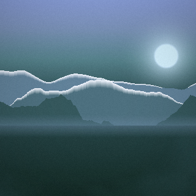
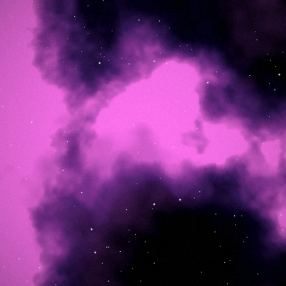
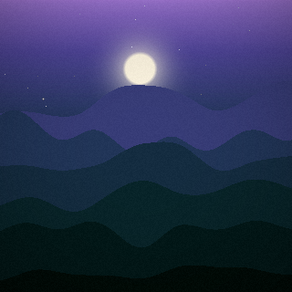
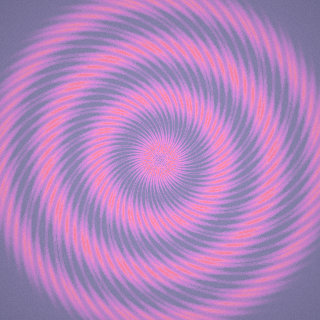
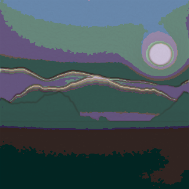
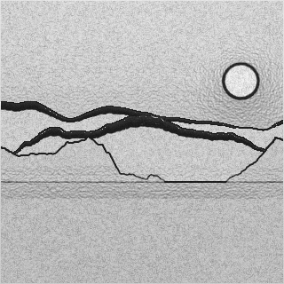
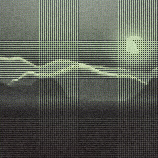

# offimg — 와이파이 없이 쓰는 이미지 생성기

인터넷 연결도, 모델 가중치도, 외부 패키지도 **하나도 필요 없는** 이미지 생성 프로그램입니다.
파이썬 표준 라이브러리만으로 동작하므로, 네트워크가 끊긴 PC에 파일만 복사하면 바로 씁니다.

* **텍스트 → 이미지** : 프롬프트(한국어/영어)를 해석해 색감·구도를 정하고 그림을 그립니다.
* **원본 이미지 → 이미지** : 사진이나 그림을 받아 회화·스케치·망점·도트 등으로 다시 그립니다.
* **완전 오프라인** : 설치·다운로드·API 키 전부 불필요. PNG 인코더/디코더까지 직접 구현했습니다.
* **결정적 생성** : 같은 프롬프트 + 같은 시드 = 항상 같은 이미지.

| 텍스트 → 이미지 | | | |
|---|---|---|---|
|  |  |  |  |
| `겨울 설산 위로 떠오르는 아침 해` | `깊은 우주의 보라색 성운과 별` | `밤바다 위에 뜬 보름달` | `파스텔 만다라 문양` |

| 원본 → 이미지 (왼쪽 첫 그림을 원본으로) | | |
|---|---|---|
|  |  |  |
| `paint` (유화풍) | `sketch` (연필) | `halftone` (인쇄 망점) |

## 요구 사항

파이썬 3.8 이상. 그 외에는 아무것도 없습니다.

```bash
python3 -m offimg info      # 환경과 사용 가능한 옵션 확인
```

Pillow가 이미 설치돼 있으면 JPEG·WEBP 같은 형식도 자동으로 읽고 씁니다.
없으면 PNG만 다룹니다(기본 동작).

## 사용법

### 1. 텍스트로 이미지 만들기

```bash
python3 -m offimg text "밤바다 위에 뜬 보름달"
python3 -m offimg text "네온 사이버 도시 야경" --size 1024x640 --seed 42
python3 -m offimg text "겨울 설산" --style landscape -n 4 -o out/snow.png
```

| 옵션 | 설명 |
|---|---|
| `--size 768` / `--size 1024x640` | 출력 크기 (기본 768×768) |
| `--style` | `auto`(기본) `landscape` `nebula` `abstract` `mosaic` `mandala` `waves` |
| `--seed N` | 시드 고정. 같은 시드는 항상 같은 그림 |
| `-n, --count N` | 여러 장 생성 (시드를 조금씩 바꿔가며) |
| `-o, --output` | 저장 경로 (기본 `output/<프롬프트>-<시드>.png`) |

### 2. 원본 이미지를 다시 그리기

```bash
python3 -m offimg image photo.png -p "가을 단풍" -e paint
python3 -m offimg image photo.png -e sketch --strength 0.9
python3 -m offimg image photo.png -p "네온" -e blend -s 0.8 -o out/neon.png
```

| 옵션 | 설명 |
|---|---|
| `-p, --prompt` | 색감·분위기 프롬프트 (효과 자동 선택에도 쓰임) |
| `-e, --effect` | `auto`(기본) `paint` `dream` `duotone` `mosaic` `halftone` `sketch` `pixel` `blend` |
| `-s, --strength` | 변형 강도 0~1 (기본 0.7) |
| `--max-side N` | 긴 변이 N을 넘으면 축소 (기본 1024). 순수 파이썬이라 속도에 직결됩니다 |

효과 요약:

| 효과 | 설명 |
|---|---|
| `paint` | 붓터치 왜곡 + 색 단순화 + 윤곽선 → 유화·일러스트 |
| `dream` | 글로우와 색 이동 → 몽환적인 분위기 |
| `duotone` | 밝기를 프롬프트 팔레트 색으로 치환 |
| `mosaic` | 사각 타일 모자이크 |
| `halftone` | 인쇄 망점 |
| `sketch` | 윤곽선 기반 연필 스케치 |
| `pixel` | 축소 + 팔레트 양자화 → 레트로 도트 |
| `blend` | 프롬프트로 새로 그린 그림에 원본의 명암·윤곽을 입힘 |

### 3. 파이썬 API

```python
import offimg

# 텍스트 -> 이미지
offimg.generate("노을 지는 사막", 768, seed=7).save("desert.png")

# 원본 -> 이미지
offimg.transform("photo.png", "빈티지 필름", effect="halftone", strength=0.8).save("out.png")

# 캔버스 직접 다루기
canvas = offimg.generate("숲", 512)
canvas.resized(256, 256).blur(2).save("small.png")
```

## 동작 원리

1. **프롬프트 해석** (`palette.py`) — 사전에 등록된 한국어/영어 키워드(바다, 노을, 설산, 네온, 만다라 …)를
   찾아 색상·채도·명도·구도·태그(night, water, snow, glow …)를 정합니다.
   맞는 키워드가 없으면 문자열 해시로 결정적인 색을 만듭니다.
2. **팔레트 생성** — 기준 색상에서 유사색·보색·삼색 배색 중 하나를 골라 5스톱 팔레트를 만듭니다.
3. **합성** (`compose.py`) — fBm 노이즈 필드와 팔레트로 하늘·구름·능선·수면 반사·별·성운·문양을 그립니다.
   노이즈는 저해상도에서 만들고 확대해, 순수 파이썬으로도 큰 이미지를 빠르게 채웁니다.
4. **후처리** (`raster.py`) — 블룸, 비네팅, 대비·채도 보정, 필름 그레인.
5. **image-to-image** (`stylize.py`) — 소벨 윤곽, 도메인 워핑, 포스터라이즈, 팔레트 매핑, 망점 등을 조합합니다.

`python3 -m offimg info` 로 인식하는 키워드 전체 목록을 볼 수 있습니다.

## (선택) 로컬 Stable Diffusion 백엔드

PC에 이미 `torch`, `diffusers`와 **모델 가중치를 미리 받아 둔 경우에만** 쓸 수 있는 선택 경로입니다.
허브 접속을 강제로 끄고(`HF_HUB_OFFLINE=1`, `local_files_only=True`) 지정한 로컬 폴더에서만 모델을 읽습니다.

```bash
python3 -m offimg text "a lighthouse at dusk" \
    --backend diffusion --model ~/models/stable-diffusion-v1-5 --size 512 --steps 25

python3 -m offimg image photo.png -p "watercolor" \
    --backend diffusion --model ~/models/stable-diffusion-v1-5 -s 0.6
```

torch/diffusers가 없거나 모델 폴더가 없으면 무엇이 없는지 알려주고 종료합니다.
기본 `procedural` 백엔드는 이 경로와 무관하게 항상 동작합니다.

## 테스트

```bash
python3 -m unittest discover -s tests -v
```

## 프로젝트 구조

```
offimg/
  png.py        순수 파이썬 PNG 인코더/디코더
  noise.py      결정적 PRNG, fBm 노이즈, 도메인 워핑
  palette.py    색 변환, 팔레트 생성, 프롬프트 키워드 사전
  raster.py     Canvas(픽셀 버퍼), 블러/블룸/리사이즈/보정
  compose.py    텍스트 -> 이미지 (6가지 구도)
  stylize.py    원본 이미지 -> 이미지 (8가지 효과)
  imageio.py    입출력 (Pillow 있으면 자동 활용)
  cli.py        명령줄 인터페이스
  backends/
    diffusion.py  선택: 로컬 Stable Diffusion (오프라인 전용)
examples/       예시 이미지와 생성 스크립트
tests/          단위 테스트
```

## 한계

* 순수 파이썬이라 큰 이미지는 느립니다. 768×768 기준 대략 1~5초, 2048×2048은 수십 초 걸립니다.
* 절차적 생성이므로 "고양이 사진" 같은 사실적 묘사는 만들지 못합니다.
  풍경·성운·추상·패턴 같은 분위기 이미지가 목적입니다. 사실적 생성이 필요하면 위의 diffusion 백엔드를 쓰세요.
* 기본 코덱은 PNG만 지원합니다(비인터레이스). 다른 형식은 Pillow가 있을 때만 처리합니다.
