::: {custom-style="Title"}
한화에어로스페이스 LS 기계 R&D 면접 종합서
:::

**회사·제품 · 전공 · 직무 · 자소서 경험 · PT · 용어 — 한 권으로 끝내기**

2026년 10월 29일 작성 · LS사업부 R&D 기계/항공기계 (창원) 1차 면접 대비

이 자료는 **직관 → 핵심 식 → 숫자 감각 → LS 제품 연결 → 면접 한 줄**의 순서로 구성했습니다. 외우기보다 **"왜 그런가"를 말로 설명할 수 있게** 만드는 것이 목표입니다.

## 이 자료를 읽는 규칙

**[가정]** 표시는 계산 연습을 위해 정한 값입니다. 실제 제품 제원이나 실제 측정값이 아니므로 면접에서 사실처럼 말하지 않습니다.

**[확인]** 표시는 면접 전에 본인이 사실 여부를 꼭 확인해야 하는 항목입니다. 하지 않은 일을 했다고 말하면 꼬리질문에서 반드시 드러납니다.

**공개 사실**은 회사 공식 홈페이지·공시·공고와 언론 보도를 요약한 것입니다. 보도 수치는 "약 ○○, 보도 기준"으로 말합니다.

## 전체 구성

| 파트 | 내용 | 목표 |
|-----------|---------------------------------------------------------------------|--------------------|
| 1 회사 | 회사 구조, 실적, 제품 전체, 2026년 동향, 경쟁 구도 | "왜 한화인가"를 근거 있게 말하기 |
| 2 전공 | 고체역학 8강, 재료, 기계설계, 동역학·진동, 차량동역학, 열역학, 열전달, 유체, 제어·모터, 공학수학, 심화 | 공고 교과목 질문에 즉답 |
| 3 직무 | 공고 해부, 체계설계(레이아웃·중량·무게중심), 구조·기구, 시험평가, 형상관리, 기술자료, 방산 개발·RAM | 실제 업무 언어로 말하기 |
| 4 경험 | AGV 리프트 논리 시나리오(계산 포함), 모터 제어, 로봇팔, 열화상, 문항별 꼬리질문 | 자소서를 숫자와 논리로 방어 |
| 5 PT | 발표 구조, 30분 운영, 주제 유형별 해결 방향, 계산형 예시 | 어떤 주제든 같은 틀로 풀기 |
| 6 용어 | 약 150개 용어, 공식 요약 1장 | 마지막 점검 |

## 지원자 핵심 사실 정리 (답변의 기준)

| 항목 | 내용 | 근거 |
|-----------|------------------------------------------------------------------------------|-----------|
| 지원 | LS사업부 R&D 기계/항공기계, 정규직 신입, 창원 | 공고 |
| 전공 | 기계공학 (사시 및 차량동역학, 진동공학, 유한요소해석기초, 계측공학, 시스템제어, 메카트로닉스, 수치해석 이수) | 이력 |
| CAD | CATIA V5(초급, 1년), CREO(중급, 2년) | 이력 |
| 대표 경험 | 조선소 블록 내부 용접로봇 이송용 AGV 리프트 설계 → 프로토타입 제작 | 이력·자소서 |
| 성과 | 초기안 약 1.2 × 1.2 m → 최종 베이스 1.0 × 0.8 m (외곽 약 20% 축소, 바닥 면적 약 44% 감소) | 대화·STL |
| 기타 경험 | 로봇팔 병 던지기(46 → 97회/100회), 열화상 객체 인식(검출률 약 40 → 70%), Jetson 실시간화(1.76M 파라미터, 3.9 GFLOPs), 무인 해상구조 로봇(팀장) | 자소서·이력 |
| 병역 | 육군 만기 전역 | 이력 |

**면접 전 정리할 모순 하나:** 이력에는 "CATIA V5로 설계"라고 되어 있고, 대화에서는 "SolidWorks로 해석"이라고 했습니다. **"설계는 CATIA V5, 해석은 SolidWorks Simulation"**이 사실이면 그대로, 아니라면 사실에 맞게 하나로 통일하세요. [확인]

## 시간이 없을 때 우선순위

| 남은 시간 | 반드시 볼 것 |
|--------------------|--------------------------------------------------------------------------------|
| 하루 | 4파트 AGV 시나리오 전체 → 3파트 체계설계(무게중심) → 5파트 PT 구조 → 1분 자기소개 |
| 3일 | 위 + 2파트 고체역학 8강·기계설계·차량동역학 + 1파트 제품·동향 |
| 7일 | 전체 + 계산 드릴 반복 + 모의 PT 녹화 3회 |

```{=openxml}
<w:p><w:r><w:br w:type="page"/></w:r></w:p>
```

# 파트 1-1 회사 한눈에 보기

**회사 이해 \| 사업 구조·실적·사업장**

## 한화에어로스페이스는 어떤 회사인가

한 줄로 말하면 **"땅·하늘·우주를 아우르는 한화그룹의 방산·항공우주 핵심 회사"**입니다. 지상방산(LS), 항공엔진·항공우주, 정밀유도무기·탄약 등 여러 사업을 갖고 있고, 한화시스템(방산 전자) 등을 자회사로 두며 한화오션(조선·해양) 실적이 연결 실적에 포함됩니다. \[공개 사실\]

| 시기 | 사건 | 의미 |
|------------|---------------------------------|-------------------------------------------------------|
| 2022년 11월 | 한화디펜스(지상장비) 흡수합병 | K9·레드백·천무 등 지상방산이 한화에어로스페이스 안으로 |
| 2023년 | (주)한화 방산부문(탄약·유도무기 등) 통합 | 지상 플랫폼 + 탄약·유도무기까지 한 회사에서 |
| 2025년 | 한화오션 연결 실적 편입 | 연결 매출 규모 급증(지상방산 단독 실적과 구분해서 말해야 함) |

**면접 주의:** "회사 전체 매출"과 "지상방산 매출"을 섞지 마세요. LS사업부는 지상방산 부문입니다.

## 사업 구조와 LS의 위치

| 사업 | 대표 제품·내용 | LS와의 관계 |
|---------------------------|-------------------------------------|-------------------------------------|
| **지상방산(LS, Land Systems)** | K9, K10, 레드백, 천무, 대공, 무인차량 | **지원 부서** |
| 정밀유도무기·탄약 | 유도탄, 탄약 | 천무 유도탄 등 플랫폼과 연결 |
| 항공엔진·항공우주 | 항공기 엔진, 우주 발사체 관련 | '기계/항공' 채용 분류가 공유되는 이유로 추정 |
| 자회사 한화시스템 | 레이다, 사격통제, 통신 등 방산 전자 | 체계 통합 시 전자 장비 협업 |

**LS의 근무지:** 공고 기준 **창원**. 창원은 K9 등 지상장비의 개발·생산 거점으로 알려져 있습니다.

## 실적으로 보는 회사의 현재 \[공개 사실, 보도 기준\]

| 시점 | 수치 | 해석 |
|------------|----------------------------------------------------|------------------------------------|
| 2025년 연간 | 연결 매출 약 26.6조 원, 영업이익 약 3.0조 원 / 지상방산 매출 약 8.1조 원, 영업이익 약 2.0조 원 | 한화오션 연결 편입 효과 포함, 지상방산이 이익의 핵심 |
| 2026년 2분기 | 연결 영업이익 약 1.37조 원(분기 첫 1조 돌파 보도) / 지상방산 매출 약 2.1조 원, 영업이익 약 5,330억 원 / 지상방산 수주잔고 약 38조 원대 | 수주잔고가 연 매출의 몇 년치 → **납기·양산 품질·현지 생산**이 중요해지는 단계 |
| 2026년 3분기 | 보통 11월 초 발표 | 면접일이 발표 후라면 반드시 확인 |

**면접에서 숫자보다 중요한 해석:** "수주잔고가 많다는 것은 앞으로 **약속한 장비를 제때, 같은 품질로, 여러 나라에서** 만들어야 한다는 뜻이고, 그래서 설계 단계부터 양산성·형상관리·현지 생산을 고려하는 엔지니어가 필요하다고 이해했습니다."

## 회사의 인재상 \[공개 사실\]

한화그룹 핵심가치는 **도전·헌신·정도**입니다. 2026년 하반기 자기소개서 문항에는 **주인의식, 기존 틀을 넘어선 차별성, 변화 수용성**이 인재상 문항으로 제시됐습니다(본인 자소서 문항과 동일).

| 키워드 | 연결할 본인 경험 |
|--------------------|--------------------------------------------------------------------------------|
| 주인의식 | 로봇팔 성공률 46 → 97회: 과제 달성 후에도 끝까지 원인 개선 |
| 차별성 | 열화상: 모델이 아닌 입력 조건으로 원인 범위를 넓힘, 조건 통제 플랫폼 |
| 변화 수용성 | 기구 설계자가 AI·임베디드(Jetson)까지 학습해 실시간화 |
| 도전 | AGV: 사양을 키우는 대신 구조(복층)를 바꿔 해결 |
| 정도 | 하지 않은 검증은 했다고 말하지 않는 태도(면접 답변 전체의 원칙) |

```{=openxml}
<w:p><w:r><w:br w:type="page"/></w:r></w:p>
```

# 파트 1-2 지상 제품 백과

**제품 이해 \| 나무위키처럼 재미있게, 면접에는 정확하게**

## 제품 족보

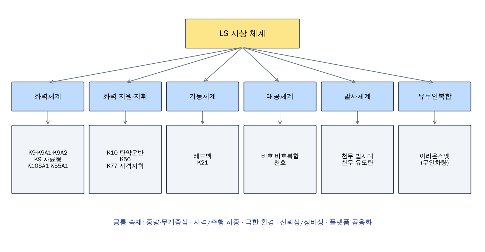{width=100%}

| 체계(공고 분류) | 제품 | 한 줄 정체 |
|-------------------|-------------------------------------------------|--------------------------------|
| 화력체계 | **K9 / K9A1 / K9A2 / K9 차륜형**, K105A1, K55A1 | 쏘고 빠지는 자주포 가족 |
| 화력 지원 | **K10** 탄약운반장갑차, K56 | K9 전용 탄약 배달부 |
| 화력 지휘 | **K77** 사격지휘장갑차 | 포병 지휘소 |
| 기동체계 | **레드백**, K21 | 보병을 태우고 싸우는 장갑차 |
| 대공체계 | 비호, 비호복합, 천호 | 낮게 오는 항공기·드론 사냥꾼 |
| 발사체계 | **천무** 발사대·유도탄 | 하이마스의 라이벌 다연장로켓 |
| 유무인복합체계 | 아리온스멧 등 무인차량 | 사람 없이 다니는 짐꾼·정찰병 |

## K9 자주포 계열: LS의 간판

**정체:** 155 mm 52구경장 궤도형 자주포. 세계 자주포 시장에서 가장 많이 팔린 축에 드는 장비로 소개됩니다.

**공식 소개 핵심**

- "세계 최고 수준의 운용성능과 끊임없는 성능개선을 통하여 전 세계 자주포 시장을 석권하고 있는 대한민국의 명품 자주포"(회사 표현)
- K9A1: **360도 전방위 사격**, K307탄으로 **40 km** 화력 지원, **NATO 규격탄 호환**
- 사격 정보를 받으면 **정지 상태 30초, 기동 중 60초 이내** 사격 가능
- 종방향 **60%**, 횡방향 **30%** 경사 주행, 항속거리 600 km 이상
- 강력한 파워팩 + **유기압 현수장치** → 빠른 기동(약 65~67 km/h급)과 높은 사격 정확도

**보도 기준 추가 정보:** 1,000마력급 디젤 파워팩, 전투중량 약 47 t, 승무원 5명. **K9A2**는 자동장전으로 승무원 3명, 분당 8~9발 수준을 목표로 개발 중이라고 보도됐습니다. 2026년 8월에는 미국 육군에 **K9 차륜형 시제품 6문** 공급 계약 보도가 있었습니다.

**수출 별명 모음**

| 국가 | 이름 |
|-------------------|---------------------------------------------------------------------------------|
| 튀르키예 | T-155 피르티나(폭풍) |
| 폴란드 | 크랩(Krab) 자주포 차체로 K9 차체 사용 |
| 인도 | K9 바지라(벼락) |
| 핀란드 | K9FIN 모우카리(해머) |
| 노르웨이 | K9 비다르 |
| 호주 | AS9 헌츠맨(호주 사냥거미) |
| 기타 | 이집트, 에스토니아, 루마니아, 스페인(2026년, 서유럽 첫 진출, 운용·도입국 11개국 보도) |

**기계 설계 포인트:** 사격 반동(짧고 큰 충격)과 주행 진동(길고 반복적)이 같은 차체에 겹칩니다. 포탑·트러니언 체결부 피로, 유기압 현수, 파워팩 냉각, 자동장전 신뢰성이 핵심 과제입니다.

**면접 한 줄:** "K9은 쏘는 장비이면서 달리는 장비라서, 사격 충격과 주행 진동을 함께 견디는 구조와 무게중심 관리가 핵심이라고 생각합니다."

## K10 탄약운반장갑차

**공식 소개:** "K9 자주포에 탄약을 보급하는 **세계 최초로 자동화된 로봇형** 탄약 운반 장갑차"

**정체:** K9 뒤에 붙어 컨베이어로 탄약을 자동 이송합니다. 155 mm 포탄 한 발이 수십 kg이라 사람이 옮기면 느리고 위험합니다.

**기계 포인트:** 두 차량 사이의 정렬·결합 인터페이스, 이송 메커니즘 신뢰성, 고장 시 수동 보급 전환. **AGV 리프트의 "이송·배치·타 파트 연결" 경험과 가장 닮은 제품**입니다.

## K77 사격지휘장갑차

**공식 소개:** "획득한 표적에 대해 신속, 정확한 사격 임무를 부여하는 포병부대의 지휘 및 사격통제용 장갑차"

**여담:** K9(쏘는 차) + K10(탄약차) + K77(지휘차) = **포병 3형제**. 제품을 체계로 묶어 말하면 이해도가 드러납니다.

## K105A1·K55A1·K56

- **K105A1:** 105 mm급 자주포(제품명 기준).
- **K55A1:** 기존 K55 자주포의 성능개량형, **K56**은 함께 운용하는 탄약운반장갑차.
- **여담:** 신형만이 아니라 **기존 장비 개량(성능개량·수명연장)**도 기계 연구원의 큰 업무입니다.

## 레드백 보병전투장갑차

**공식 소개:** "기동력, 방호력, 화력 등 모든 분야에서 세계 최고 성능을 갖추고 있는 미래형 보병전투장갑차", "K9에 탑재된 **검증된 파워팩**", "**고무트랙**"

**정체:** 호주 독거미 이름을 딴 수출형 장갑차. 2023년 호주 LAND 400 Phase 3에서 129대 계약, 호주 질롱의 생산시설 H-ACE에서 생산합니다. \[공개 사실\]

**기술 특징(공개 자료)**

| 특징 | 의미 |
|---------------------------------|-------------------------------------------------------------------|
| 고무궤도 | 금속 궤도보다 소음·진동·정비 부담 감소 |
| 인암(in-arm) 유기압 현수 | 토션바가 없어 바닥 공간과 지뢰 방호 설계 자유도 증가 |
| K9 파워팩 공용 | 개발 위험·정비·부품 공급 이점(단, 장착·냉각·진동은 재검증) |
| 초기 공개 전투중량 약 42 t | 방호와 기동성의 균형이 핵심 |

**면접 한 줄:** "방호를 늘리면 중량이 늘고 현수·동력·제동이 연쇄적으로 바뀌므로, 레드백은 방호와 기동성의 균형 설계가 핵심이라고 봅니다."

## K21 보병전투차량

**보도 기준:** 승무원 3명 + 보병 9명, 40 mm 기관포, 전투중량 약 25~26 t, 육상 약 70 km/h, 수상 약 7 km/h(수륙양용)

**기계 포인트:** 물에 뜨려면 차량 무게만큼 물을 밀어내야 합니다. **중량과 무게중심 관리가 곧 생존**인 장비입니다. 개발 초기 도하 훈련 중 침수 사고 후 개선된 사례가 알려져 있습니다.

## 대공 3인방: 비호·비호복합·천호

| 제품 | 정체 |
|-------------------|---------------------------------------------------------------------------------|
| 비호 | 궤도형 차체 + 30 mm 쌍열 대공포 |
| 비호복합 | 비호 + 휴대용 대공미사일(가까이는 포, 멀리는 미사일) |
| 천호 | 바퀴 달린 차륜형 대공포(2026년 실적 보도에서 국내 양산 물량으로 언급) |

**트렌드:** 드론 위협 증가로 대공·대드론 장비 수요가 커지고 있습니다. **기계 포인트:** 포탑을 빠르게 돌리고 정확히 멈추는 구동계(관성·강성), 연속 사격 중 조준 유지.

## 천무 다연장로켓

**공식 표현:** "230 mm급 다련장 천무", 강점은 **긴 사거리와 빠른 발사 속도**. 발사대와 유도탄이 별도 제품.

**보도 기준:** 포드(발사관 묶음)를 바꿔 여러 로켓 운용, 유도로켓 사거리 약 80 km, 장거리 로켓 운용도 보도. 운용 인원 3명. 폴란드에서는 호마르-K, 2026년 1월 노르웨이 도입 보도. 미국 하이마스(HIMARS)와 자주 비교됩니다.

**주의:** 언론은 239 mm로도 쓰지만 공식 표현은 **"230 mm급"**.

**기계 포인트:** 발사 반력·후폭풍에 대한 차량 안정성(지지 잭), 발사대 선회·고각 구동 정밀도, 포드 교체 메커니즘, 차량 프레임–탑재 구조 인터페이스.

## 아리온스멧 다목적 무인차량

**정체:** 6륜 다목적 무인 지상차량(UGV). 수송·정찰·경계용, 군 최초 UGV로 보도.

**본인 연결 포인트:** 열화상 객체 인식, 무인 해상구조 로봇, Jetson 실시간화 경험을 직접 연결할 수 있는 **유무인복합체계**의 대표 제품입니다. "센서 장착 위치·진동이 인식 성능을 좌우한다"는 말은 기계 설계자만 할 수 있습니다.

## 제품 공통의 기계 설계 숙제

| 숙제 | 이유 | 관련 전공 |
|---------------------|-----------------------------------------------------|--------------------------|
| **중량·무게중심** | 기동성, 전복, 현수 하중, 수상 부력, 수송 | 동역학, 차량동역학 |
| 사격·발사 하중 | 반동·반력이 구조와 차체로 전달 | 동역학, 고체역학 |
| 주행 진동·피로 | 수만 km 주행 내구 | 진동, 피로 |
| 극한 환경 | 혹한(−40 °C)~사막(+49 °C) 수출 | 재료, 열전달 |
| 신뢰성·정비성 | 장기 운용, 야전 정비 | RAM, 기계설계 |
| 플랫폼 공용화 | 같은 차체·파워팩을 여러 장비에 | 체계설계, 인터페이스 |

```{=openxml}
<w:p><w:r><w:br w:type="page"/></w:r></w:p>
```

# 파트 1-3 2026 동향과 경쟁 구도

**사업 흐름 \| 뉴스를 직무와 연결하기**

## 2026년 주요 사건 \[보도·공시 기준\]

| 시점 | 내용 | 기계 R&D 관점 |
|-----------|-----------------------------------------------------------|------------------------------|
| 1월 | 노르웨이 천무 도입 보도 | 혹한 환경 발사대·차량 통합 |
| 4월 | 핀란드 K9 추가 계약(약 5억 4,600만 유로 보도) | 극저온 시동·재료·윤활 |
| 6월 | 유로사토리에서 K9A2 소개(승무원 5 → 3명) | 자동장전 메커니즘·신뢰성 |
| 8월 | 미국 육군 K9 차륜형 시제품 6문 계약 보도 | 차륜형의 사격 안정성·축하중 |
| 8월 말 | 스페인 인드라와 K9 이행계약 공시(서유럽 첫 진출) | 현지 협력 생산, 고객 요구 반영 |
| 9월 | K9 발전 방향 발표: 차륜형 개념, K9A2 자동화 포탑, TOMMS 디지털 정비 | 플랫폼 다양화, 운용 데이터 기반 정비 |
| 2분기 실적 | 분기 영업이익 1조 원 돌파 보도 | 양산·납기·품질 중요성 증가 |

**구분해서 말하기:** 시제품 계약 ≠ 양산 계약, 도입 결정 ≠ 이행계약, 개발 목표 ≠ 전력화 성능, 회사 홍보 문구 ≠ 검증된 사실.

## 업계 큰 흐름 7가지

1. **유럽 재무장:** 우크라이나 전쟁 이후 유럽 각국의 포병·장갑차·방공 수요 급증. 빠른 납기가 경쟁력.
2. **현지 생산·기술이전:** 폴란드·호주(H-ACE)·루마니아(유럽 첫 생산거점으로 회사 소개) 등. 설계 단계부터 **현지 공급망·도면 표준화** 필요.
3. **자동화·무인화:** K9A2 자동장전, 무인차량, 유무인복합. 사람이 하던 일을 메커니즘이 대신 → **신뢰성·고장 대응**이 핵심.
4. **차륜형 화력:** 도로 기동성·운용비 장점. 대신 **반동 지지·축하중·안정성**이 새 과제.
5. **드론·대드론:** 대공체계 수요 증가.
6. **전동화·하이브리드:** 정숙 감시, 연비. 대신 **통합냉각·배터리 안전·중량** 과제.
7. **디지털 정비·데이터:** TOMMS처럼 운용 데이터로 정비·부품 공급 최적화 → 설계가 운용 데이터와 연결.

## 경쟁 구도(알아두면 좋은 이름)

| 분야 | 해외 경쟁 장비(예) | 국내 |
|------------|-----------------------------------------------------------------------|------------------|
| 자주포 | 독일 PzH 2000, 프랑스 CAESAR(차륜형), 스웨덴 Archer(차륜형), 미국 M109 계열 | — |
| 보병전투차 | 독일 Lynx, 스웨덴 CV90, 미국 ASCOD 계열 | 현대로템(차륜형 장갑차 등) |
| 다연장로켓 | 미국 HIMARS | — |
| 전차 | — | 현대로템 K2 |
| 유도무기 | — | LIG넥스원 |

**면접 대응:** 경쟁 제품 성능을 단정 비교하지 말고, "고객은 성능뿐 아니라 **납기, 가격, 현지 생산, 후속 지원, 운용 실적**을 함께 비교한다"고 말하세요.

## "왜 한화에어로스페이스인가" 완성 답변

> "AGV 리프트를 설계하며 슬라이드가 앞으로 뻗을 때 무게중심이 지지점 가까이 이동해 전복 여유가 크게 줄어드는 문제를 겪었고, 무거운 구성품을 뒤쪽·아래쪽으로 배치해 해결했습니다. 그때 부품 하나의 사양보다 **전체 배치와 무게중심이 장비의 안정성을 결정한다**는 것을 배웠습니다.
>
> LS사업부의 체계설계는 바로 레이아웃과 중량·무게중심을 최적화하는 일입니다. K9처럼 기동 후 바로 사격하거나 천무처럼 차량 위에서 발사하는 장비는 같은 문제가 훨씬 큰 하중과 엄격한 신뢰성 요구 속에서 일어납니다. 또 혹한부터 사막까지 여러 나라 환경에 맞춰 플랫폼을 개량하는 경험이 가장 많이 쌓인 곳이라, 운용 조건까지 고려하는 설계를 배우기에 가장 좋은 곳이라고 생각해 지원했습니다."

```{=openxml}
<w:p><w:r><w:br w:type="page"/></w:r></w:p>
```

# 파트 2-1 고체역학 8강

**전공 핵심 \| 공고 필수 교과목(고체역학·재료역학) — 구조 안정성 해석의 기초**

## 1강 재료는 힘을 어떻게 느끼는가

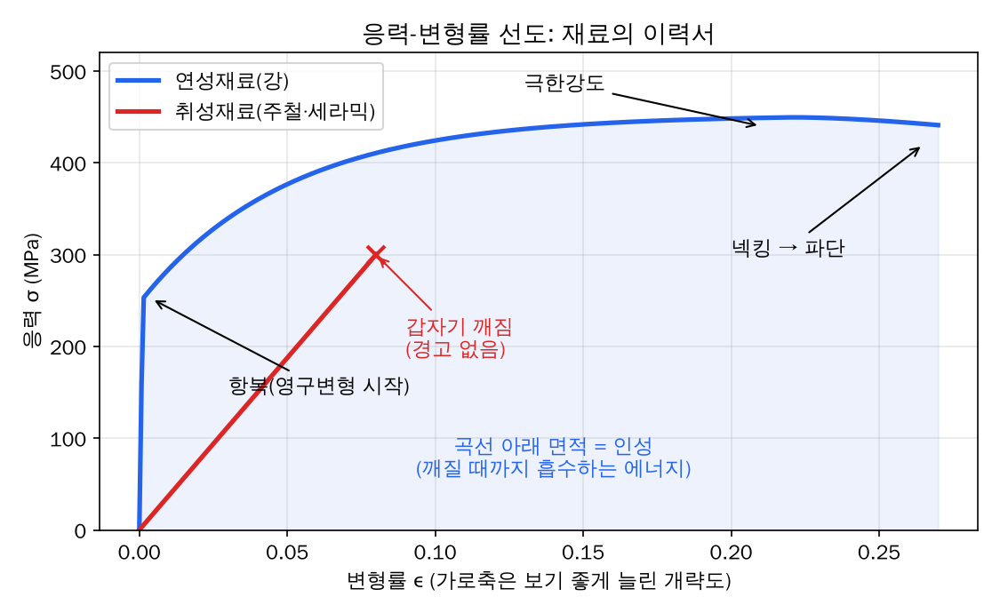{width=85%}

**응력 = 면적당 부담.** 같은 몸무게라도 운동화보다 하이힐 굽이 아픈 것처럼, 재료가 끊어질지는 힘이 아니라 **σ = F/A**가 결정합니다. 1 MPa = 1 N/mm²이므로 **N을 mm²로 나누면 바로 MPa**입니다.

- 10 kN을 M12 볼트(약 84 mm²)가 받으면 약 119 MPa, M20(약 245 mm²)이면 약 41 MPa.

**변형률과 훅의 법칙:** ε = ΔL/L(단위 없음), **σ = E·ε**. E는 재료의 "고집"입니다. 강 약 210 GPa, 티타늄 약 110 GPa, 알루미늄 약 70 GPa(강의 1/3).

**강도 vs 강성(면접 단골 1순위)**

| 구분 | 의미 | 결정 요인 |
|-----------|------------------------------------|-----------------------------------------------------|
| 강도 | 언제 부서지나(항복·파단 저항) | 재료 강도 + 단면 크기 |
| 강성 | 얼마나 휘나(변형 저항) | **E + 형상(I, 길이, 지지 조건)** |

**함정:** 일반강을 고강도강으로 바꾸면 강도는 약 3배지만 **E가 같아 처짐은 그대로**입니다. 처짐 문제는 **형상**으로 풉니다.

**응력-변형률 선도:** 탄성(직선, 기울기 E) → **항복**(영구변형 시작, 대부분 설계 기준) → 극한강도 → 넥킹 → 파단. 연성재료는 변형으로 경고를 주고, 취성재료는 갑자기 깨집니다. 곡선 아래 면적 = **인성**(깨질 때까지 흡수하는 에너지).

**LS 연결 — 방탄강:** 경도를 높이면 관통 저항은 커지지만 **인성이 떨어져** 깨지기 쉽습니다. **"경도와 인성은 상충관계"**.

**안전율** = 한계 응력 / 작용 응력. 하중·물성·모델·제작의 **불확실성에 대한 보험**입니다. 지상장비에서는 크게 잡을수록 무거워져 기동성·부력·수송성이 나빠지므로, **정확히 알수록 줄일 수 있다**가 정답입니다.

## 2강 축하중·열응력·부정정

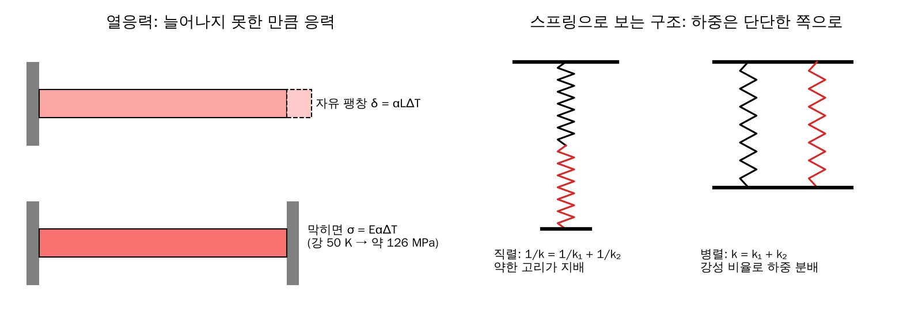{width=100%}

**봉은 단단한 스프링:** 늘음 δ = FL/(AE), 강성 **k = AE/L**. 굵을수록·E가 클수록 덜 늘고, **길수록 더 늡니다**. 지름 20 mm·1 m 강봉에 50 kN → 약 0.76 mm.

**직렬 vs 병렬:** 직렬은 1/k = 1/k₁ + 1/k₂로 **가장 약한 고리가 전체를 결정**(체결부·브래킷부터 의심). 병렬은 k₁ + k₂로 **강성 비율대로 하중을 나눔**.

**부정정 = "하중은 단단한 쪽으로 흐른다."** 강봉과 알루미늄봉(같은 단면)을 나란히 누르면 3 : 1로 나눠 받습니다. 의도치 않은 단단한 경로로 하중이 몰리면 엉뚱한 곳이 파손됩니다.

**열응력:** 자유 팽창 δ = αLΔT, 완전 구속 시 **σ = EαΔT(길이와 무관)**. 강을 50 K 가열해 양단 고정하면 **약 126 MPa** — 하중 없이 항복강도 절반.

**이종재료(알루미늄–강):** 1 m 길이에서 20 → −40 °C면 수축량 차이 약 0.66 mm. 대책은 **고정 구멍 하나 + 나머지 장공**, 절연 와셔. 혹한·사막 수출 장비의 실제 이슈입니다.

**볼트 = 부정정의 대표:** 예하중을 주면 외력의 일부(C·P, C ≈ 0.2~0.3)만 볼트가 받습니다. 예하중이 사라지면 볼트가 외력 전부를 받아 피로가 급증합니다.

## 3강 비틀림

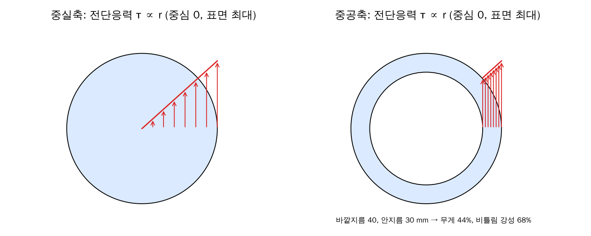{width=100%}

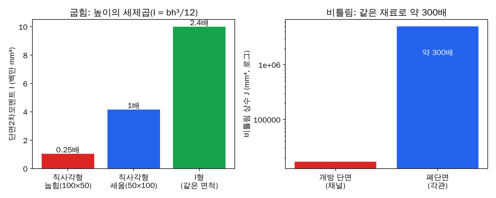{width=100%}

**직관:** 축을 비틀면 바깥쪽이 가장 많이 미끄러집니다. 그래서 전단응력은 **중심 0, 표면 최대**입니다.

**핵심 식:** τ = T·r/J, 비틀림각 φ = TL/(GJ). 중실축 J = πd⁴/32, 중공축 J = π(D⁴ − d⁴)/32. 동력 **P = T·ω**, ω = 2πN/60(rpm → rad/s 변환 필수).

**숫자 감각:** 지름 40 mm 축에 1 kN·m → τ = 16T/(πd³) ≈ **80 MPa**. 200 kW, 2,000 rpm 엔진 토크 ≈ 955 N·m.

**중공축의 비밀:** 바깥지름 40, 안지름 30 mm 중공축은 **무게 44%로 비틀림 강성 68%**. 중심부 재료는 거의 일을 안 하기 때문입니다. → 구동축·프로펠러축이 속이 빈 이유.

**박스 단면의 비밀(차체 설계 핵심):** 같은 둘레 400 mm·두께 5 mm 강판으로

- 펼친 단면(채널, 개방): J ≈ Σbt³/3 ≈ 1.7 × 10⁴ mm⁴
- 100 × 100 mm 각관(폐단면): J ≈ 4A²t/둘레 ≈ 5 × 10⁶ mm⁴
- **같은 재료로 약 300배.** 개방 단면은 전단 흐름이 한 바퀴 돌지 못하기 때문입니다.

**LS 연결:** 차체를 박스 구조로 만들고, 프레임에 크로스멤버를 두며, **해치·정비창 같은 개구부 주위를 보강**하는 이유입니다. 정비 접근 패널을 뚫으면 비틀림 강성이 크게 떨어집니다(정비성과 강성의 상충).

## 4강 굽힘

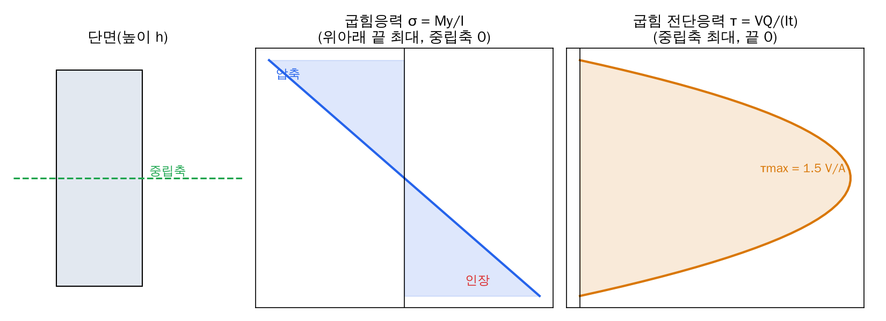{width=100%}

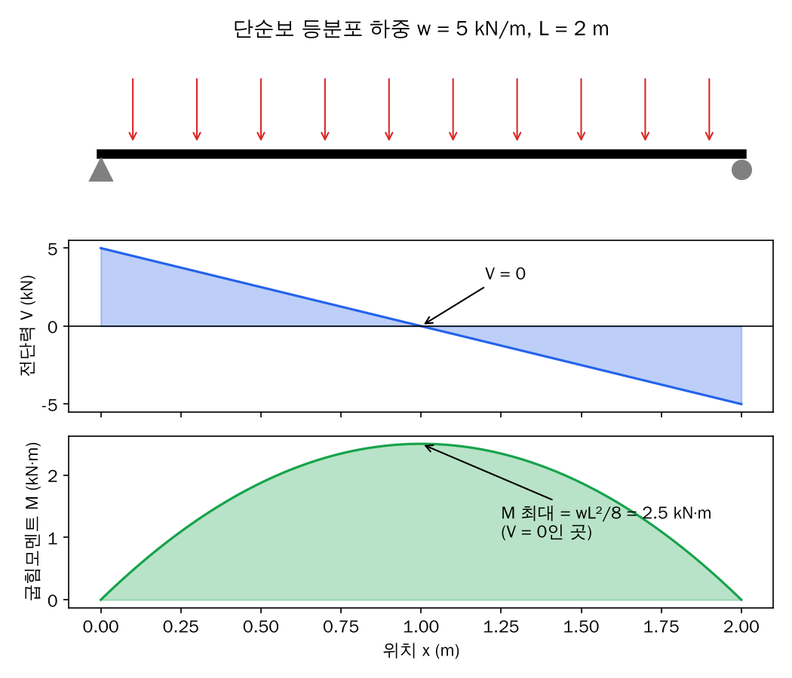{width=100%}

**직관:** 보를 휘면 위쪽은 눌리고 아래쪽은 늘어납니다. 가운데(중립축)는 길이가 변하지 않아 응력이 0입니다.

**전단력·굽힘모멘트 선도:** dM/dx = V. **V = 0인 곳에서 M 최대** → 위험 단면을 찾는 출발점. PT에서 보 문제가 나오면 자유물체도 다음에 반드시 그립니다.

**굽힘응력:** σ = M·y/I = M/Z. 직사각형 I = bh³/12 → **높이의 세제곱**. 자를 눕혀서 휘면 잘 휘고 세우면 안 휘는 이유입니다.

**숫자 감각:** 폭 50 × 높이 100 mm 강 단면, 길이 2 m 단순보, 5 kN/m 등분포 → Mmax = wL²/8 = 2.5 kN·m, σ ≈ 30 MPa, 처짐 ≈ 1.2 mm. **눕히면 처짐 4배, 응력 2배.**

**평행축 정리:** I = I_도심 + A·d². 재료를 중립축에서 멀리 둘수록 I가 급증 → **I형·박스 단면**. 플랜지가 굽힘, 웨브가 전단을 담당.

**굽힘 전단응력:** τ = VQ/(It). 굽힘응력과 반대로 **중립축에서 최대**. 직사각형 τmax = 1.5 V/A. 짧고 굵은 브래킷은 전단이 중요합니다.

## 5강 처짐

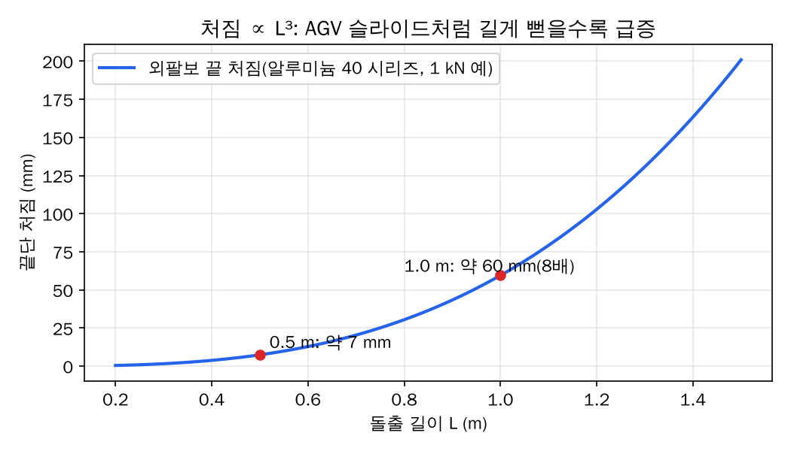{width=85%}

**식:** EI·y″ = M(작은 처짐, 선형 탄성)

| 조건 | 최대 처짐 | 최대 모멘트 |
|---------------------------------------|---------------------------------------|----------------------|
| 외팔보, 끝 집중하중 P | PL³/(3EI) | PL |
| 외팔보, 등분포 w | wL⁴/(8EI) | wL²/2 |
| 단순보, 중앙 집중 | PL³/(48EI) | PL/4 |
| 단순보, 등분포 | 5wL⁴/(384EI) | wL²/8 |
| 양단 고정, 중앙 집중 | PL³/(192EI) | PL/8 |

**세 가지 직관**

1. **길이의 위력:** 외팔보 길이 2배 → 처짐 8배. 처짐을 줄이는 가장 강력한 방법은 **길이 단축·지지점 추가**.
2. **지지 조건의 위력:** 같은 보도 양단 고정이면 단순지지의 1/4. 단, 실제 체결은 완전 고정이 아니므로 해석에서 고정으로 두면 **강성 과대평가**.
3. **중첩:** 선형이면 하중별 결과를 더하면 됨 → 표의 조합으로 1차 추정.

**LS·AGV 연결:** AGV 텔레스코픽 슬라이드는 약 1.2 m 돌출 **외팔보**입니다. 부서지지 않아도(강도 OK) 끝이 처지면 용접 위치가 틀어집니다(강성 문제). 포신도 마찬가지로 처짐·진동이 명중률에 영향을 줍니다.

## 6강 좌굴

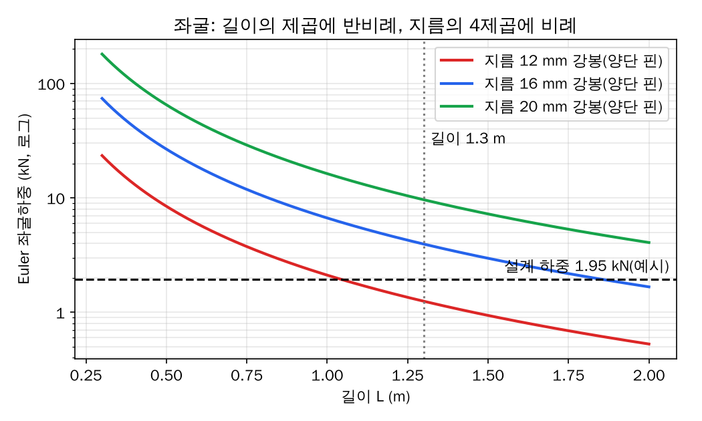{width=85%}

**직관:** 얇은 자를 양 끝에서 누르면 부러지기 전에 **옆으로 휘며 무너집니다.** 재료가 버틸 수 있는데도 형상이 불안정해지는 것입니다.

**Euler 좌굴하중:** Pcr = π²EI/(KL)². 지지계수 K: 양단 핀 1, 외팔 2, 양단 고정 0.5(이론).

**핵심 직관**

- 좌굴은 **E, I, 길이, 지지 조건**이 결정합니다. **고강도 재료로 바꿔도 좌굴하중은 거의 그대로.**
- 길이 2배 → 좌굴하중 1/4. 지름 4/3배 → I가 (4/3)⁴ ≈ 3.2배.
- 세장비 KL/r이 크면 Euler, 작으면 항복이 먼저(Johnson 식). 강은 경계가 약 100 전후.
- 얇은 판은 **국부 좌굴** → 리브·보강재로 칸을 나눔. 경량화로 두께를 줄일 때 가장 먼저 확인.

**AGV 연결(중요):** 긴 액추에이터는 **압축 시 좌굴과 옆 하중에 약해** 더 굵은 규격이 필요합니다. 복층 구조로 스트로크를 줄인 것은 좌굴 관점에서도 유리합니다. 스트로크가 1.6배 길면 좌굴하중은 1/2.56로 떨어집니다.

## 7강 조합응력과 모어원

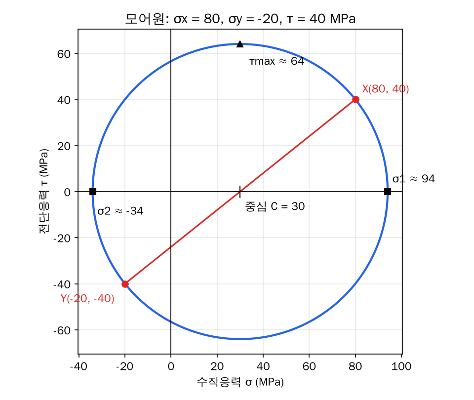{width=62%}

**왜 필요한가:** 같은 점도 **자르는 방향**에 따라 σ와 τ가 달라집니다. 부재는 가장 위험한 방향으로 파손됩니다.

**모어원:** 중심 C = (σx + σy)/2(평균 수직응력), 반지름 R = √[((σx − σy)/2)² + τ²](면내 최대 전단). **σ1,2 = C ± R**. 주응력면에서 전단은 0, 최대 전단면은 45° 회전. 요소를 θ 돌리면 원 위에서는 2θ.

**숫자 예:** σx = 80, σy = −20, τ = 40 MPa → C = 30, R ≈ 64 → σ1 ≈ 94, σ2 ≈ −34 MPa, θp ≈ 19.3°, von Mises ≈ 115 MPa.

**파손 모양으로 이해하기:** 분필(취성)을 비틀면 **45° 나선**으로 부러짐(최대 인장 주응력 방향). 강봉(연성)을 비틀면 **단면에 수직**으로 끊어짐(최대 전단면). 연성 강봉 인장은 **컵-콘** 파단(45° 전단).

**3차원 주의:** 평면응력이라도 σ3 = 0이 있으므로 **절대 최대 전단 = (σmax − σmin)/2**. σ1 = 100, σ2 = 40이면 면내 30이지만 절대 50 MPa.

**조합하중(축):** 굽힘 σ = 32M/(πd³), 비틀림 τ = 16T/(πd³) → von Mises √(σ² + 3τ²), Tresca √(σ² + 4τ²).

**압력용기:** σθ = pr/t(원주), σa = pr/(2t)(축) → 원주가 2배라 **세로로 터짐**.

## 8강 응력집중·피로·파손이론

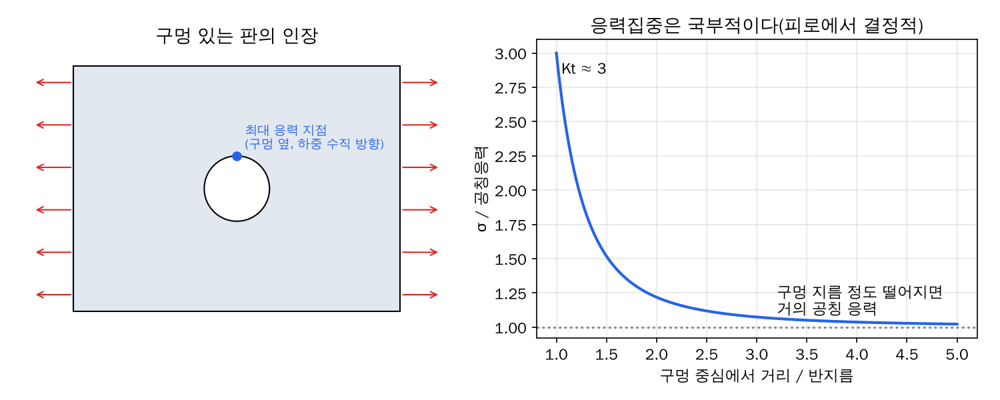{width=100%}

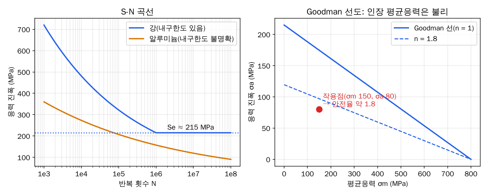{width=100%}

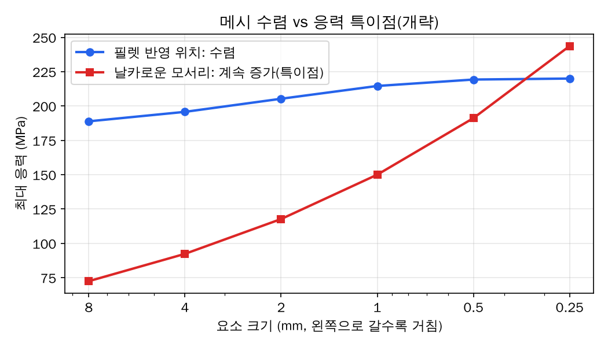{width=80%}

**파손이론**

| 재료 | 이론 | 판단 |
|---------------------------|-------------------------------------------------|------------------------|
| 연성(강, 알루미늄) | von Mises(또는 보수적 Tresca) | 등가응력 < 항복강도 |
| 취성(주철, 세라믹) | 최대주응력, Mohr-Coulomb | σ1 < 인장강도 |

**응력집중:** 구멍·노치·단차·키홈에서 국부 응력이 Kt배(판의 작은 원형 구멍 Kt ≈ 3). 정적 연성재료는 국부 항복으로 재분배되어 영향이 작지만, **피로에서는 결정적**(Kf = 1 + q(Kt − 1)). 대책: 필렛 반경 확대, 완만한 단면 변화, 구멍 위치 이동, 쇼트피닝.

**피로:** 항복보다 낮은 응력도 **반복되면** 균열이 생기고 자라 파단합니다.

- S-N 곡선, 강의 내구한도 ≈ 0.5 Sut(표면·크기·신뢰도 보정 후 더 낮아짐). 알루미늄은 뚜렷한 내구한도가 없음.
- **Goodman:** σa/Se + σm/Sut = 1/n(인장 평균응력은 불리)
- **Miner:** D = Σn/N, D = 1이면 파손
- 실차 하중 → 레인플로우 카운팅 → 손상 합산 → 등가 내구시험
- 파단면: 시작점 → 비치마크(매끈한 성장부) → 거친 최종 파단부

**파괴역학:** 균열이 있는 부재는 K = Yσ√(πa)로 평가, K ≥ K_IC면 불안정 파괴. 임계 균열 전에 **비파괴검사로 찾는 손상허용 설계**. 파괴인성은 저온에서 떨어질 수 있습니다.

**크리프·응력이완:** 고온에서 일정 하중에도 계속 늘어남(배기계). 고정 변형에서 응력이 줄어듦(고온부·도장면 볼트 축력 저하).

## 고체역학 1분 체크

| 질문 | 답 |
|------------------------------------|----------------------------------------------------------------|
| 처짐이 크면 고강도강으로 바꾸면 되나? | 아니다. E가 같아 처짐은 그대로. 형상(I)·길이·지지 조건으로 해결 |
| 차체를 박스로 만드는 이유? | 폐단면은 개방 단면보다 비틀림 강성이 수백 배 |
| 긴 액추에이터가 불리한 이유? | 좌굴하중이 길이 제곱에 반비례, 옆 하중에 취약 |
| 정적 안전율만 보면 안 되는 이유? | 반복하중은 항복 이하에서도 피로 파손, 응력집중이 수명을 좌우 |
| 하중 없는 열응력 크기? | 완전 구속 강 50 K → 약 126 MPa, 길이 무관 |

```{=openxml}
<w:p><w:r><w:br w:type="page"/></w:r></w:p>
```

# 파트 2-2 재료: Fe-C 상태도에서 방탄강까지

**전공 \| 기계재료 — 방탄강·용접·혹한 재료 선택의 근거**

## Fe-C 상태도 읽는 법

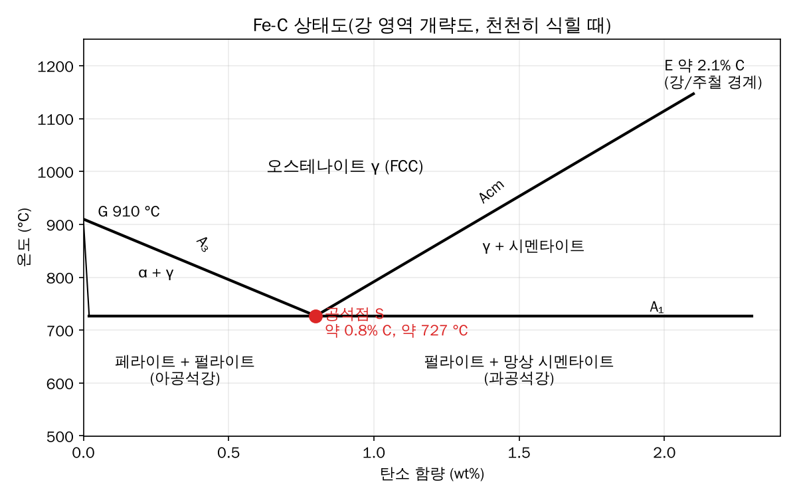{width=85%}

**정체:** 탄소가 몇 % 든 철을 **아주 천천히 식힐 때** 온도에 따라 어떤 조직이 생기는지 보여주는 지도입니다. 내 재료의 탄소 %에서 수직선을 긋고 위에서 아래로 내려오며 읽습니다. 급랭(담금질) 조직은 이 그림에 없습니다.

| 조직 | 정체 | 구조 | 성질 | 비유 |
|--------------|----------------------|-----------|-----------------------------------|------------------|
| 오스테나이트(γ) | 고온의 철 + 녹은 탄소 | FCC | 연함, 탄소 최대 약 2.1% 고용, 비자성 | 뜨거운 설탕물 |
| 페라이트(α) | 상온 순철에 가까움 | BCC | 매우 연하고 연성 큼, 탄소 거의 못 녹임(약 0.02%) | 찰흙 |
| 시멘타이트(Fe₃C) | 철-탄소 화합물(6.67% C) | 화합물 | 매우 단단하고 취약 | 유리 조각 |
| 펄라이트 | 페라이트 + 시멘타이트 층상 | 혼합 | 중간 강도·연성 | 찰흙과 유리판을 번갈아 쌓은 합판 |

**FCC가 탄소를 많이 녹이는 이유:** 원자 사이 빈틈이 커서 탄소가 쉽게 끼어 들어갑니다. BCC는 빈틈이 작습니다. 이것이 열처리의 원리입니다.

**주요 점:** 순철 변태점 약 910 °C, **공석점 약 0.8% C · 약 727 °C**(오스테나이트 → 펄라이트), 강과 주철 경계 약 2.1% C(교재마다 0.77/0.8%, 723/727 °C, 2.06/2.11% 표기 차이).

**탄소량별 강**

| 구분 | 탄소량 | 상온 조직 | 대표 용도 |
|---------------|----------------|---------------------------|------------------------------------------|
| 아공석강(저·중탄소) | 0.8% 미만 | 페라이트 + 펄라이트 | 구조용 강재, 축·기어(중탄소) |
| 공석강 | 약 0.8% | 100% 펄라이트 | 레일, 고강도 선재 |
| 과공석강 | 0.8~2.1% | 펄라이트 + 망상 시멘타이트 | 공구, 베어링강(구상화 처리) |
| 주철 | 2.1% 초과 | 흑연·시멘타이트 포함 | 엔진 블록, 브레이크 드럼(감쇠능·주조성) |

탄소가 늘수록 **경도·강도↑, 연성·인성·용접성↓**.

**지렛대 법칙(조직 비율):** 0.4% C강의 펄라이트 비율 ≈ (0.4 − 0.02)/(0.8 − 0.02) ≈ 49%. 간단히 0.4/0.8 = 50%.

## 열처리 4종 세트

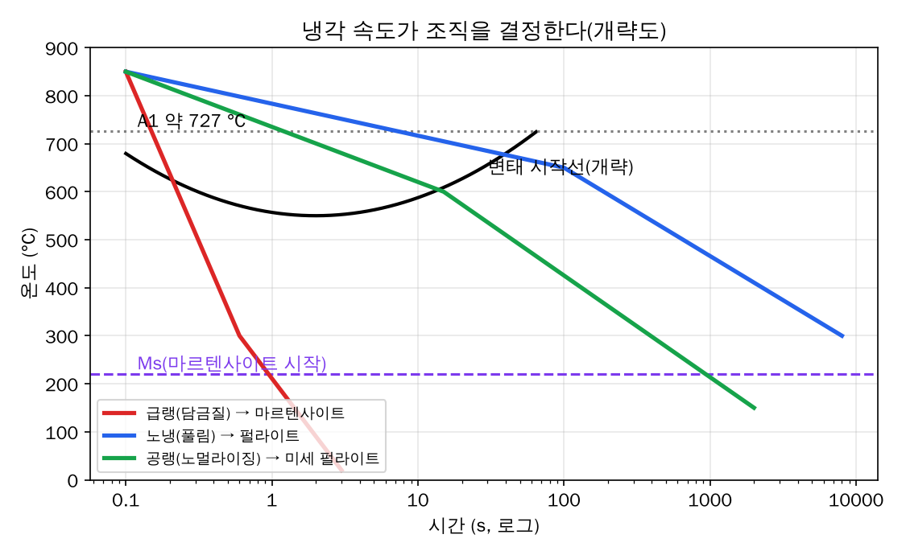{width=85%}

| 열처리 | 방법 | 결과 |
|----------------|-----------------------------------|-------------------------------------------------|
| 풀림 | 오스테나이트화 후 노 안에서 천천히 냉각 | 연하게, 가공성·내부응력 개선 |
| 노멀라이징(불림) | 오스테나이트화 후 공랭 | 결정립 미세·균일 → 강도·인성 개선 |
| 담금질 | 오스테나이트화 후 급랭 | **마르텐사이트**: 매우 단단·취약 |
| 뜨임 | 담금질 후 A₁ 아래 재가열 | 인성 회복(담금질 + 뜨임 = 조질) |

**마르텐사이트 직관:** 천천히 식히면 탄소가 빠져나와 펄라이트가 되지만, 급랭하면 **탄소가 빠질 시간이 없이 격자에 갇혀** 격자가 일그러집니다(BCT). 그래서 단단하지만 깨지기 쉽습니다.

**표면경화(침탄·질화·고주파):** 겉은 단단하게(마모·접촉 피로), 속은 질기게(충격). 기어·축·핀. 침탄을 오스테나이트 영역에서 하는 이유는 FCC가 탄소를 많이 받아들이기 때문.

## 합금원소

| 원소 | 효과 |
|--------------------|--------------------------------------------------------------------------------|
| Mn | 담금질성↑, 황(S)의 해로움 제거 |
| Cr | 담금질성·내마모성↑, 약 10.5% 이상이면 스테인리스 |
| **Ni** | 인성↑, **저온 인성 개선**, 오스테나이트 안정화 |
| Mo | 담금질성·고온 강도↑, 뜨임 취성 방지 |
| V | 결정립 미세화 |

**담금질성:** 굵은 부품의 **속까지** 경화되는 능력. 큰 축·고강도 부품에 Cr-Mo, Ni-Cr-Mo 합금강을 쓰는 이유.

## 방탄강·장갑 재료(공고 키워드)

| 재료 | 장점 | 주의 |
|---------------------------|---------------------|----------------------------------------------------|
| 고경도 압연 방탄강 | 관통 저항, 구조재 겸용 | 경도↑ → 인성↓, 용접 열영향부 연화·수소 균열, 성형 어려움(스프링백) |
| 알루미늄 장갑(5000·7000계) | 경량, 저온 인성 양호 | 같은 방호에 두께 증가, 강과 접합·갈바닉 부식 |
| 세라믹(타격면) | 매우 높은 경도 | 취성, 다층 구조로 사용 |
| 섬유 복합재(배면재) | 경량, 파편 흡수 | 이방성, 층간 박리, 손상 검사 |

**용접 주의:** 탄소당량이 높을수록 열영향부가 급랭되어 마르텐사이트 → 수소 균열. **예열·저수소 용접재·용접 순서 관리**. 고경도 방탄강은 열영향부가 오히려 연화되어 방호 성능이 떨어지는 문제도 있습니다.

**혹한 재료(핀란드·노르웨이):** BCC 강은 **연성-취성 천이온도** 아래에서 충격 인성이 급감 → 저온 샤르피 충격시험 기준, Ni 첨가강, 미세 결정립. FCC(알루미늄, 오스테나이트 스테인리스)는 천이가 거의 없음.

**알루미늄 합금 상식:** 6061-T6(구조용, 용접 시 강도 저하), 6063-T5(압출 프로파일, AGV 프레임 계열), 7075(고강도, 응력부식 주의), 5083(내식·용접성, 선박·장갑). E는 모두 약 70 GPa. **비강성(E/ρ)은 강·알루미늄·티타늄이 거의 같아** 축 강성 기준으로는 경량화 효과가 없고, **판 굽힘 강성 기준**으로는 알루미늄이 같은 강성에 약 절반 무게.

```{=openxml}
<w:p><w:r><w:br w:type="page"/></w:r></w:p>
```

# 파트 2-3 기계요소설계

**전공 \| 공고 필수 교과목(기계설계) — 볼트·나사·축·베어링·공차**

## 볼트 체결

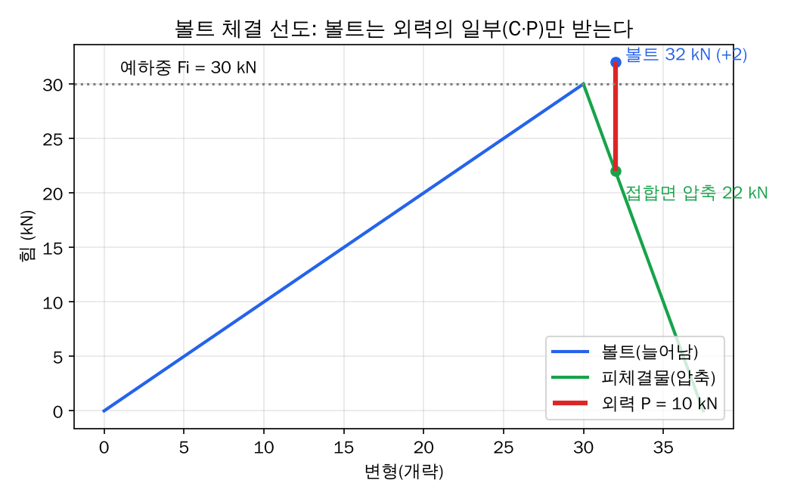{width=80%}

**토크와 축력:** T = K·d·Fi. 너트계수 K ≈ 0.2(건조), 윤활 시 0.15 이하 → **같은 토크라도 축력이 30% 이상 달라질 수 있음**. 중요 체결부는 토크-각도법, 축력 측정을 검토.

**예하중 기준:** 재사용 체결 Fi ≈ 0.75 × 보증하중. 예: M16, 10.9(As = 157 mm², 보증응력 830 MPa) → Fi ≈ 97.7 kN, T ≈ 313 N·m.

**외력 분담:** Fb = Fi + C·P, 접합면 압축 = Fi − (1 − C)P, 분리 하중 = Fi/(1 − C). **예하중이 유지되면 볼트의 변동 응력이 작아 피로에 강함.**

**미끄럼:** 마찰 체결 능력 = n·μ·Fi. 전단을 볼트 지압으로 받게 하면 풀림·피로 → **전단 핀·키·턱으로 전단을 따로** 받게 하는 것이 좋음.

**풀림 원인:** 접합면 미끄럼(가로 진동), 좌면 함몰·도장막 크리프. 대책: 충분한 예하중, 접촉면 경도, 나사 고정제, 기계적 잠금.

## 나사 구동(리드스크류·볼스크류): AGV 리프트와 직결

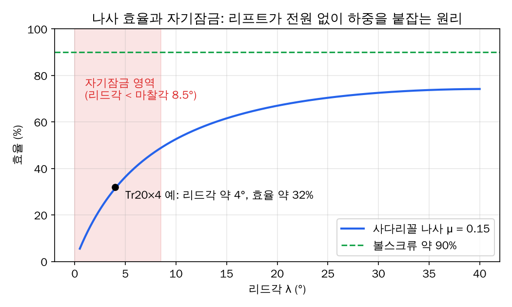{width=85%}

**직관:** 나사는 **경사면을 원통에 감아 놓은 것**입니다. 회전 토크를 직선 힘으로 바꿉니다.

| 구분 | 사다리꼴 리드스크류(스크류잭) | 볼스크류 |
|-------------|-----------------------------------------------|---------------------------------------|
| 접촉 | 미끄럼 | 볼 구름 |
| 효율 | 약 20~40% | 약 90% |
| **자기잠금** | **가능**(전원이 꺼져도 하중을 붙잡음) | 불가(하중에 밀려 역회전) → **브레이크 필요** |
| 정밀도·속도 | 보통 | 높음 |
| 발열·마모 | 큼 | 작음 |

**자기잠금 조건:** 리드각 λ < 마찰각 φ(tan φ = μ). 예: Tr20×4(유효지름 18 mm, 리드 4 mm), μ = 0.15 → tan λ = 4/(π × 18) ≈ 0.071(λ ≈ 4.0°) < φ ≈ 8.5° → **자기잠금 O**. 효율 η = tan λ / tan(λ + φ) ≈ 32%.

**필요 토크:** T = F·l / (2π·η)

- 하중 2.5 kN, 리드스크류(리드 4 mm, η ≈ 0.32) → T ≈ 5.0 N·m
- 같은 하중, 볼스크류(리드 5 mm, η ≈ 0.9) → T ≈ 2.2 N·m

**면접 포인트(AGV):** "리프트는 정지 중 하중을 붙잡아야 하므로 자기잠금이 되는 스크류 방식은 전원 상실 시 낙하를 막는 데 유리하고, 효율이 높은 볼스크류나 리니어 액추에이터는 브레이크가 필요합니다."

**4개 액추에이터 동기화(꼬리질문 대비):** 네 기둥 중 하나가 늦으면 스테이지가 기울어 걸리거나(바인딩) 한쪽에 하중이 몰립니다. 대책은 ① **기계적 동기**(모터 하나 + 축·기어박스로 스크류잭 4개를 함께 구동) ② **전자적 동기**(각 액추에이터 엔코더 피드백으로 위치를 맞춤) ③ 가이드 강성 확보. [본인 설계 방식 확인]

## 축·베어링·기어

**축:** 굽힘 + 비틀림 조합(von Mises), 강성(처짐·비틀림각 — 기어 물림과 베어링 정렬), **위험속도**(회전수가 굽힘 고유진동수와 일치하면 휘돌림), 키홈·단차 응력집중.

**구름 베어링 수명:** L10 = (C/P)^p × 10⁶ 회전(볼 p = 3, 롤러 10/3). **하중 2배 → 볼베어링 수명 1/8.** 예: C = 50 kN, P = 10 kN, 1,500 rpm → 약 1,390시간.

**기어:** 모듈 m = d/z, 기어비 i = z₂/z₁, 출력 토크 = 입력 × i × η. 치 굽힘(Lewis)과 치면 접촉응력(피팅)을 따로 평가. 유성기어는 동축·고감속(변속기·최종감속기). 백래시는 열팽창·윤활 여유지만 크면 충격·위치 오차.

## 공차·끼워맞춤·GD&T

**공차 누적:** 부품 4개 각 ±0.1 mm → 최악 조건 ±0.4, 통계(RSS) ±0.2. 안전·기능 치수는 최악 조건.

**끼워맞춤(지름 50 mm 예):** H7 구멍(0/+0.025)에 g6 축(헐거움, 미끄럼), k6(중간), p6(억지, 압입). **회전하는 쪽에 억지 끼워맞춤**이 원칙.

**GD&T:** 데이텀(조립·측정 기준면), 평면도·직각도·위치도·동심도. 치수공차만으로는 표현하기 어려운 **기능**을 정의. 투상법은 KS 3각법.

## 용접 이음

필렛 용접 전단응력 τ = F/(0.707·h·L). 용접부는 형상 불연속·잔류응력·결함으로 모재보다 피로강도가 크게 낮아 **용접 상세 등급별 S-N 곡선**으로 평가. 개선: 고응력부에서 용접 위치 이동, 토우 그라인딩, 완전 용입. 변형 대책: 대칭 용접 순서, 지그 구속, 예열.

## 기계설계 1분 체크

| 질문 | 답 |
|-------------------------------|---------------------------------------------------------------------|
| 볼트 예하중의 목적? | 접합면 분리·미끄럼 방지, 볼트 변동 응력 감소로 피로 수명 향상 |
| 리프트에 스크류잭을 쓰는 이유? | 자기잠금으로 전원 상실 시에도 하중 유지 |
| 볼스크류의 단점? | 역구동되므로 브레이크 필요 |
| 4기둥 리프트의 위험? | 동기 불일치로 기울어짐·바인딩 → 기계적 또는 전자적 동기 |
| 베어링 하중 2배면? | 볼베어링 수명 1/8 |

```{=openxml}
<w:p><w:r><w:br w:type="page"/></w:r></w:p>
```

# 파트 2-4 동역학과 진동

**전공 \| 공고 교과목(동역학) — 사격·주행 하중, 현수, 공진**

## 동역학 핵심 5가지

| 개념 | 직관 | 식 | LS 연결 |
|------------|----------------------------|---------------------|--------------------------------------|
| 뉴턴 2법칙 | 힘이 가속도를 만든다 | F = m·a | 가감속 관성력 → 전복·체결부 하중 |
| 운동량·충격량 | 짧고 큰 힘 = 긴 작은 힘(같은 충격량) | F·Δt = m·Δv | **포 반동**: 포탄 운동량 = 주퇴부 운동량 |
| 에너지 보존 | 형태만 바뀜 | ½mv², mgh, ½kx² | 제동 에너지 → 열, 주퇴 에너지 흡수 |
| 회전 관성 | 회전 변화에 대한 저항 | T = I·α | 포탑 선회 가속, 구동계 관성 |
| 각운동량 | 회전체는 자세를 유지하려 함 | L = I·ω | 자이로 효과, 포 안정화 |

**반동 계산 감각 \[가정\]:** 포탄 45 kg × 900 m/s = 40,500 N·s. 주퇴부 3,000 kg이면 주퇴속도 13.5 m/s, 에너지 약 273 kJ. 주퇴거리 0.9 m로 받으면 평균 약 304 kN. **에너지는 운동량의 제곱에 비례**하므로 포구제퇴기로 운동량을 30% 줄이면 에너지는 약 절반이 됩니다.

**충격하중:** 갑자기 놓기만 해도 응력 2배. 높이 h에서 떨어지면 충격계수 1 + √(1 + 2h/δst). **부드럽게 받을수록(δst 큼) 충격이 줄어듭니다**(완충재, 범프스톱, 주퇴기).

## 진동의 기본: 질량-스프링-댐퍼

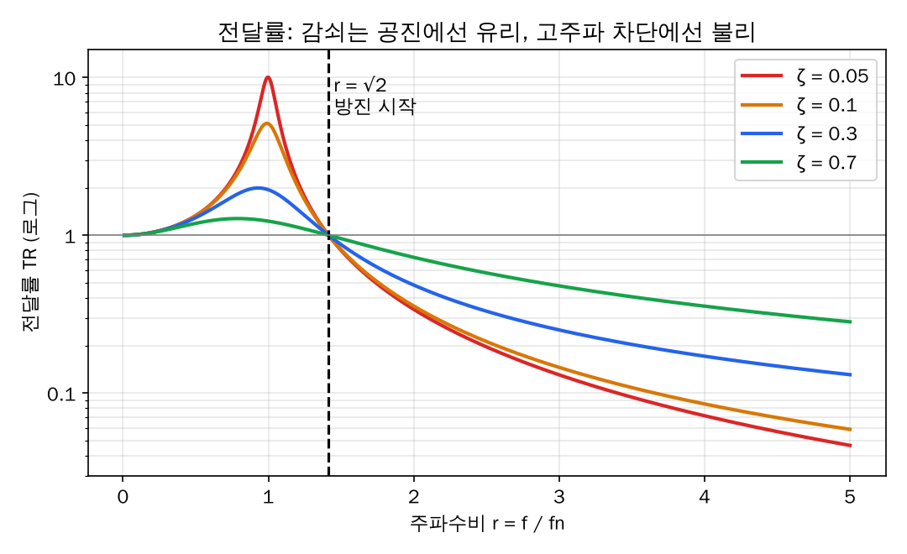{width=85%}

**식:** m·x″ + c·x′ + k·x = F(t) → "외력을 관성·감쇠·복원력이 나눠 받는다."

- 고유진동수 fn = √(k/m)/(2π), 정적처짐으로 **fn ≈ 15.76/√δ(mm)** Hz(처짐 25 mm → 3.2 Hz, 250 mm → 1 Hz)
- 감쇠비 ζ = c/(2√(km)). ζ < 1 진동하며 감소, = 1 임계, > 1 천천히 복귀
- **공진:** 가진 주파수 ≈ 고유진동수 → 응답 급증, 진폭은 **감쇠만이 제한**(공진 증폭 Q ≈ 1/(2ζ))

**주파수 영역 3구간(진동 대책의 핵심)**

| 영역 | 지배 요소 | 효과적인 대책 |
|------------------------------------|--------------------------|--------------------------------------|
| 공진 아래(저주파) | 강성 | 강성 증가 |
| 공진 근처 | **감쇠** | 감쇠 추가 |
| 공진 위(고주파) | 질량 | 질량 추가, 방진 |

**방진(전달률):** 고유진동수를 가진 주파수의 **1/√2 이하**로 낮춰야 차단 시작. 감쇠는 공진 통과 시 유리, 고주파 차단에는 불리.

**공진 대책 5가지:** 가진원 감소(밸런싱), 고유진동수 이동(강성·질량), 감쇠 추가, 전달 경로 차단(방진), 동흡진기.

**공진인지 가진력 증가인지:** 특정 회전수에서만 크면 공진, 회전수가 오를수록 계속 커지면 **불평형(F = m·e·ω², 회전수 2배 → 힘 4배)**.

## 다자유도·랜덤·충격

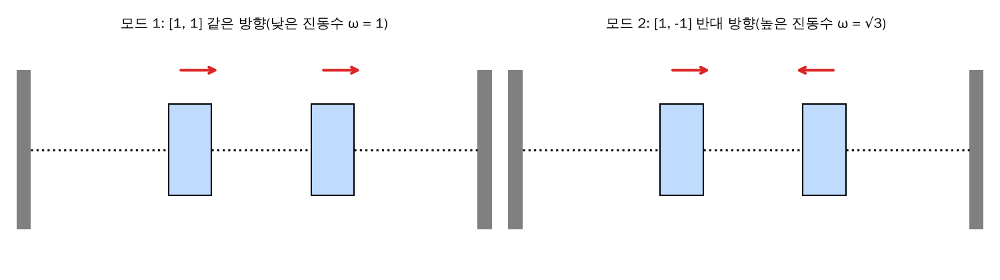{width=100%}

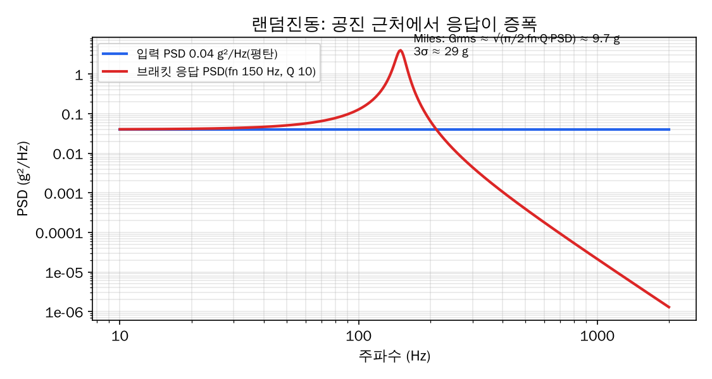{width=85%}

- **모드:** 구조는 여러 고유진동수·모드형상을 가짐. 해석에서는 유효질량이 큰 모드가 응답을 지배.
- **랜덤진동:** 주행 진동은 넓은 대역의 랜덤 신호 → **PSD(g²/Hz)**, 면적의 제곱근 = Grms. Miles 식 Grms ≈ √(π/2 · fn · Q · PSD), **3σ** 설계.
- **충격:** 반정현파 피크·지속시간, 또는 SRS(각 고유진동수 계가 받는 최대 응답).

```{=openxml}
<w:p><w:r><w:br w:type="page"/></w:r></w:p>
```

# 파트 2-5 차량동역학(사시 및 차량동역학)

**전공 \| 체계설계(중량·무게중심)와 가장 직결되는 과목**

## 주행저항과 구동력

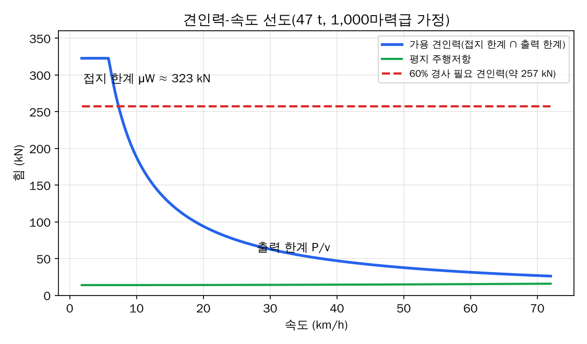{width=85%}

**주행저항 = 구름 + 경사 + 공기 + 가속:** f·W·cosθ + W·sinθ + ½ρC_dAv² + m·a. 궤도차량은 저속이라 **구름·경사가 지배**.

**구동력:** F = T_엔진 × i × η / r. 저속에선 **접지 마찰 한계(μW)**, 고속에선 **출력 한계(P/v)**.

**등판:** 60% 경사 ≈ 31°. 필요 마찰계수 ≈ tanθ + f ≈ 0.65 → **출력보다 접지력이 한계**일 수 있음. 47 t 차량이면 견인력 약 257 kN, 1,000마력급이면 약 7 km/h로 등판(학습용).

**출력 대 중량비:** 1,000 hp / 47 t ≈ 21 hp/t. 방호로 중량이 늘면 감소 → **방호와 기동성의 상충**.

## 무게중심과 하중 이동(체계설계 핵심)

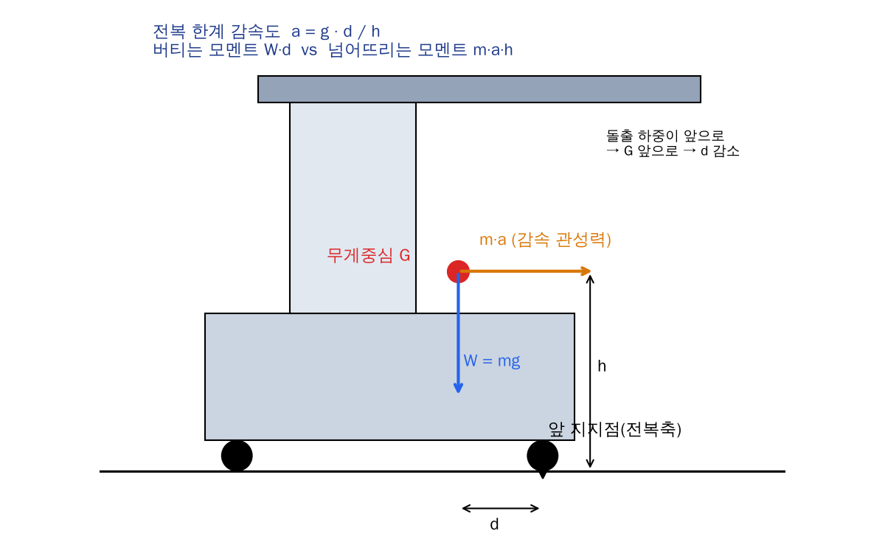{width=85%}

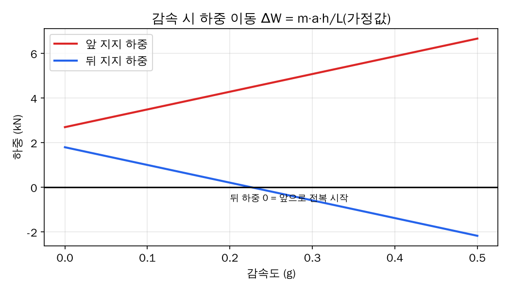{width=80%}

**정적 축하중:** 무게중심이 앞에 있을수록 앞바퀴(앞쪽 로드휠) 하중이 큽니다. 앞 하중 = W × (무게중심~뒤 지지점 거리) / 축거.

**가감속 시 하중 이동:** ΔW = m·a·h / L(h: 무게중심 높이, L: 축거). **감속하면 앞으로, 가속하면 뒤로** 하중이 이동합니다. 무게중심이 높고 축거가 짧을수록 커집니다.

- \[가정\] 459 kg, 0.1 g 감속, h = 1.41 m, L = 0.8 m → ΔW ≈ 459 × 0.981 × 1.41 / 0.8 ≈ **790 N**(약 80 kg이 앞으로 이동한 효과)

**전복 조건**

| 방향 | 조건 | 의미 |
|-------------------|-----------------------------------------------|---------------------------------|
| 정적 | 무게중심 수직선이 지지 다각형(접지점 연결선) 안 | 밖이면 그대로 넘어짐 |
| 전후(가감속) | a_tip = g × d / h | d: 무게중심~앞 지지선 수평거리 |
| 좌우(선회·측경사) | 정적 안정계수 SSF = T/(2h) | T: 좌우 접지 간격 |
| 경사면 | 정적 전복각 tanθ = d/h | 경사가 이보다 크면 전복 |

**직관:** 넘어지려는 모멘트(관성력 × 높이) vs 버티는 모멘트(무게 × 지지점까지 거리). **무게중심을 낮게, 지지점에서 멀리** 두는 것이 전부입니다.

**무게중심 측정:** 수평 위치는 바퀴별 하중(저울)으로 모멘트 평형, 높이는 **차량을 기울여 축하중 변화를 재는 기울기법**.

## 현수·조향·제동

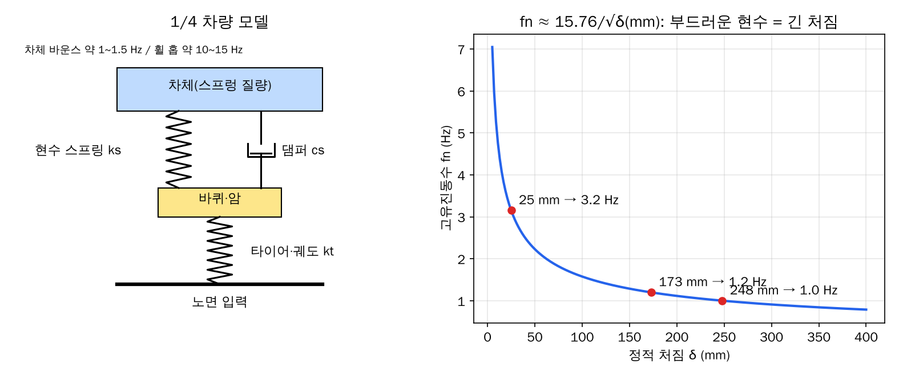{width=100%}

**현수 1/4 차량 모델:** 차체 바운스 약 1~1.5 Hz, 휠 홉 약 10~15 Hz(일반 차량 기준). 노면 파장 λ를 속도 v로 지나면 가진 f = v/λ → **특정 속도에서만 크게 출렁임**의 원인. 부드러운 스프링은 승차감↑ 대신 처짐·바닥침↑, 큰 감쇠는 차체 운동↓ 대신 충격 전달↑.

**유기압 현수:** 질소 가스 스프링(k ≈ n·p·A²/V) → 압축될수록 단단해지는 **점진형 강성**, 차고 조절 가능, 가스 온도에 따라 차고 변화(20 → 60 °C면 압력 약 14% 상승).

**조향:** 차륜형은 Ackermann(내측 바퀴를 더 꺾어 같은 회전중심), 궤도형은 **스키드 조향**(좌우 궤도 속도 차, 접지길이/궤도간격 비가 선회성 결정).

**제동:** E = ½mv², 정지거리 s = v²/(2a), 감속 ≤ μg. 47 t·60 km/h면 약 6.5 MJ. 장경사 연속 하강은 수백 MJ → **리타더가 받아 냉각계통으로** → 제동 문제가 냉각 문제로 연결.

**궤도차량 특징:** 접지압 p = W/(2bL)(낮을수록 연약지 유리), 궤도 장력(느슨하면 이탈, 팽팽하면 저항·마모).

## 동역학·차량 1분 체크

| 질문 | 답 |
|----------------------------------------|------------------------------------------------------------|
| 감속 시 전복 한계 가속도? | a = g·d/h(무게중심을 낮게, 지지점에서 멀리) |
| 감속 시 앞바퀴 하중이 느는 이유? | 관성력이 무게중심 높이에서 작용해 ΔW = m·a·h/L 만큼 앞으로 이동 |
| 공진 근처에서 진폭을 정하는 것? | 감쇠 |
| 방진을 시작하려면? | 고유진동수를 가진 주파수의 1/√2 이하로 |
| 반동 에너지를 줄이는 가장 효과적인 방법? | 운동량 자체 감소(포구제퇴기) — 에너지는 운동량 제곱 |

```{=openxml}
<w:p><w:r><w:br w:type="page"/></w:r></w:p>
```

# 파트 2-6 열역학

**전공 \| 공고 교과목(열역학) — 파워팩·냉각의 출발점**

## 1법칙과 2법칙

| 구분 | 1법칙 | 2법칙 |
|-----------|------------------------------------------------|-----------------------------------------|
| 한 줄 | 에너지는 사라지지 않는다 | 에너지에는 방향과 질이 있다 |
| 식 | ΔU = Q − W(밀폐계), 개방계는 엔탈피 h = u + pv | 고립계 ΔS ≥ 0, η ≤ 1 − T_L/T_H |
| 비유 | 통장: 입금 − 출금 = 잔액 변화 | 환전할 때마다 수수료가 빠진다 |
| 금지 | 제1종 영구기관(에너지 무에서 생성) | 제2종 영구기관(열을 100% 일로) |

**1법칙 실무 직관:** 유압 릴리프 밸브의 압력 강하 → 기름 온도 상승. 브레이크 → 운동에너지가 전부 열. 전자장비 → 소비 전력이 결국 열(냉각 부하 = 소비 전력).

**2법칙 실무 직관:** 엔진은 열을 100% 일로 못 바꾸므로 **남는 열을 반드시 버려야** 합니다. 냉각계통은 설계 부족이 아니라 물리법칙상 필수입니다.

**엔트로피:** 에너지가 흩어져 쓸모가 줄어든 정도. 열 1,000 J이 400 K → 300 K로 흐르면 −2.5 + 3.33 = +0.83 J/K(가능), 반대는 −0.83(불가능). 이때 잃은 일 = 300 × 0.83 ≈ 250 J = 카르노 기관이 얻었을 일.

**비가역성(효율 손실)의 원인:** 마찰, 유한 온도차 열전달, 교축, 혼합, 전기저항, 소성변형.

## 이상기체와 단열 압축

- pV = mRT(**반드시 절대온도 K**). 유기압 현수 가스: 20 → 60 °C면 압력 약 14% 상승, −40 °C면 약 20% 하강 → 차고 변화.
- 단열 압축 T₂/T₁ = (p₂/p₁)^((k−1)/k). 터보차저가 1 → 2.5 bar로 압축하면 300 K → 이상적 약 390 K, 효율 75%면 약 420 K(147 °C) → **인터쿨러**가 필요하고, 그 열도 냉각 부하.

## 사이클 비교

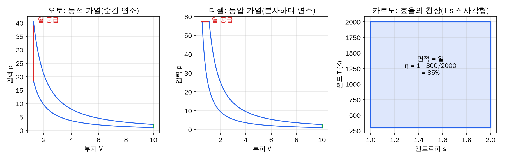{width=100%}

| 구분 | 카르노 | 오토(가솔린) | 디젤 |
|-----------|-----------------------|----------------------------|-------------------------------------|
| 열 공급 | 등온 | 등적(순간 연소) | 등압(분사하며 연소) |
| 효율 | 1 − T_L/T_H | 1 − 1/r^(k−1) | 오토 식 × (rc^k − 1)/[k(rc − 1)] 보정 |
| 예 | 2,000/300 K → 85% | r = 10 → 60% | r = 18, rc = 2 → 63% |
| 실제 | 실현 불가(효율의 천장) | 약 25~35%, 노킹으로 r 제한 | 약 40~45% |

**핵심 비교:** 같은 압축비면 오토가 유리, 하지만 디젤은 **공기만 압축해 노킹이 없으므로** 압축비를 15~22까지 높여 실제 효율이 더 좋습니다. 스로틀이 없어 부분 부하 손실도 적습니다.

**군용 차량이 디젤을 쓰는 이유:** 효율·항속거리, 저속 고토크, 연료 안전성(낮은 휘발성), 군용 연료 단일화, 내구성.

**엔진 에너지 수지(1,000마력급, 학습용):** 축출력 746 kW, 효율 40% → 연료 에너지 약 1,865 kW → **버리는 열 약 1,120 kW**(배기 + 냉각수·오일). 엔진 출력보다 큰 열을 처리해야 합니다.

**BSFC → 효율:** η = 3,600 / (BSFC[g/kWh] × 저위발열량[MJ/kg]). 200 g/kWh, 42.8 MJ/kg → 약 42%.

**냉동 사이클(칠러):** 압축기 → 응축기 → 팽창밸브 → 증발기. COP는 1보다 클 수 있지만, **배터리 열 5 kW를 빼면 응축기는 5 + 압축기 일만큼 버려야** 합니다(열을 없애는 게 아니라 옮김).

**혹한 디젤 시동이 어려운 이유:** 차가운 흡기·실린더 벽이 압축열을 빼앗아 착화 온도에 못 미침 + 오일 점도 증가 + 배터리 성능 저하 → 흡기 예열·냉각수 히터.

```{=openxml}
<w:p><w:r><w:br w:type="page"/></w:r></w:p>
```

# 파트 2-7 열전달과 냉각

**전공 \| 열전달 — 파워팩 냉각, 전자장비, 사막 수출**

## 직관 7개

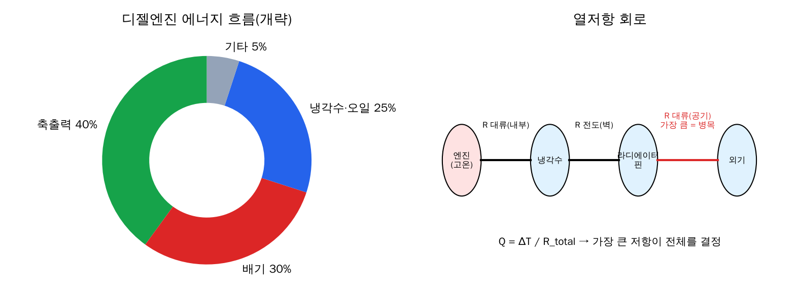{width=100%}

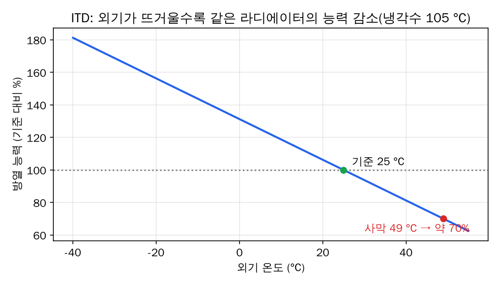{width=80%}

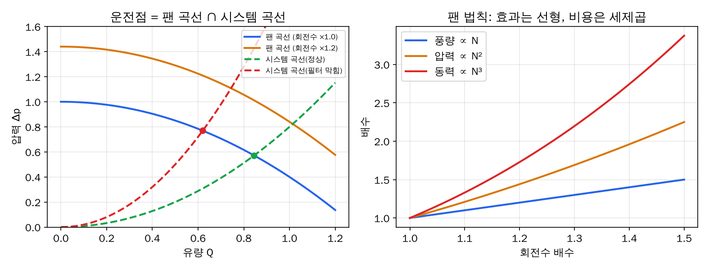{width=100%}

1. **열과 온도는 다르다:** 열은 이동하는 에너지의 양, 온도는 수준. 물은 비열이 커서 같은 열에도 온도가 덜 오름 → 냉각수.
2. **욕조 모델:** 들어오는 열 − 나가는 열 = 쌓이는 열. 정상상태는 열이 멈춘 게 아니라 들어오는 만큼 나가는 상태. 과열 대책은 **발열을 줄이거나 방열을 키우거나** 둘뿐.
3. **Q̇ = ṁ·cp·ΔT(열을 실어 나르는 트럭):** 유량이 크면 온도차가 작아도 많은 열을 나름 → "온도차가 작으니 냉각이 나쁘다"는 틀릴 수 있음.
4. **세 가지 길:** 전도(접촉), 대류(흐름이 싣고 감, Q = hAΔT), 복사(εσT⁴, 고온·일사).
5. **열저항 = 병목:** Q̇ = ΔT/R_total, 가장 큰 저항이 전체를 결정. 라디에이터의 병목은 거의 항상 **공기 쪽**(h가 액체의 수십 분의 1) → 공기 쪽에 핀.
6. **ITD(온도차가 있어야 열이 흐른다):** 냉각수 105 °C에서 외기 25 → 49 °C면 ITD 80 → 56 K, **방열 능력 약 70%**. 사막 수출형 냉각 설계의 핵심. 외기보다 차가워야 하는 배터리는 공기로 불가 → 칠러.
7. **팬 법칙:** 풍량 ∝ N, 압력 ∝ N², 동력 ∝ N³. 회전수 +10% → 동력 +33%, +43% → 약 2.9배. **"효과는 선형, 비용은 세제곱."**

**과도 열전달:** 비오 수 Bi = hL/k < 0.1이면 집중용량법, 시정수 τ = ρcV/(hA). 약 5τ면 정상상태. "30분 시험에서 괜찮았다"가 장시간 보증은 아님.

**열교환기:** Q = UA·ΔT_lm(입출구 온도를 알 때), ε-NTU(성능 예측). 대향류가 병행류보다 유리.

**하이브리드 통합냉각:** 엔진(약 100 °C) / 전력전자(약 60 °C) / 배터리(약 20~40 °C)로 온도 레벨이 달라 **회로 분리**, 공기 흐름 상류에 저온 열교환기 배치.

**냉각 문제 원인 분해:** 발열 측(부하·손실) / 냉각수 측(유량·공기 혼입·막힘) / 공기 측(풍량·우회·**재유입**) / 열교환기(오염·용량).

```{=openxml}
<w:p><w:r><w:br w:type="page"/></w:r></w:p>
```

# 파트 2-8 유체역학

**전공 \| 유압, 냉각, 흡기, 도하, 바람 하중**

## 유체의 성질

- **점성:** 액체는 온도가 오르면 감소(꿀을 데우면 묽어짐), 기체는 증가. 혹한 유압유는 굳고, 고온에선 누설.
- **체적탄성계수:** 유압유 약 1.5 GPa로 거의 압축되지 않음. **공기가 섞이면 스펀지처럼 물렁해짐** → 유압 강성 k = K·A²/V 저하.
- **증기압:** 압력이 낮으면 상온에서도 끓음 → 캐비테이션.

## 정지 유체

- p = ρgh: 물속 10 m마다 약 1 bar. 도하 시 수심 1.5 m 해치(0.5 m²)에 약 7.4 kN.
- **파스칼:** 밀폐 유체의 압력은 어디나 같음 → F = p·A(유압 잭, 브레이크, 구동 실린더).
- **부력:** 밀어낸 물의 무게. 25 t 수륙양용 차량은 물 25 m³를 밀어내야 함 → **중량 관리가 생존**.

## 흐르는 유체의 3대 보존식

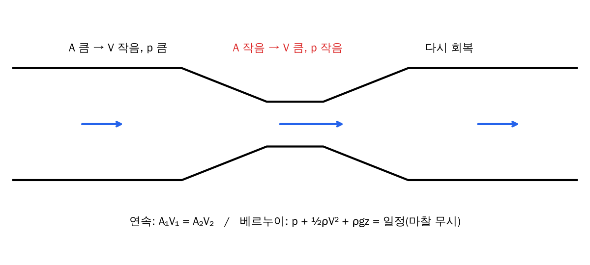{width=100%}

| 보존 | 식 | 직관 | 예 |
|-------------|-------------------------------|-----------------------|---------------------------------|
| 질량(연속) | A₁V₁ = A₂V₂ | 좁아지면 빨라진다 | 호스 끝을 누르면 물이 빨라짐 |
| 에너지(베르누이) | p + ½ρV² + ρgz = 일정(+ 손실) | 압력·속도·높이가 서로 바뀜 | 피토관, 벤투리 |
| 운동량 | ΣF = ṁ(V₂ − V₁) | 흐름이 꺾이면 힘이 생김 | 배관 엘보 하중, **포구제퇴기 반동 저감** |

**베르누이 주의:** 마찰 없음, 같은 유선 가정. 실제 배관은 손실수두를 더함. 펌프 동력 P = ρgQH/η.

## 손실과 흐름의 성격

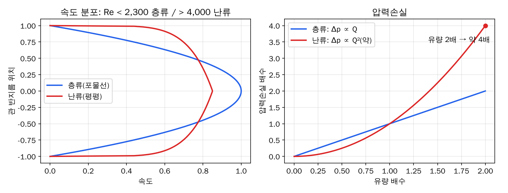{width=100%}

- **레이놀즈 수 Re = VD/ν:** 약 2,300 이하 층류, 약 4,000 이상 난류. 냉각수 배관은 대개 난류(열전달↑, 손실↑), 유압 배관은 층류인 경우가 많음.
- **압력손실:** Δp = f(L/D)(ρV²/2) + ΣK(ρV²/2). **유량 2배 → 난류 손실 약 4배**, 층류는 지름 절반 → 16배. 실제로는 부속품·필터 손실이 큰 경우가 많음.
- **틈새 누설 ∝ h³:** 틈새 2배 → 누설 8배. 유압 부품 마모·공차·청정도 관리의 이유.
- **박리:** 급확대·급굴곡에서 흐름이 벽을 못 따라감 → 손실·소음. 냉각 덕트는 완만하게.

## 외부 유동

- **항력 F = ½ρV²C_dA:** 속도 제곱. 풍속 20 m/s, 면적 2 m², C_d 1.2 → 약 580 N. 높은 발사대·마스트에는 모멘트로 작용.
- **와류 방출 f ≈ 0.2·V/D:** 지름 50 mm 마스트, 풍속 10 m/s → 약 40 Hz. 구조 고유진동수와 겹치면 공진.

## 유체기계·과도 현상

- **원심펌프**(대유량·저압, 냉각수) vs **용적형**(고압·유량 일정, 유압) — 용적형은 **릴리프 밸브 필수**.
- **운전점** = 펌프 곡선과 배관 저항 곡선의 교점. 필터가 막히면 장치가 정상이어도 유량 감소.
- **캐비테이션:** NPSH_가용 > NPSH_필요. 흡입 가압·흡입 배관 짧고 굵게·온도 낮추기.
- **수격:** Δp = ρ·c·ΔV. 물 2 m/s 급정지 → 약 2.4 MPa. 밸브를 천천히 닫고 축압기로 흡수.

## 열유체 1분 체크

| 질문 | 답 |
|--------------------------------------|--------------------------------------------------------------|
| 엔진에 냉각이 꼭 필요한 이유? | 2법칙상 열을 100% 일로 못 바꿔 남는 열을 버려야 함 |
| 팬을 더 빨리 돌리면? | 효과는 선형, 동력은 세제곱 → 면적·유로·재유입 개선이 먼저 |
| 사막에서 냉각이 약해지는 이유? | ITD 감소로 같은 열교환기 능력 약 70% |
| 유압에 공기가 섞이면? | 체적탄성계수 저하 → 물렁·응답 지연·캐비테이션 |
| 디젤이 실제로 더 효율적인 이유? | 노킹이 없어 높은 압축비, 스로틀 손실 적음 |

```{=openxml}
<w:p><w:r><w:br w:type="page"/></w:r></w:p>
```

# 파트 2-9 제어와 모터 제어

**전공 \| 시스템제어·메카트로닉스 — AGV 모터 제어를 남이 했어도 설명할 수 있게**

## 제어의 기본

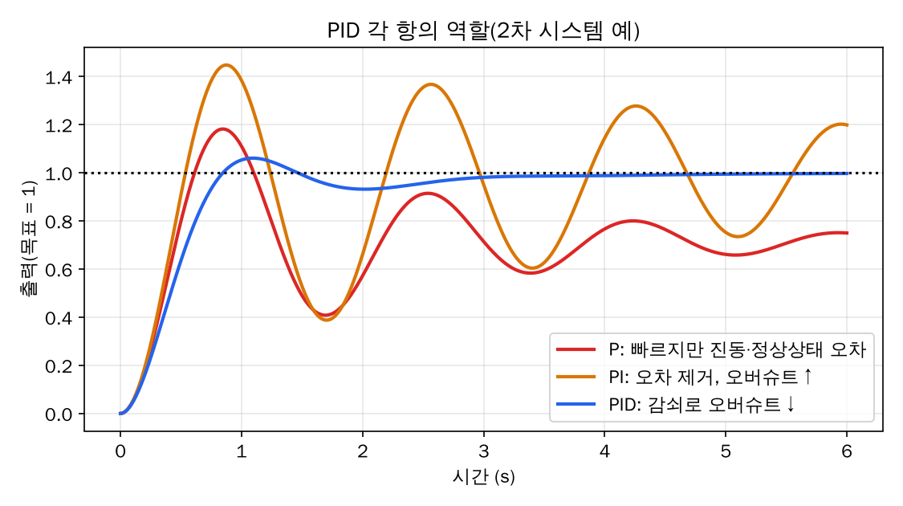{width=85%}

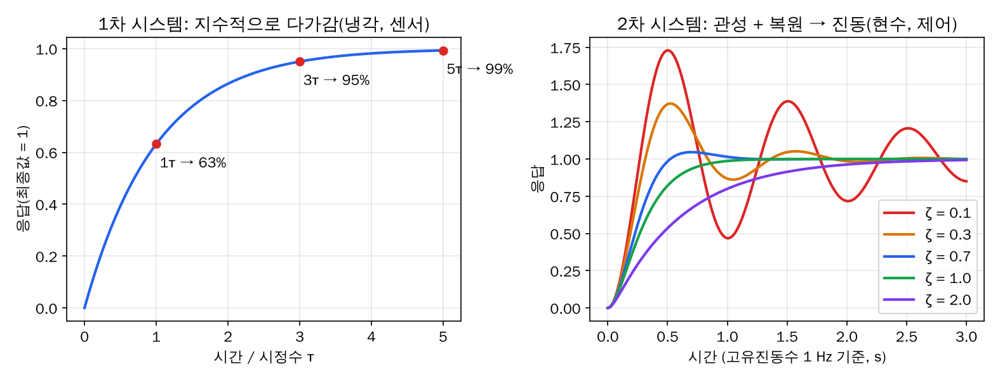{width=100%}

**개루프 vs 폐루프:** 개루프는 정해진 명령만 내림(전자레인지 타이머). 폐루프는 **센서로 결과를 측정해 오차를 되먹임(피드백)**해서 보정(에어컨 온도 조절). 외란과 모델 오차에 강합니다.

**PID 제어**

| 항 | 하는 일 | 너무 크면 | 비유 |
|------------|---------------------------------------|------------------------|--------------------------|
| P(비례) | 오차에 비례해 반응 → 빠른 응답 | 진동·오버슈트, 정상상태 오차 남음 | 목표와 멀수록 세게 밟는 운전자 |
| I(적분) | 쌓인 오차를 없앰 → **정상상태 오차 제거** | 오버슈트, 느린 진동, 와인드업 | "아직도 못 갔네" 하고 점점 더 밟음 |
| D(미분) | 오차 변화율에 반응 → **감쇠**, 오버슈트 감소 | 센서 노이즈 증폭 | 빠르게 다가가면 미리 브레이크 |

**응답 특성:** 1차 시스템은 시정수 τ(63% 도달 시간, 약 5τ면 정상상태). 2차 시스템은 고유진동수와 감쇠비 — **진동 공부의 질량-스프링-댐퍼와 같은 식**. ζ ≈ 0.7이 빠르면서 오버슈트가 작은 절충점.

**안정성:** 전달함수 극점이 모두 복소평면 왼쪽이면 안정. 실무는 보드 선도의 이득·위상 여유.

**기계와 제어의 연결(면접 포인트):** 구조 강성이 낮으면 **구조 공진이 제어 대역과 겹쳐 불안정**해집니다. 그래서 포탑·발사대 구동부는 기계 강성과 제어 대역폭을 함께 설계합니다. K9의 포 안정화처럼 **자이로로 흔들림을 측정해 모터로 보상**하는 것이 폐루프 제어의 대표 예입니다.

## AGV 모터 제어는 이렇게 동작한다(본인 담당이 아니어도 설명할 수 있게)

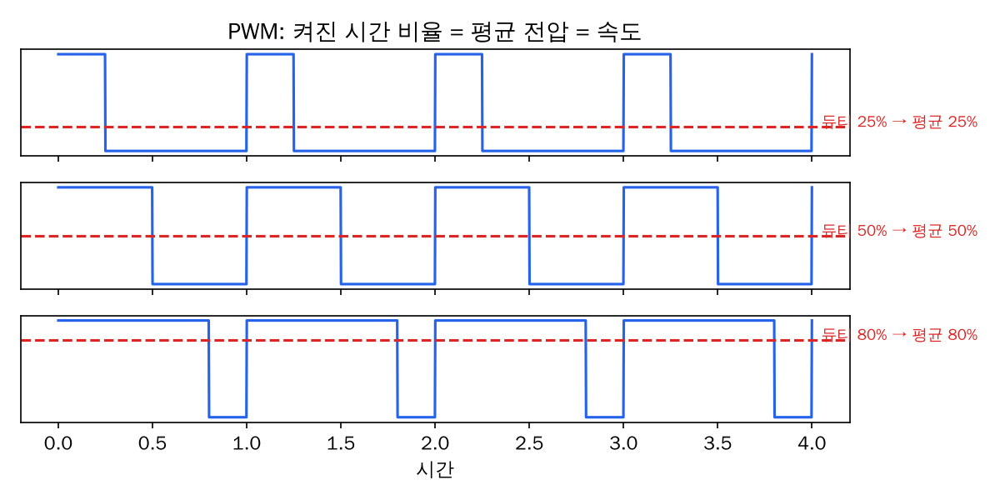{width=85%}

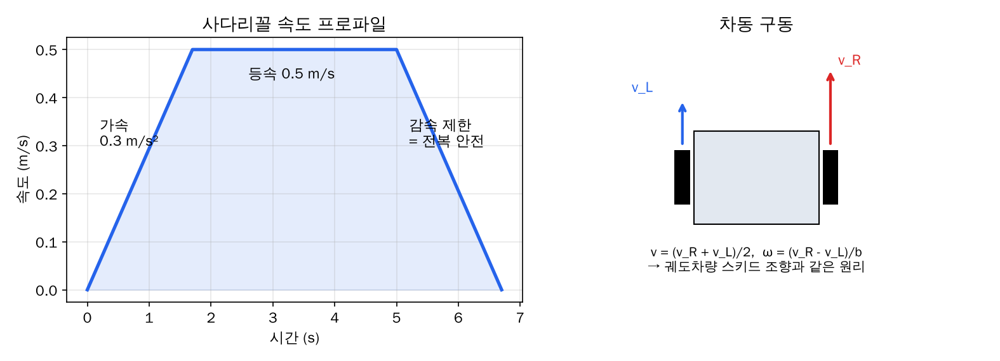{width=100%}

**구성(신호와 에너지의 흐름)**

배터리 → **모터 드라이버** → 모터(DC 또는 BLDC) → **감속기** → 바퀴. 센서(**엔코더**·홀센서)가 회전을 측정해 **제어기**(MCU·PC)로 되돌려 보냅니다.

**① PWM으로 속도 조절:** 드라이버는 전원을 아주 빠르게 켜고 끄는데, **켜져 있는 시간 비율(듀티비)**이 평균 전압이 됩니다. 듀티 50%면 절반 전압 → 절반 속도에 가까움. 방향은 H-브리지로 전류 방향을 바꿔 정·역회전.

**② 폐루프 속도 제어:** 목표 속도와 엔코더로 잰 실제 속도의 차이(오차)를 PID에 넣어 PWM을 조정합니다. 짐을 실어 느려지면 오차가 커지고 → 듀티를 올려 → 다시 목표 속도로.

**③ 계층(캐스케이드) 제어:** 바깥부터 **위치 → 속도 → 전류(토크)** 루프. 전류는 토크에 비례하므로 전류를 제한하면 과부하·모터 과열을 막을 수 있습니다.

**④ 차동 구동(두 바퀴로 방향 바꾸기):** 직진 속도 v = (v_R + v_L)/2, 회전 속도 ω = (v_R − v_L)/b(b: 바퀴 간격). 양쪽을 반대로 돌리면 제자리 회전 — **궤도차량의 스키드 조향과 같은 원리**.

**⑤ 가감속 프로파일:** 속도를 계단처럼 바꾸지 않고 **사다리꼴(일정 가속 → 등속 → 일정 감속)**로 바꿔 미끄럼·충격·적재물 흔들림을 줄입니다.

**⑥ 리프트 액추에이터 제어:** 리미트 스위치(상·하한 정지), 엔코더·홀센서로 위치 측정, 4개 기둥 **동기화**(전자적 위치 맞춤 또는 기계적 연결), 과전류 감지로 걸림 보호.

**본인 설계와 연결되는 핵심 한 줄:** "**가감속 제한값이 곧 전복 안전과 연결**됩니다. 리프트를 올리고 슬라이드를 뻗은 상태에서는 전복 한계 감속도가 작아지므로, 그 상태에서는 감속을 더 부드럽게 하거나 주행을 막아야 합니다." (4파트 AGV 시나리오에서 계산)

## 구동 모터 크기 1차 계산 \[가정\]

조건: 총질량 460 kg, 목표 가속 0.3 m/s², 구름저항계수 0.02, 바퀴 반지름 0.1 m, 구동륜 2개, 감속비 20, 효율 0.8, 최고 속도 0.5 m/s

| 단계 | 계산 | 결과 |
|------------------|------------------------------------|----------------------------------------------|
| 가속력 | 460 × 0.3 | 138 N |
| 구름저항 | 0.02 × 460 × 9.81 | 90 N |
| 필요 견인력 | 합 | **228 N** |
| 바퀴 토크(전체) | 228 × 0.1 | 22.8 N·m(바퀴당 11.4) |
| 모터 토크(바퀴당) | 11.4 / (20 × 0.8) | **약 0.71 N·m** |
| 바퀴 회전수 | 0.5 / 0.1 = 5 rad/s | 약 48 rpm |
| 모터 회전수 | 48 × 20 | **약 955 rpm** |
| 필요 출력 | 228 × 0.5 | **약 114 W**(+ 여유율, 경사, 기동 토크) |

**의미:** 감속기는 토크를 키우고 속도를 줄입니다. 경사·문턱·용접 비드를 넘는 조건이 있으면 견인력이 크게 늘어나므로 그 조건으로 다시 계산합니다. 0.3 m/s²(약 0.03 g) 감속은 뒤의 전복 한계와 비교해 볼 값입니다.

**프로토타입 시험과 연결:** "적재 상태로 이동 가능한지, 모터가 굴릴 수 있는지, 제어가 되는지"를 확인한 것은 **견인력(토크) 충분성, 구동계 성능, 제어 안정성을 실물로 검증**한 것입니다.

```{=openxml}
<w:p><w:r><w:br w:type="page"/></w:r></w:p>
```

# 파트 2-10 공학수학과 수치해석

**전공 \| 공학수학·수치해석·유한요소해석기초 — 모든 해석의 공통 언어**

## 직관으로 보는 공학수학

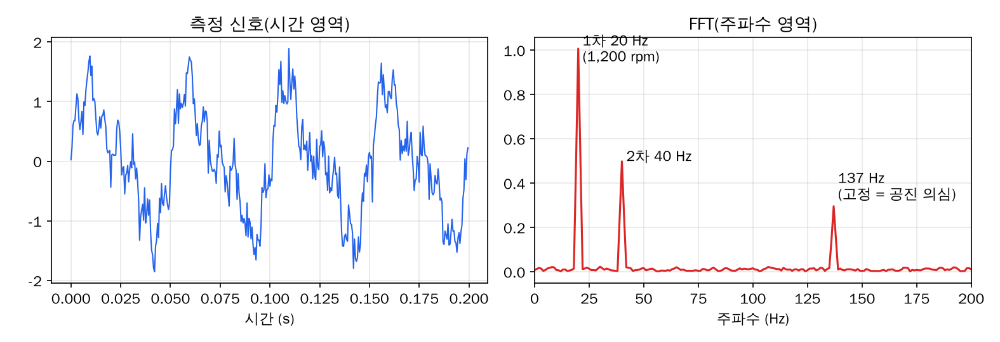{width=100%}

| 수학 | 직관 | 공학 연결 |
|------------------|---------------------------------------|-------------------------------------------|
| 1차 ODE | "남은 차이에 비례해 변한다" → 지수적으로 다가감 | 냉각, 센서 응답, 1차 제어 |
| 2차 ODE | 되돌아가려는 성질 + **관성** → 진동 | 진동, 현수, 2차 제어 |
| 선형대수 [K]{u} = {F} | 수많은 스프링 연립방정식 | FEM의 본체 |
| 고유값 | 곱해도 방향이 안 바뀌는 특별한 방향 | **고유진동수·모드, 주응력, 좌굴하중** |
| 라플라스 | 미분 → s 곱셈, 미분방정식 → 분수식 | 전달함수, 안정성(극점) |
| 푸리에·FFT | 신호를 사인파의 합으로 분해 | 진동·소음 측정, PSD, 차수 분석 |
| 복소수·페이저 | 크기 + 위상 | 주파수 응답, 보드 선도 |
| 테일러 전개 | 한 점 근처를 직선으로 근사 | 선형화, 수치해석, sinθ ≈ θ(10°에서 오차 0.5%) |
| 벡터 미적분 | 기울기(열은 온도가 내려가는 방향), 발산(연속) | 열전도, 유체 보존식 |
| PDE | 공간 + 시간 변화 | 열확산, 파동(수격), 연속체 진동 |

**ODE 한 줄:** "지금 상태면 다음 순간 이만큼 변한다는 **규칙**이고, 초기조건에서 그 규칙을 따라가 이어 붙인 곡선이 해입니다." 컴퓨터 시뮬레이션은 시간을 잘게 나눠 이 규칙을 반복 적용합니다(오일러·룽게-쿠타).

**2자유도 예:** 질량 1, 스프링 1인 벽-질량-질량-벽 → 고유값 1, 3 → 모드 [1, 1](같이 움직임, 낮은 진동수), [1, −1](반대로, 높은 진동수).

**최종값 정리:** 계단 힘 F₀에 대한 질량-스프링-댐퍼의 최종 변위 = F₀/k(정적 처짐과 같음 → 직관 확인).

## 수치해석·FEM 원리

- **FEM 흐름:** 요소 분할 → 형상함수 → 요소 강성행렬 → 조립 → 경계조건 → [K]{u} = {F} → 응력. **구속이 부족하면 K가 특이** → "강체 운동" 오류.
- **응력이 요소마다 불연속인 이유:** 변위만 절점에서 연속이고 응력은 미분값이라서.
- **뉴턴-랩슨:** 접선을 따라 근을 반복 탐색(√2: 1 → 1.5 → 1.4167 → 1.41422). 비선형 FEM 수렴 반복의 원리, 접촉·소성처럼 강성이 급변하면 발산.
- **암시적 vs 명시적:** 암시적은 평형 반복·큰 시간 간격(정적·느린 동적), 명시적은 작은 시간 간격(충격·폭발·충돌). 명시적은 가장 작은 요소가 시간 간격을 결정.
- **오차:** 모델링(가정) / 이산화(메시) / 수치(반올림). 메시가 촘촘해도 경계조건이 틀리면 틀린 답에 수렴합니다.
- **해석 검증 순서:** 반력 합 = 하중? → 변형 모양이 상식적? → 손계산과 크기 비교 → 메시 수렴 → 시험 비교.

```{=openxml}
<w:p><w:r><w:br w:type="page"/></w:r></w:p>
```

# 파트 2-11 추가 전공: 꼬리질문에 자주 걸리는 주제

**전공 보강 \| 기구학·트라이볼로지·제조·품질·소음·전동화·복합재·도면**

## 기구학과 메커니즘

**자유도(그뤼블러 식):** 평면 기구 M = 3(n − 1) − 2j₁ − j₂(n: 링크 수, j₁: 1자유도 조인트, j₂: 2자유도 조인트). M = 1이면 입력 하나로 운동이 정해집니다. 예: 4절 링크 n = 4, j₁ = 4 → M = 3 × 3 − 8 = 1.

**4절 링크 그라스호프 조건:** 가장 짧은 링크 s + 가장 긴 링크 l ≤ 나머지 두 링크 합 p + q이면 적어도 한 링크가 완전히 회전(크랭크-로커 등). 해치 개폐, 현수암, 발사대 기립, 자동장전 메커니즘에 쓰입니다.

**토글(사점) 위치:** 링크가 일직선이 되면 작은 입력으로 매우 큰 힘이 납니다(클램프·잠금 장치). 반대로 그 위치에서는 구동이 멈추므로 설계 시 피해야 할 위치이기도 합니다.

**전달각:** 커플러와 출력 링크 사이 각도. 90°에 가까울수록 힘이 잘 전달되고, 보통 40° 이상 확보.

**속도·가속도 해석:** 상대속도법, 벡터 루프, 다물체동역학(MBD). 링크 반력 → 구조 해석 하중.

**캠:** 원하는 변위 곡선을 만들지만 가속도가 불연속이면 충격·소음 → 사이클로이드 등 매끄러운 곡선.

## 트라이볼로지(마찰·마모·윤활)

| 윤활 영역(스트리벡 곡선) | 상태 | 언제 |
|------------------------------------------|------------------------------------|----------------------|
| 경계 윤활 | 금속 접촉, 마찰·마모 큼 | 기동·정지, 저속·고하중 |
| 혼합 윤활 | 일부 접촉 | 중간 |
| 유체 윤활 | 유막이 완전 분리, 마찰 최소 | 정상 운전 |

**마모 종류:** 응착(같은 금속끼리 붙었다 떨어짐), **연삭(모래·먼지 입자 — 사막 운용)**, 피로(반복 접촉 → 표면 아래 균열 → 피팅·스폴링), 부식, **프레팅**(미세 진동 미끄럼 — 볼트 체결면·스플라인·베어링 끼워맞춤면).

**윤활의 목적:** 마찰·마모 감소, 냉각, 세정, 방청, 밀봉.

**지상장비 예:** 궤도 핀·부싱, 로드휠 베어링, 포탑 링 베어링, 기어, 유압 씰. 사막에서는 실링(먼지 차단)과 필터, 혹한에서는 저온 점도.

## 제조 공정과 용접

| 공정 | 특징 | 예 |
|------------|----------------------------------------------------|------------------------------------|
| 주조 | 복잡 형상, 내부 결함 가능 | 하우징, 엔진 블록 |
| 단조 | 결 흐름이 형상을 따라 **강도·피로 우수** | 크랭크축, 고하중 링크, 토션바 |
| 기계가공 | 정밀, 재료 손실 | 축, 기어, 정밀 부품 |
| 판금·용접 | 대형 구조, 경량 | 차체, 프레임, 포탑 |
| 적층제조 | 복잡 형상, 시제품·소량 | 시작품, 경량 브래킷 |

**용접 종류:** 피복아크, MIG/MAG(생산성), TIG(정밀·얇은 판), 레이저(저변형), 마찰교반(알루미늄, 용융 없음).

**용접 결함:** 기공, 균열(고온·수소), 용입 불량, 언더컷, 슬래그 혼입. **변형·잔류응력 대책:** 대칭 용접 순서, 지그 구속, 예열·후열, 용접량 최소화.

**비파괴검사:** 육안 → 침투(표면) → 자분(강 표면 근처) → 초음파(내부) → 방사선(내부).

**DFM/DFA:** 부품 수 감소, 공구 접근성, 표준 부품, 조립 방향 단순화, 오조립 방지. 현지 생산이 늘수록 **도면·공정 표준화**가 중요.

## 품질과 통계

- **정규분포:** ±1σ 68.3%, ±2σ 95.4%, ±3σ 99.73%
- **Cp = (USL − LSL) / 6σ**(산포만), **Cpk = min(USL − μ, μ − LSL) / 3σ**(치우침까지). 일반 목표 Cpk ≥ 1.33.
- **관리도:** 공정이 우연 원인 범위 안에서 안정적인지 감시.
- **Gage R&R:** 측정 산포가 공차 대비 충분히 작은지(측정이 흔들리면 판정도 틀림).
- **근본원인 분석:** 5 Why, 특성요인도(피시본), 8D 보고서.
- **상관 ≠ 인과:** 같이 움직인다고 원인은 아님.

## 소음

- **dB 합성:** 같은 소음원 2개는 +3 dB(2배가 아님), 10개면 +10 dB.
- **A 가중 dB(A):** 사람 귀 감도 반영.
- **차음 vs 흡음:** 차음은 벽으로 막음(질량법칙: 벽 질량 2배 → 약 +6 dB), 흡음은 다공질로 반사음 감소.
- **차량 소음원:** 엔진·배기·냉각팬·**궤도와 로드휠 충격**(고무궤도의 장점). 승무원 소음 노출 기준(MIL-STD-1474 등).

## 전동화와 액추에이터

| 구분 | 유압 | 전동 | 공압 |
|------------------|--------------------------------|--------------------------------|------------------|
| 힘 밀도 | 매우 높음 | 중간 | 낮음 |
| 위치 정밀도 | 높음 | 매우 높음 | 낮음(압축성) |
| 약점 | 누유, 저온 응답, 발열 | 순간 대출력 시 전력·열 | 힘 약함 |

- **모터 토크-속도 곡선:** 저속 일정 토크, 고속 일정 출력. **감속기**로 토크↑·속도↓. 부하 관성과 모터 관성 비(관성 매칭)가 크면 응답 저하.
- **센서:** 엔코더·리졸버(리졸버는 진동·온도에 강해 군용에 많음), LVDT(직선), 로드셀, 가속도계.
- **배터리:** SOC(충전 상태), C-rate(충방전 속도), **열폭주**(온도 상승 → 반응 가속 → 연쇄 발열), 저온 용량 저하 → 진동·충격·열 안전을 함께 설계.

## 복합재

- **이방성:** 섬유 방향으로 강하고 수직 방향으로 약함 → 적층 각도(0°, ±45°, 90°) 조합.
- **파손:** 섬유 파단, 기지 균열, **층간 박리**(충격 후 내부에서 생겨 눈에 안 보임 → 비파괴검사).
- **접합:** 볼트 구멍이 섬유를 끊어 약점 → 접착 병행.
- **쓰임:** 방호 배면재, 경량 덮개, 발사관.

## 도면과 규격

- **투상법:** KS는 3각법. 정면도·평면도·우측면도 배치.
- **표면 거칠기 Ra**, 끼워맞춤 기호(H7/g6), 기하공차(평면도·직각도·위치도·동심도), 데이텀.
- **규격:** KS·ISO·MIL. 방산은 규격서(도면 + 시험·검사 기준)로 품질을 정의.
- **도면이 곧 계약:** 도면에 없는 요구는 생산·검사되지 않습니다 → 기능에 중요한 치수·공차·검사 기준을 빠짐없이.

## 탄도학 기초(일반 물리 수준)

- **내탄도:** 포신 안에서 장약 가스가 탄을 미는 과정(압력-시간 곡선), 강선에 의한 회전 안정.
- **외탄도:** 중력·공기저항·바람, 장거리에선 지구 자전 효과.
- **기계 연결:** 포신 열·마모(연속 사격), 반동, 사격 하중이 포탑·차체에 주는 영향.

## 실험계획법과 최적설계

- **DOE:** 여러 인자를 효율적으로 조합해 시험 횟수를 줄이고 주효과·교호작용을 찾음(다구치, 반응표면법). 로봇팔 개선처럼 여러 변수를 바꿀 때 **효과를 분리**하는 도구.
- **최적화:** 치수(두께) / 형상(곡률) / 위상(재료 배치). 위상최적화 결과는 제조성·응력집중·좌굴을 다시 검토해야 설계안이 됨.
- **민감도 분석:** 가정이 ±20% 바뀌면 결과는? PT 꼬리질문 대응에 직접 쓰임.

```{=openxml}
<w:p><w:r><w:br w:type="page"/></w:r></w:p>
```

# 구조·기계설계 심화

**전공 심화 \| 식 → 숫자 예 → 면접 한 줄의 순서로 익히기**

## 조합응력과 파손이론

축에 굽힘응력 σ와 비틀림 전단응력 τ가 동시에 작용하면, 연성재료는 등가응력으로 판단합니다.

**von Mises:** σ_vm = √(σ² + 3τ²). **Tresca(최대전단응력):** σ_eq = √(σ² + 4τ²).

예: σ = 100 MPa, τ = 60 MPa이면 σ_vm = √(10,000 + 10,800) ≈ 144 MPa, Tresca ≈ 156 MPa. Tresca가 더 보수적입니다.

| 재료 | 적용 이론 | 이유 |
|-----------------------|-----------------------------------|------------------------------------------|
| 연성재료(강, 알루미늄) | von Mises 또는 Tresca | 전단에 의한 소성 변형이 파손을 지배 |
| 취성재료(주철, 세라믹) | 최대주응력, Mohr-Coulomb | 인장에 의한 파단이 지배, 압축강도 ≫ 인장강도 |

**면접 한 줄:** "해석에서 von Mises를 보는 이유는 연성재료의 항복 판단에 적합하기 때문이고, 취성재료나 피로 균열 평가에는 그대로 쓰지 않습니다."

## 응력집중과 노치 민감도

Kt는 형상만으로 정해지는 이론 응력집중계수, Kf는 실제 피로에서의 유효 계수입니다. **Kf = 1 + q(Kt − 1)**, q는 노치 민감도(0~1)입니다. 예: Kt = 2.0, q = 0.8이면 Kf = 1.8.

연성재료의 **정적 하중**에서는 국부 항복으로 응력이 재분배되어 Kt의 영향이 작지만, **피로**에서는 Kf가 수명을 크게 좌우합니다. 그래서 "정적 해석의 응력집중부 최대값"과 "피로 평가"를 따로 봐야 합니다. 원본 PT 예시 2(항복 이하인데 균열 발생)의 전공적 근거가 여기 있습니다.

**응력집중 완화 설계:** 필렛 반경 확대, 단면 변화 완만하게, 하중 방향과 구멍 위치 조정, 이완 홈(relief groove), 표면 처리(쇼트피닝으로 압축 잔류응력 부여).

## 피로 설계의 기본 흐름

1\. **S-N 곡선:** 응력 진폭과 파단 반복수의 관계. 강은 약 10⁶~10⁷회 부근에서 내구한도가 나타나는 경우가 많고, 알루미늄은 뚜렷한 내구한도가 없어 반복수 기준으로 평가합니다.

2\. **내구한도 추정:** 시편 내구한도 Se′ ≈ 0.5 Sut(강, Sut ≤ 1,400 MPa 근사). 실제 부품은 표면·크기·하중종류·온도·신뢰도 계수(Marin 계수)로 낮춥니다.

3\. **평균응력 보정(Goodman):** σa/Se + σm/Sut = 1/n. 인장 평균응력은 피로수명을 줄입니다.

4\. **변동 하중 누적(Miner 법칙):** D = Σ(ni/Ni), D = 1이면 파손으로 봅니다.

**학습용 계산:** Sut = 800 MPa 강재 축(지름 30 mm, 기계가공, 신뢰도 99%).

Se′ = 400 MPa. 표면계수 ka = 4.51 × 800^(−0.265) ≈ 0.77, 크기계수 kb = 1.24 × 30^(−0.107) ≈ 0.86, 신뢰도계수 ke ≈ 0.81. → **Se ≈ 400 × 0.77 × 0.86 × 0.81 ≈ 215 MPa**. 시편값의 절반 가까이로 떨어집니다.

응력집중을 반영한 σa = 80 MPa, σm = 150 MPa이면 Goodman: 80/215 + 150/800 = 0.372 + 0.188 = 0.56 → **피로 안전율 n ≈ 1.8**. 같은 조건에서 최대응력 230 MPa의 정적 항복 안전율은 Sy = 650 MPa 기준 약 2.8입니다. **정적 안전율보다 피로 안전율이 작다**는 점이 핵심입니다.

**Miner 예:** 10⁶회 수명 응력에서 2×10⁵회, 2×10⁵회 수명 응력에서 5×10⁴회 작용 → D = 0.2 + 0.25 = 0.45. 남은 수명 여유가 있지만, Miner 법칙은 하중 순서 효과를 무시하므로 실제 D가 1보다 작을 때 파손되기도 합니다.

**실제 하중 이력 처리:** 주행 중 측정한 불규칙 변형률 이력은 **레인플로우 카운팅**으로 진폭·평균별 반복수를 세고 Miner 법칙으로 손상을 합산합니다. "실차 하중 측정 → 레인플로우 → 손상 계산 → 등가 내구시험 조건"의 흐름을 말할 수 있으면 직무 이해가 드러납니다.

## 용접부 피로

용접부는 형상 불연속(토우), 잔류응력, 미세 결함 때문에 모재보다 피로강도가 크게 낮습니다. 그래서 용접 구조는 모재 S-N이 아니라 **용접 상세 등급별 S-N 곡선(FAT 등급 등)**으로 평가하는 경우가 많습니다.

**필렛 용접 전단응력 1차 계산:** τ = F / (0.707 h L). 예: F = 50 kN, 다리길이 h = 6 mm, 총 용접길이 L = 200 mm → τ ≈ 50,000 / (0.707 × 6 × 200) ≈ 59 MPa.

**개선 방법:** 용접 위치를 고응력부에서 멀리, 토우 그라인딩·피닝, 완전 용입, 용접 대신 볼트 체결 검토. 고강도강은 **탄소당량**이 높을수록 용접 균열 위험이 커져 예열·저수소 용접봉이 필요합니다. 열영향부(HAZ)는 경화·취화되거나 연화될 수 있습니다.

## 좌굴

**Euler 좌굴하중:** Pcr = π²EI / (KL)². 양단 핀 K = 1, 일단 고정·타단 자유 K = 2, 양단 고정 K = 0.5(이론값).

**세장비 판단:** λ = KL/r, r = √(I/A). 강(E = 210 GPa, Sy = 350 MPa)은 λ가 약 109보다 크면 Euler 식, 작으면 Johnson 식(비탄성 좌굴)을 씁니다. 짧은 기둥은 좌굴 전에 항복합니다.

**면접 한 줄:** "좌굴은 재료 강도보다 **탄성계수와 단면2차모멘트, 길이·지지조건**에 지배됩니다. 고강도 재료로 바꿔도 좌굴하중은 거의 늘지 않습니다." 원본의 '흔한 오해' 표와 연결하세요.

**판재 좌굴:** 얇은 판에 압축·전단이 걸리면 국부 좌굴이 생깁니다. 리브·보강재로 판을 작은 칸으로 나누어 좌굴 강도를 높입니다. 경량화 설계에서 판 두께를 줄일 때 반드시 확인합니다.

## 파괴역학 기초

균열이 이미 있는 부재는 응력이 아니라 **응력확대계수 K = Yσ√(πa)**로 평가합니다. K가 파괴인성 K_IC에 도달하면 불안정 파괴가 일어납니다.

예: σ = 200 MPa, 표면 균열 a = 2 mm, Y = 1.12 → K ≈ 17.8 MPa√m. K_IC = 50 MPa√m인 강이면 임계 균열길이 a_c = (1/π)(K_IC / Yσ)² ≈ 16 mm. 균열이 16 mm에 이르기 전에 **비파괴검사 주기**로 발견해야 한다는 설계(손상허용 설계)로 이어집니다. 균열 성장 속도는 Paris 법칙 da/dN = C(ΔK)^m으로 다룹니다.

## 볼트 체결 심화

**토크와 축력:** T = K·d·Fi. K(너트계수)는 건조 강재에서 약 0.2, 윤활 시 0.15 이하로 떨어질 수 있습니다. **같은 토크라도 윤활 상태에 따라 축력이 30% 이상 달라질 수 있습니다.**

**권장 예하중:** 재사용 체결은 Fi ≈ 0.75 × 보증하중, 영구 체결은 약 0.9(일반 설계 교재 기준).

**외력 분담:** 볼트 강성 kb, 피체결물 강성 km, C = kb/(kb + km). 외부 인장 P가 작용하면 볼트 하중은 Fb = Fi + C·P, 피체결물 압축은 Fi − (1 − C)P 만큼 감소합니다. 피체결물이 볼트보다 훨씬 강해 C가 작으면(보통 0.2~0.3) **볼트는 외력의 일부만 느낍니다.** 분리 하중 P_sep = Fi / (1 − C).

**왜 예하중이 피로에 유리한가:** 반복 외력 중 볼트가 느끼는 진폭은 C·P/2뿐입니다. 예하중이 부족해 접합면이 벌어지면 볼트가 외력 전체를 받게 되어 피로 손상이 급증합니다.

**풀림 원인:** 접합면 미끄럼(가로 진동), 좌면 함몰·크리프로 인한 축력 저하. 대책은 충분한 예하중, 접촉면 경도 확보, 와셔, 나사 고정제, 기계적 잠금. "스프링 와셔가 항상 풀림을 막는다"는 것은 오해로 알려져 있으니 단정하지 마세요.

## 베어링·기어·축

**구름 베어링 정격수명:** L10 = (C/P)^p × 10⁶ 회전. 볼 p = 3, 롤러 p = 10/3. 예: C = 50 kN, P = 10 kN, 볼베어링, 1,500 rpm → L10 = 125 × 10⁶ 회전 ≈ 1,390시간. **하중이 2배가 되면 볼베어링 수명은 1/8**입니다.

**기어:** 모듈 m = d/z, 기어비 i = z2/z1, 출력 토크 = 입력 토크 × i × η. 치 굽힘응력(Lewis) σ = Ft / (b·m·Y), 치면은 접촉응력(피팅)으로 별도 평가합니다.

**축 설계 체크:** 강도(조합응력·피로), 강성(처짐·비틀림각 — 기어 물림과 베어링 정렬), 위험속도(회전수가 굽힘 고유진동수에 근접하지 않게), 키홈·단차 응력집중.

## 공차와 끼워맞춤

**공차 누적:** 부품 4개가 각각 ±0.1 mm일 때 최악 조건(worst-case)은 ±0.4 mm, 통계적 RSS 방식은 ±√(4 × 0.1²) = ±0.2 mm입니다. 안전·기능에 치명적인 치수는 최악 조건, 대량 생산의 일반 치수는 RSS를 검토할 수 있습니다.

**끼워맞춤 예(지름 50 mm):** 구멍 H7 = 0/+0.025. 축 g6 = −0.025/−0.009(헐거운 끼워맞춤, 미끄럼), k6 = +0.002/+0.018(중간), p6 = +0.026/+0.042(억지, 압입). 하우징과 베어링 외륜, 축과 내륜의 끼워맞춤은 **회전하는 쪽에 억지 끼워맞춤**을 주는 것이 일반 원칙입니다.

**GD&T 기본:** 데이텀(측정·조립 기준), 평면도·직각도·위치도·동심도. "치수공차만으로는 형상·위치 관계를 표현하기 어려워 기하공차로 기능을 정의한다"고 설명하세요. 조립 기준면을 데이텀으로 잡는 것이 원칙입니다.

## 재료 선택 심화

| 재료 | 밀도 g/cm³ | E GPa | 특징 | 주의 |
|------------|--------------|------------|-----------------------------|---------------------------------|
| 구조용·합금강 | 7.85 | 약 210 | 고강도, 용접성 다양, 저가 | 중량, 부식, 저온 취성(BCC) |
| 알루미늄 합금 | 2.7 | 약 70 | 경량, 저온 인성 양호(FCC), 가공성 | 피로 내구한도 불명확, 고강도 계열 용접성·응력부식 |
| 티타늄 합금 | 4.5 | 약 110 | 높은 비강도, 내식성 | 고가, 가공 난이도 |
| 세라믹 | 약 3~4 | 300 이상 | 높은 경도(방호 타격면) | 취성, 인장 약함 |
| 섬유 복합재 | 1.4~2.0 | 방향별 상이 | 비강도·비강성 우수, 방호 배면재 | 이방성, 손상 검사, 접합 |

**비강성의 함정:** E/ρ는 강 약 26.8, 알루미늄 약 25.9, 티타늄 약 24.4로 거의 같습니다. 그래서 **인장(축) 강성 기준으로는 알루미늄으로 바꿔도 무게가 거의 줄지 않습니다.** 반면 **판의 굽힘 강성(∝ E·t³)**을 같게 하면 알루미늄 두께는 (210/70)^(1/3) ≈ 1.44배, 무게는 1.44 × 2.7 / 7.85 ≈ **0.5배**가 됩니다. 경량재의 효과는 하중 형태에 따라 다르다는 것을 숫자로 말할 수 있으면 강한 답변이 됩니다.

**저온 취성:** 체심입방(BCC) 구조의 탄소강은 연성-취성 천이온도 아래에서 충격 인성이 급감합니다. 혹한 운용 장비는 **저온 샤르피 충격시험** 기준을 만족하는 강재를 선택하거나 니켈 함유 강재 등을 검토합니다. 면심입방(FCC)인 알루미늄·오스테나이트계 스테인리스는 천이가 뚜렷하지 않습니다.

**부식:** 알루미늄과 강을 직접 접촉시키면 전해질(염수·습기) 환경에서 알루미늄이 우선 부식(갈바닉 부식)될 수 있습니다. 절연 와셔·실런트·코팅으로 전기적 접촉을 끊습니다.

**열처리:** 담금질(경도↑, 취성↑) → 뜨임(인성 회복). 표면경화(침탄·질화·고주파)로 표면 내마모·피로강도를 높이고 내부 인성을 유지합니다. 기어·축·핀에 흔히 씁니다.

```{=openxml}
<w:p><w:r><w:br w:type="page"/></w:r></w:p>
```

# 진동·차량동역학·유압 심화

**전공 심화 \| 현수·조향·제동, 체계·탑재 직무의 핵심**

## 진동 기본 수치 감각

**정적처짐과 고유진동수:** fn = (1/2π)√(g/δst). δst를 mm로 쓰면 **fn ≈ 15.76 / √δst(mm)** Hz입니다. 정적처짐 25 mm → 약 3.2 Hz, 248 mm → 약 1.0 Hz. 차량 현수가 길고 부드러워야 낮은 고유진동수를 얻는 이유를 한 줄로 설명할 수 있습니다.

**감쇠 측정:** 자유진동 감쇠 곡선에서 대수감소율 δ = ln(x1/x2) ≈ 2πζ(ζ가 작을 때). 주파수응답에서는 반파워 대역폭 ζ ≈ (f2 − f1) / (2fn), 공진 증폭 Q ≈ 1/(2ζ).

**힘 전달률(방진):** TR = √{[1 + (2ζr)²] / [(1 − r²)² + (2ζr)²]}, r = f/fn.

| r | ζ = 0.1 | ζ = 0.3 | 의미 |
|---------------|--------------------|--------------------|---------------------------------------------|
| 1.0 | 약 5.1 | 약 1.9 | 공진: 감쇠가 클수록 유리 |
| √2 ≈ 1.41 | 1.0 | 1.0 | 이보다 커야 방진 효과 시작 |
| 3.0 | 약 0.15 | 약 0.25 | 방진 영역: 감쇠가 클수록 오히려 불리 |

**면접 한 줄:** "방진은 고유진동수를 가진 주파수의 1/√2 이하로 낮추는 것이 출발점이고, 감쇠는 공진 통과 시 응답을 줄이는 대신 고주파 전달률을 높이는 상충관계가 있습니다."

**회전 불평형 가진력:** F = m·e·ω². 불평형 0.005 kg·m가 3,000 rpm(ω ≈ 314 rad/s)에서 만드는 힘은 약 490 N입니다. **회전수가 2배면 힘은 4배**입니다. 원본 PT 예시 3에서 "특정 회전수 구간에서만 진동이 크다"면 공진, "회전수가 오를수록 계속 커진다"면 불평형 가진력 증가를 먼저 의심하는 근거입니다.

## 다자유도·랜덤진동·충격

**모드:** 다자유도 구조는 여러 고유진동수와 모드형상을 가집니다. 해석에서는 **유효질량(질량참여율)**이 큰 모드가 기초 가진에 대한 응답을 지배합니다. 보통 누적 유효질량이 각 방향 80~90% 이상이 되도록 모드를 추출합니다.

**랜덤진동:** 차량 주행 진동은 특정 주파수 하나가 아니라 넓은 대역에 에너지가 퍼진 랜덤 신호로, **PSD(g²/Hz)**로 표현합니다. PSD 곡선 아래 면적의 제곱근이 Grms입니다. 예: 20~2,000 Hz에서 0.04 g²/Hz로 평탄하면 Grms = √(0.04 × 1,980) ≈ 8.9 g.

**Miles 식(단자유도 응답 근사):** Grms,응답 ≈ √[(π/2) · fn · Q · PSD(fn)]. 입력 PSD가 고유진동수 부근에서 평탄하고 단자유도로 볼 수 있을 때의 근사입니다. 응답은 가우스 분포로 보고 **3σ(= 3 × Grms)**를 설계 하중으로 쓰는 경우가 많습니다.

**충격:** 반정현파(half-sine) 같은 펄스의 피크 가속도와 지속시간으로 정의하거나, **충격응답스펙트럼(SRS)**으로 "각 고유진동수를 가진 단자유도 계가 받는 최대 응답"을 나타냅니다. 같은 충격도 부품의 고유진동수에 따라 심각도가 다르다는 것이 SRS의 핵심입니다.

## 차량 주행저항과 구동력

**주행저항 = 구름저항 + 경사저항 + 공기저항 + 가속저항**

구름저항 = f·W·cosθ, 경사저항 = W·sinθ, 공기저항 = ½ρC_dAv², 가속저항 = (1 + δ)m·a(δ는 회전부 관성 보정).

구름저항계수 f는 포장도로·궤도차량에서 약 0.03 전후, 연약지에서는 0.1 이상으로 커집니다(학습용 범위). 궤도차량은 저속이 많아 **공기저항보다 구름·경사저항이 지배적**입니다.

**구동력(스프로킷·바퀴):** F = T_엔진 × i_전체 × η / r. 출력은 P = F·v. **저속에서는 접지 마찰 한계(μW)**, 고속에서는 **엔진 출력 한계(P/v)**가 구동력을 제한합니다. 이 두 곡선으로 변속기 기어비를 설계합니다.

**등판능력:** 경사 % = tanθ × 100. 60% 경사는 약 31°입니다. 저속 등판에서 필요한 마찰계수는 대략 μ ≥ tanθ + f ≈ 0.65(f = 0.05 가정)로, **출력보다 접지력이 한계가 될 수 있습니다.**

**출력 대 중량비(hp/t):** 가속·등판·최고속도의 1차 지표입니다. 1,000마력급 엔진으로 47 t 차량이면 약 21 hp/t입니다. 방호를 추가해 중량이 늘면 이 값이 떨어지므로 **방호와 기동성의 상충**을 수치로 보여줄 수 있습니다.

## 궤도차량의 특징

**접지압:** p = W / (2·b·L), b는 궤도 폭, L은 접지 길이. 예: 47 t, b = 0.55 m, L = 4.6 m → 약 91 kPa(학습용 수치). 낮을수록 연약지 기동성이 좋습니다.

**스키드 조향:** 좌우 궤도의 속도 차로 선회합니다. 접지길이 L과 궤도 중심거리 B의 비(L/B)가 크면 직진 안정성은 좋지만 선회 저항이 커지고, 작으면 선회는 쉽지만 직진성이 떨어집니다. 일반적으로 L/B ≈ 1.2~1.8 범위가 균형점으로 알려져 있습니다.

**궤도 장력:** 너무 느슨하면 고속 선회·역회전 시 궤도 이탈, 너무 팽팽하면 구름저항·마모·소비동력 증가. 유압(그리스) 실린더식 장력조절장치로 조정합니다.

**차륜형과의 비교:** 차륜형은 도로 속도·연비·정비성·소음이 유리하고, 궤도형은 험지·연약지 기동성과 중량 수용 능력이 유리합니다. K9 차륜형 개념처럼 같은 화력을 차륜형에 올리면 **사격 반동을 받치는 안정성(아웃리거·잭), 축하중 한계, 타이어·현수 강성**이 새로운 과제가 됩니다.

## 전복 안정성

**정적 안정계수 SSF = T / (2h)**, T는 좌우 접지 중심거리, h는 무게중심 높이. 측방 가속도가 SSF × g를 넘으면 (강체·정적 근사로) 전복이 시작됩니다. 예: T = 2.9 m, h = 1.5 m → SSF ≈ 0.97, 정적 전복 경사각 ≈ 44°.

포탑·탑재장비를 높은 위치에 추가하면 h가 올라가 SSF가 떨어집니다. **탑재 장비 설계에도 무게중심 관리가 필요한 이유**입니다. 실제 동적 전복은 현수 롤 강성·노면 충격으로 더 일찍 일어날 수 있습니다.

## 차륜 조향과 Ackermann

Ackermann 조건: cot δo − cot δi = w / L(w: 킹핀 간 거리, L: 축거). 저속에서 모든 바퀴가 같은 순간 회전중심을 갖도록 내측 바퀴를 더 크게 꺾습니다. 다축 차량(차륜형 대형 플랫폼)은 여러 축의 조향각을 같은 회전중심에 맞추도록 링키지를 설계합니다. 고속에서는 타이어 슬립각 때문에 Ackermann이 정확히 맞지 않습니다(원본 내용 연결).

## 현수장치 1/4 차량 모델

차체(스프렁 질량 ms)와 바퀴·암(언스프렁 질량 mu)을 두 질량으로 보고, 현수 스프링 ks·댐퍼 cs, 타이어(또는 궤도·고무) 강성 kt로 연결합니다.

| 모드 | 대략적 범위(승용·일반 차량 기준) | 의미 |
|------------|---------------------------------------------------------|-------------------------------|
| 차체 바운스 | 약 1~1.5 Hz | 승차감, 멀미, 차체 운동 |
| 휠 홉 | 약 10~15 Hz | 접지 하중 변동, 접지력 |

**노면 가진 주파수:** 파장 λ의 노면을 속도 v로 달리면 f = v/λ. 파장 5 m 굴곡을 21.6 km/h(6 m/s)로 지나면 1.2 Hz로 차체 바운스와 일치할 수 있습니다. **"특정 속도에서만 차가 심하게 출렁인다"는 현상의 원인**입니다.

**스프링·댐퍼 상충:** 부드러운 스프링 → 충격 전달 감소, 대신 처짐·바닥침·자세 변화 증가. 큰 감쇠 → 차체 운동 억제, 대신 고주파 충격 전달 증가. 원본 PT 예시 5의 꼬리질문 답변 근거입니다.

## 유압·유기압 기초

**기본식:** 힘 F = p·A, 속도 v = Q/A, 유압동력 P = p·Q. 예: 압력 20 MPa, 피스톤 지름 100 mm(A ≈ 7.85×10⁻³ m²)이면 힘 약 157 kN. 같은 실린더가 0.1 m/s로 움직이려면 유량 약 47 L/min, 유압동력 약 15.7 kW.

**오리피스 유량:** Q = Cd·A0·√(2Δp/ρ). 댐퍼의 감쇠력이 오리피스에서는 속도 제곱에 비례하는 경향이 있어, **블로오프 밸브**로 고속 영역 감쇠력을 제한해 큰 충격의 전달을 줄입니다.

**가스 스프링(유기압 현수의 원리):** 질소 가스를 유체로 압축해 스프링으로 씁니다. 폴리트로픽 관계 pVⁿ = 일정에서 강성 k ≈ n·p·A²/V. 가스가 압축될수록 압력이 올라 **강성이 점점 커지는(점진형) 특성**이 생겨, 작은 입력에는 부드럽고 큰 입력에는 바닥침을 막아줍니다. 가스 온도 변화에 따라 차고가 변할 수 있다는 점도 기억하세요.

**축압기:** 짧은 시간에 큰 유량이 필요한 작동기(장전·이송 장치 등)에서 펌프 용량을 키우지 않고 순간 유량을 공급합니다. 예시 7에서 계산합니다.

**유압유와 온도:** 저온에서는 점도가 커져 응답이 느리고 펌프 흡입이 어려워지며, 고온에서는 점도 저하로 누설·마모가 늘어납니다. **점도지수(VI)**가 높은 유압유와 작동유 예열·냉각 설계가 필요합니다.

## 제동 기초

**제동 에너지:** E = ½mv² (+ 하강 시 위치에너지). 정지거리 s = v²/(2a), 최대 감속은 접지 마찰 μg를 넘을 수 없습니다.

**열 문제:** 1회 제동은 브레이크 질량의 열용량으로 흡수하지만, **반복·연속 제동(장경사 하강)**에서는 방열이 따라가지 못해 온도가 누적되고 마찰계수가 떨어지는 페이드가 생깁니다. 중량 차량은 유체식 리타더나 엔진 브레이크로 연속 제동 에너지를 분담합니다. 예시 9에서 계산합니다.

```{=openxml}
<w:p><w:r><w:br w:type="page"/></w:r></w:p>
```

# 열유체·동력 심화

**전공 심화 \| 동력·냉각 직무의 핵심, 다른 직무도 기본은 필수**

## 엔진 에너지 수지 감각

디젤엔진은 연료 에너지의 대략 **35~45%를 축동력**으로, 나머지를 배기와 냉각수·윤활유·복사 열로 내보냅니다(운전점에 따라 다름, 학습용 범위). 그래서 **축출력과 비슷한 크기의 열을 냉각계통이 처리**해야 하는 경우가 많습니다. 여기에 변속기(특히 토크컨버터 저속 고부하), 인터쿨러, 유압·전장 발열이 더해집니다.

**고도 영향:** 공기 밀도는 해수면 근처에서 고도 1,000 m마다 약 10% 감소합니다. 흡기 질량과 냉각 공기 질량유량이 모두 줄어 **출력 저하와 냉각 성능 저하가 동시에** 일어납니다.

## 열저항 회로

열 흐름을 전기회로처럼 다룹니다. 전도 R = L/(kA), 대류 R = 1/(hA), 직렬은 더하고 병렬은 역수로 더합니다. **Q̇ = ΔT / R_total.**

**가장 큰 저항이 병목**입니다. 공기 측 h가 액체 측보다 수십 배 작기 때문에, 라디에이터·열교환기는 **공기 측에 핀을 붙여 면적을 늘립니다.** "냉각수 유량을 아무리 늘려도 공기 측이 병목이면 효과가 작다"는 원본 PT 예시 4의 근거입니다.

## 열교환기 해석 두 가지 방법

**LMTD 방법(입출구 온도를 알 때):** Q̇ = U·A·ΔT_lm, ΔT_lm = (ΔT1 − ΔT2) / ln(ΔT1/ΔT2).

예: 냉각수 105 → 95 °C, 공기 45 → 70 °C, 대향류 근사 → ΔT1 = 35 K, ΔT2 = 50 K → ΔT_lm ≈ 42 K. 500 kW를 처리하려면 UA ≈ 11.9 kW/K가 필요합니다.

**ε-NTU 방법(출구 온도를 모를 때, 성능 예측):** Q̇ = ε·C_min·(T_h,in − T_c,in). NTU = UA/C_min. 같은 열교환기에서 **입구 온도차(ITD = 냉각수 입구 − 외기 온도)**에 열량이 비례한다는 점이 핵심입니다.

**ITD로 고온 환경 설명하기:** 냉각수 상한 105 °C에서 외기 25 °C면 ITD = 80 K, 외기 49 °C면 56 K입니다. 같은 열교환기·같은 유량이면 방열량이 약 56/80 = **0.7배**로 줄어듭니다. 같은 열을 버리려면 UA나 공기 유량을 약 1.4배 늘려야 합니다. 사막 수출형 냉각 설계를 질문받으면 이 계산을 말하세요.

## 팬·펌프 법칙과 운전점

**상사 법칙(같은 팬, 같은 유체):** 유량 Q ∝ N, 압력 Δp ∝ N², 동력 P ∝ N³.

팬 회전수 10% 증가 → 유량 10% 증가, 소비동력 약 33% 증가. 20% 증가 → 동력 약 73% 증가. "팬을 더 빨리 돌리면?"이라는 질문에 **효과는 선형, 비용은 세제곱**이라고 답할 수 있습니다.

**운전점:** 팬·펌프 성능곡선(유량-압력)과 시스템 저항곡선(Δp ∝ Q²)의 교점입니다. 덕트가 막히거나 필터가 오염되면 시스템 곡선이 가팔라져 **장치는 정상이어도 유량이 줄어듭니다.** 원본의 "장치 용량만 키우기 전에 막힘·우회유동·재유입을 확인한다"의 근거입니다.

**재유입(recirculation):** 라디에이터를 통과한 뜨거운 공기가 다시 흡입되면 실질 외기온도가 올라가 ITD가 줄어듭니다. 차량 배기·냉각 출구 배치, 차폐판 설계로 막습니다.

## 배관 유동

**Reynolds 수:** Re = ρvD/μ. 원관에서 약 2,300 이하는 층류, 약 4,000 이상은 난류로 봅니다.

**압력손실(Darcy-Weisbach):** Δp = f·(L/D)·(ρv²/2) + Σ K·(ρv²/2). 층류 f = 64/Re, 난류는 Moody 선도. 유량이 같을 때 관 지름을 줄이면 속도가 커져 손실이 대략 D⁵에 반비례해 커집니다(난류 근사).

**캐비테이션:** 펌프 흡입부 압력이 증기압 아래로 떨어지면 기포가 생겼다 붕괴하면서 성능 저하·소음·침식을 일으킵니다. **NPSH_가용 > NPSH_요구**가 되도록 흡입 배관을 짧고 굵게, 냉각수 계통은 가압(라디에이터 압력캡)으로 비등점을 높입니다.

## 하이브리드·전동화 열관리 기초

전동 구성품(모터·인버터·배터리)은 엔진보다 **허용 온도가 낮고 온도 범위가 좁습니다.** 대략 엔진 냉각수 90~105 °C, 전력전자 50~65 °C, 배터리 20~40 °C 수준으로 생각하면 됩니다(학습용 범위).

**통합냉각 설계 원칙:** 온도 레벨이 다른 회로를 분리하거나 순서대로 배치합니다. 공기 흐름 방향으로 **저온 열교환기를 앞(상류)에, 고온 열교환기를 뒤**에 두면 저온 회로가 차가운 공기를 먼저 씁니다. 배터리는 열폭주 안전을 위해 온도 감시·격리·배기 경로를 함께 설계합니다.

```{=openxml}
<w:p><w:r><w:br w:type="page"/></w:r></w:p>
```

# 해석·시험 심화

**직무 핵심 \| 도구 이름보다 "왜 그 방법인가"**

## FEM 요소와 해석 종류 선택

| 대상 | 적합한 요소 | 주의 |
|-------------------------|----------------------|-----------------------------------------------------|
| 프레임·트러스 | 1D 보(beam) 요소 | 체결부·국부 응력은 보지 못함 |
| 얇은 판·차체 패널 | 2D 쉘 요소 | 두께 방향 응력, 용접부 상세 |
| 두꺼운 블록·주조품·체결부 | 3D 솔리드 요소 | 굽힘 지배 얇은 부재에 1차 요소 사용 시 과강성(전단잠김) |

**1차 vs 2차 요소:** 2차 사면체(중간절점) 요소는 굽힘과 곡면 표현이 좋아 응력 정확도가 높습니다. 1차 사면체는 지나치게 뻣뻣한 결과를 낼 수 있습니다.

| 질문 | 해석 종류 |
|----------------------------------------------|------------------------------------------------------|
| 정하중에서 응력·변위는? | 선형 정적 |
| 고유진동수와 모드형상은? | 모달 |
| 특정 주파수 가진의 정상 응답은? | 조화(하모닉) 응답 |
| 넓은 대역 주행 진동 응답은? | 랜덤진동(PSD) |
| 충격·사격 하중의 시간 응답은? | 과도(트랜지언트) 동해석, SRS |
| 큰 변형·접촉·소성이 있는가? | 비선형 정적(기하·재료·경계 비선형) |
| 충돌·폭발처럼 매우 짧고 큰 변형은? | 명시적(explicit) 동해석 |
| 반복하중 수명은? | 피로해석(응력 결과 + S-N + 하중 이력) |
| 온도 분포와 열응력은? | 열전달 → 열-구조 연성 |
| 냉각 공기·유동은? | CFD |
| 링크·현수·궤도의 운동과 하중은? | 다물체동역학(MBD) |

**비선형 세 가지:** 기하 비선형(큰 변형·좌굴 후 거동), 재료 비선형(소성·고무 초탄성), 경계 비선형(접촉·마찰·볼트 접합면 분리).

**암시적 vs 명시적:** 암시적(implicit)은 매 증분마다 평형을 반복 계산해 정적·느린 동적 문제에 적합하고 큰 시간 간격을 쓸 수 있습니다. 명시적(explicit)은 평형 반복 없이 아주 작은 시간 간격으로 진행해 충격·폭발·충돌처럼 짧고 비선형이 큰 문제에 적합합니다. 명시적 해석의 안정 시간 간격은 **가장 작은 요소 크기 / 재료 음속**에 비례하므로 작은 요소 하나가 전체 계산 시간을 좌우합니다.

**경계조건 실수 사례:** 볼트 구멍 전체를 완전 고정 → 실제보다 강성 과대, 응력 위치 왜곡. 대칭 조건을 비대칭 하중에 사용. 점하중 → 특이점 응력. 접촉을 일체(bonded)로 가정 → 접합면 분리·미끄럼을 놓침. 원본의 "메시가 촘촘해도 경계조건이 틀리면 옳지 않다"를 구체 사례로 말할 수 있게 준비하세요.

## 다물체동역학과 CFD

**다물체동역학(MBD):** 강체(또는 유연체)와 조인트·힘 요소로 기구의 운동과 연결부 하중을 계산합니다. 궤도차량 주행 시뮬레이션으로 노면별 현수 하중·차체 가속도를 얻고, 이 하중을 FEM 피로해석의 입력으로 넘기는 흐름이 대표적입니다.

**CFD 점검 포인트:** 난류 모델 선택(k-ε, k-ω SST 등), 벽면 격자(y+)가 난류 모델에 맞는지, 격자 수렴, 잔차와 함께 **관심 물리량(유량·압력손실·온도)이 수렴했는지**, 시험값(풍량·압력)과 비교.

## 계측 기초

**스트레인게이지:** 저항 변화율 ΔR/R = GF·ε(게이지율 GF ≈ 2). 휘트스톤 브리지로 미소 저항 변화를 전압으로 바꿉니다. 1/4 브리지는 온도 보상이 약하고, 하프·풀 브리지는 온도 보상과 감도가 좋습니다. **주응력 방향을 모르면 3축 로제트**를 붙입니다. 응력집중부 바로 위가 아니라 **해석과 비교 가능한 위치**에 붙이는 것이 중요합니다.

**가속도계:** 측정 주파수 범위, 측정 범위(충격 측정 시 포화 주의), 질량 효과(가벼운 구조에 무거운 센서 → 고유진동수 저하), 부착 방법(나사 > 접착 > 자석 순으로 고주파 응답 좋음).

**샘플링:** 나이퀴스트 조건상 최고 관심 주파수의 2배 이상으로 샘플링해야 하고, 실무에서는 여유를 두며 **샘플링 전 앤티앨리어싱 필터**로 높은 주파수 성분을 제거합니다. 앨리어싱은 샘플링 후에는 제거할 수 없습니다.

**FFT:** 주파수 분해능 Δf = 1/T(측정 시간). 신호가 주기의 정수배로 잘리지 않으면 누설(leakage)이 생겨 윈도우 함수(Hanning 등)를 씁니다. 회전 장치는 **회전수와 함께 측정한 워터폴·차수 분석**으로 회전 차수 성분과 고정 주파수(공진)를 구분합니다.

**모달 시험:** 임팩트 해머나 가진기로 가진하고 주파수응답함수(FRF)를 측정합니다. **코히어런스**로 입력-출력 관계의 신뢰도를 확인하고, 피크에서 고유진동수·감쇠비, 여러 점의 응답으로 모드형상을 얻습니다. 해석 모드와는 주파수 차이와 **MAC 값(모드형상 상관도)**으로 비교합니다.

## 차량 내구시험의 흐름

1\. **실차 하중 측정:** 대표 노면(포장·비포장·벨지안·장애물 등)에서 변형률·가속도·변위 측정.

2\. **목표 수명 하중 정의:** 운용 프로파일(노면 비율·거리·사격 횟수)로 측정 데이터를 조합.

3\. **가속화:** 손상에 기여하지 않는 작은 진폭 구간을 제거하거나 하중 반복을 압축해 시험 시간 단축. 손상 등가성(Miner 손상 동일) 확인.

4\. **시험:** 리그(유압 가진기)·내구 주행로·부품 시험.

5\. **판정과 개선:** 균열·변형·풀림 점검, 원인 분석, 설계 변경 후 재시험.

**대표 차량 기동 시험 항목(일반 개념):** 최고속도, 가속, 등판, 측경사 주행, 수직장애물·참호 통과, 도하, 선회, 제동, 연비·항속거리. 시험 항목의 공식 명칭과 기준은 사업별 요구서를 따릅니다.

```{=openxml}
<w:p><w:r><w:br w:type="page"/></w:r></w:p>
```

# 파트 3-1 공고 해부

**직무 이해 \| LS사업부 R&D 기계/항공기계 — 무엇을 하는 자리인가**

## 공고 원문을 쉬운 말로

| 업무 축 | 공고 문구 | 쉬운 말 | 관련 교과목(공고) |
|-----------|--------------------------------------|-----------------------------------|----------------|
| **체계설계** | 체계 Lay-out 설계, 체계 중량 및 무게중심 최적화 설계, 개발관리/사업관리/형상관리/시험평가 | 차량 전체에 무엇을 어디에 둘지 정하고, 무게와 무게중심을 요구 범위 안에 맞추며, 개발 과정과 형상을 관리 | 기계설계, 재료역학, 동역학, 열역학 |
| **구조·기구설계** | 차량, 포탑, 방탄강, 부가장갑, 시스템 프레임 등 기계 구조물 설계/분석, 구조 안정성 해석 및 시험절차서 작성, 체계 조립 및 시험평가 지원 | 차체·포탑·장갑·프레임을 설계·해석하고, 시험 방법을 문서로 만들고, 조립·시험 현장을 지원 | 고체역학, 동역학, 재료역학, 열역학 |
| **기술자료** | 기술자료 작성 및 형상관리, 규격화, 기술문제 검토 및 기술검토서 작성 | 도면·규격서·검토서로 설계 근거를 남기고 표준화 | 기계설계, 재료역학, 동역학, 열역학 |

**관련 제품군:** 화력체계, 기동체계, 대공체계, 발사체계, 유무인복합체계

**자격요건:** 기계요소설계/고체역학/재료역학/동역학 전공, **시스템 설계 및 시험평가 경험**, 3D 설계(CATIA, SolidEdge, NX) 활용 역량

**우대사항:** 방산 산학 연구, 방산 기구설계 및 MIL 규격 신뢰성 시험, 논문·발표·특허

**주요 툴:** CATIA, AutoCAD, Abaqus, NX, ANSYS, SolidEdge

## 공고 ↔ 본인 경험 매칭

| 공고 항목 | 본인 근거 | 적합도 | 면접 전략 |
|----------------|-------------------------------------------|------------|-----------------------------|
| 체계 레이아웃 | AGV 복층 구조, 부품 배치 조율 | 상 | 배치 결정 기준(공간·하중·정비·무게중심)으로 말하기 |
| **중량·무게중심 최적화** | AGV 무거운 구성품 후방·하부 배치, 전복 검토 | **상(최대 무기)** | 4파트 계산으로 숫자화 |
| 시험평가 | 프로토타입 적재·주행·제어 확인, 로봇팔 100회 반복, 열화상 조건 통제 | 중 | 시험평가 언어(목적·조건·판정 기준·반복성)로 번역 |
| 구조 설계·해석 | 알루미늄 프로파일 프레임, 정적 해석, 국부 재해석 | 중 | 강도·강성·좌굴·피로·전복 구분해 말하기 |
| 3D CAD | **CATIA V5(1년), CREO(2년)** | 중상 | "AGV 리프트를 CATIA V5로 설계" |
| 해석 툴 | SolidWorks Simulation \[확인\], 유한요소해석기초 이수 | 중 | 원리 이해 + Abaqus·ANSYS 학습 계획 |
| 형상관리·기술자료 | 직접 경험 적음 | 하 | 개념을 정확히 + 변경 기록 습관 |
| 유무인복합체계 | 열화상, Jetson, 무인 해상구조 로봇 | 중상(차별점) | 센서 장착·진동·배치 이해로 연결 |
| 우대(MIL·방산 산학·논문) | \[확인\] | ? | 해당 없으면 개념 이해로 대응 |

```{=openxml}
<w:p><w:r><w:br w:type="page"/></w:r></w:p>
```

# 파트 3-2 체계설계: 레이아웃·중량·무게중심

**직무 핵심 \| 공고 첫 줄 업무 — 가장 많이 준비할 부분**

## 체계 레이아웃 체크리스트

| 관점 | 확인할 것 | 지상장비 예 |
|------------------|----------------------------------------------|-------------------------------------|
| 임무·기능 | 무장·승무원·탄약·장비 위치 | 포탑 위치, 탄약 적재 위치 |
| **중량·무게중심** | 전후·좌우 균형, 높이, 축하중 분배 | 부가장갑·탄약 적재에 따른 변화 |
| 하중 경로 | 사격·주행 하중이 구조로 잘 전달되나 | 포탑 링 → 차체 프레임 |
| 인터페이스 | 장착·배관·배선·냉각 공기 흐름 | 파워팩 냉각 공기 유입·배출 |
| 정비성 | 자주 교체하는 부품 접근성 | 파워팩 일체 탈착, 필터 위치 |
| 생존성 | 중요 구성품 보호, 탄약·승무원 분리 | 장갑 뒤 배치 |
| 수송성 | 폭·높이·중량 제한 | 철도·항공·선박 수송 |
| 환경 | 혹한·고온·먼지·도하 | 흡기 위치, 배수, 밀봉 |

## 중량 관리(Weight Budget)

1. **배분:** 개발 초기에 체계 목표 중량을 구성품별로 나눠 줌(예: 차체 ○ t, 포탑 ○ t, 파워팩 ○ t …)
2. **여유(margin):** 설계가 진행될수록 무게는 늘어나는 경향이 있어 처음부터 여유를 둠
3. **갱신:** 추정 → CAD 계산 → 실측으로 정확도를 높여가며 주기적으로 갱신
4. **관리:** 초과 시 경량화 대안 검토(구조 최적화, 재료 변경, 배치 변경) 또는 요구조건 조정 협의

**면접 한 줄:** "중량은 한 번 계산하고 끝나는 값이 아니라, 개발 단계마다 추정에서 실측으로 갱신하며 여유를 관리하는 대상이라고 이해하고 있습니다."

## 무게중심 계산

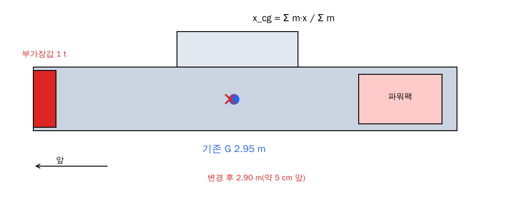{width=100%}

**식:** x_cg = Σ(mᵢ·xᵢ) / Σmᵢ(y, z 동일). CAD 질량 특성 + 실제 부품 질량 보정.

**예 \[가정\]**

| 구성품 | 질량 | 위치(앞에서) | m·x |
|----------------------------------|--------------|-----------------------------------|-----------------|
| 차체 | 30 t | 2.5 m | 75 |
| 포탑 | 12 t | 3.0 m | 36 |
| 파워팩(후방) | 5 t | 5.5 m | 27.5 |
| 합계 | 47 t | **2.95 m** | 138.5 |
| + 전면 부가장갑 1 t | 48 t | **2.90 m** | 139.0 |

→ 부가장갑 1 t으로 무게중심이 **약 5 cm 앞으로**: 앞쪽 현수 하중↑, 차체 피치 자세 변화, 사격 안정성·등판 특성 변화.

**무게중심이 영향을 주는 것:** 전복(정적·동적), 로드휠·바퀴별 하중 → 현수·궤도 수명, 사격 시 차체 거동, 등판·측경사, 도하 부력 균형, 수송 고정.

**측정:** 저울로 축하중 → 수평 위치, **기울기법** → 높이. 계산값과 비교해 차이를 설계에 반영.

**최적화 수단:** 무거운 구성품(파워팩·탄약·연료·배터리) 위치, 경량 소재, 구조 경량화, 최후 수단으로 균형추.

```{=openxml}
<w:p><w:r><w:br w:type="page"/></w:r></w:p>
```

# 파트 3-3 구조·기구 설계

**직무 \| 차량·포탑·방탄강·부가장갑·시스템 프레임**

## 구조 안정성 해석에서 확인하는 6가지

| 항목 | 질문 | 도구 |
|------------|-----------------------------------------------|-----------------------------------------|
| 강도 | 부서지거나 영구변형되지 않나 | 정적 해석, von Mises |
| 강성 | 기능에 문제될 만큼 휘지 않나 | 처짐, 고유진동수 |
| 좌굴 | 얇은 판·긴 부재가 불안정해지지 않나 | 선형·비선형 좌굴 해석 |
| 피로 | 반복하중에 균열이 생기지 않나 | 하중 이력 + S-N + Miner |
| 충격 | 사격·낙하·지면 충격 | 과도 해석, 명시적 해석, SRS |
| 전복·자세 | 장비가 넘어지거나 자세가 무너지지 않나 | 모멘트 평형, 다물체동역학 |

## 부품별 설계 포인트

| 대상 | 핵심 하중·이슈 | 설계 포인트 |
|----------------|-----------------------------|------------------------------------------------------|
| **차체** | 주행 진동, 비틀림, 현수 하중, 방호 | 박스 단면, 개구부 보강, 용접부 피로 |
| **포탑** | 사격 반동, 선회 관성, 자중 | 트러니언 → 포탑 → 포탑 링 베어링 → 차체 하중 경로, 체결부 피로 |
| **방탄강** | 경도 vs 인성, 용접·성형 | 열영향부 연화·균열, 예열, 저온 인성 |
| **부가장갑** | 중량·무게중심 변화, 장착 체결 | 볼트·브래킷의 진동·충격·피로, 탈부착, 수송 제원, 갈바닉 |
| **시스템 프레임** | 탑재 장비 하중, 차량 진동 | 폐단면, 크로스멤버, 방진 마운트, 무게중심 |

## 해석 툴 이해

- **CATIA·NX·SolidEdge:** 3D 설계. 대형 체계는 **상위 골격(스켈레톤) 기준 하향식 설계**로 구성품 위치·인터페이스를 관리.
- **SolidWorks Simulation·CATIA 해석 기능:** 설계 단계 선형 정적·모달 검토에 편리.
- **Abaqus·ANSYS:** 접촉·소성·큰 변형 같은 **비선형**, 충격·폭발 같은 **명시적 동해석**까지. 방탄·충격은 후자.
- **답변:** "SolidWorks 계열과 CATIA V5로 모델링·도면·정적 해석을 했고, 원리는 같아서 빠르게 전환할 수 있습니다. 대형 어셈블리 관리와 비선형 해석은 입사 후 집중적으로 익히겠습니다."

```{=openxml}
<w:p><w:r><w:br w:type="page"/></w:r></w:p>
```

# 파트 3-4 시험평가·형상관리·기술자료

**직무 \| 설계를 증명하고 기록하는 일**

## 시험절차서 템플릿

| 항목 | 내용 | 예(AGV 리프트를 다시 시험한다면) |
|-------------|---------------------------------|------------------------------------------------------|
| 목적·근거 | 검증할 요구사항, 적용 규격 | 적재 100 kg 상태 최대 높이 정지 안정성 |
| 시험품 | **형상(버전)**, 수량 | 리프트 Rev.○, 1대 |
| 장비·계측 | 장비, 센서 위치·범위, **교정 상태** | 하중 추, 경사계, 변위 센서 |
| 조건 | 하중·순서·환경 | 하강 → 최대 상승 → 3분 유지, 3회 반복 |
| 절차 | 단계별 방법 | 1) 적재 2) 상승 3) 측정 … |
| **판정 기준** | 합격 기준값 | 상판 기울기 ○° 이하, 처짐 ○ mm 이하, 이상음 없음 |
| 안전 | 위험·중단 기준 | 전도 방지 고정, 출입 통제 |
| 기록 | 데이터 양식, 이상 처리 | 측정표, 사진, 이상 보고 |

**개발시험평가(DT&E) vs 운용시험평가(OT&E):** 기술적 요구성능 달성 여부 vs 실제 운용 환경에서의 적합성.

**MIL-STD-810:** 고온·저온·습도·염수·모래먼지·진동·충격 등 환경시험 방법. 핵심은 실제 운용 환경에 맞춘 **tailoring**.

## 형상관리

**정의:** 승인된 기준 형상(도면·BOM·규격·소프트웨어)을 정하고, **변경 요청 → 영향 검토 → 승인 → 반영 → 추적**의 절차로 관리.

**왜 필요한가:** **시험한 형상 = 생산된 형상 = 배치된 형상**임을 보장하고, 문제 발생 시 어떤 형상에서 생겼는지 추적.

**설계 변경 시 검토:** 중량·무게중심, 인터페이스, 강도·강성 재해석, 조립성, 재시험 필요 여부, 도면·BOM 갱신, 이미 생산된 물량 적용 범위.

## 기술검토서 템플릿

1\. 배경·문제 정의 → 2. 현상·데이터 → 3. 원인 분석(후보와 판별 근거) → 4. 대안 비교(효과·부담·일정·비용) → 5. 결론·권고 → 6. 검증 계획 → 7. 근거 자료. **PT 발표 구조와 같은 흐름**입니다.

```{=openxml}
<w:p><w:r><w:br w:type="page"/></w:r></w:p>
```

# 방산 개발 심화와 신뢰도 계산

**개발 지식 \| 일반 개념과 학습용 계산 — 사업별 실제 절차는 별도 확인**

## 무기체계 획득의 큰 흐름

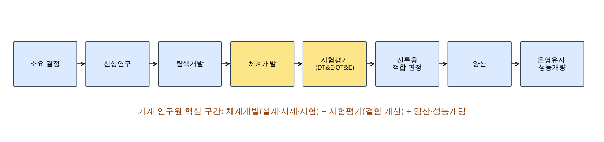{width=100%}

국내 무기체계 연구개발은 일반적으로 **소요 결정 → 선행연구 → 탐색개발 → 체계개발 → 시험평가(개발시험평가·운용시험평가) → 전투용 적합 판정 → 양산 → 배치·운영유지**의 흐름으로 이해할 수 있습니다. 사업 유형(국내 연구개발, 구매, 성능개량 등)에 따라 단계와 명칭이 달라질 수 있으므로 "일반적으로"라는 말을 붙여 설명하세요. \[16,27\]

| 단계 | 기계 연구원이 주로 하는 일 | 대표 산출물 |
|-------------|------------------------------------------------------|----------------------------------|
| 탐색개발 | 핵심 기술 개념 검증, 대안 비교, 위험 요소 식별 | 개념 설계, 기술 검증 시험 결과 |
| 체계개발 | 상세설계, 시제 제작, 구성품·체계 시험, 결함 개선 | 도면, 해석·시험 보고서, 규격서 |
| 시험평가 | 시험 지원, 결함 원인 분석, 설계 변경 | 결함 조치 보고서, 형상 변경 자료 |
| 양산 | 양산성 개선, 공정·품질 문제 대응, 원가 절감 설계 | 양산 도면, 기술 변경 자료 |
| 운영유지·성능개량 | 야전 고장 분석, 수명 연장, 개량형 설계 | 고장 분석 보고서, 개량 설계 |

**연결 답변:** "설계는 시제 제작 전에 끝나는 것이 아니라 시험평가와 양산, 야전 운용에서 나온 데이터로 계속 개선된다고 이해하고 있습니다."

## 국산화와 수출통제를 이해하기

해외 구성품(엔진·변속기·센서 등)을 쓰면 해당 국가의 **수출 승인**이 필요해 수출 대상국이 제한되거나 일정이 지연될 수 있습니다. 국산화는 공급망과 수출 자유도를 높이는 수단입니다. 기계 R&D 관점에서 국산화는 단순 대체가 아니라 다음을 다시 증명하는 일입니다.

1\. **형상·인터페이스 호환:** 장착 위치, 체결, 배관·배선, 무게중심 변화.

2\. **성능 동등성:** 출력·토크 곡선, 효율, 발열량, 응답 특성.

3\. **환경·내구:** 고온·저온·고지·먼지 조건의 시동과 연속 운전, 누적 주행 내구.

4\. **체계 영향:** 냉각계통 용량, 진동 특성 변화에 따른 마운트 재설계, 정비 절차·공구 변경.

## 신뢰도 기본 계산

**고장률이 일정한 경우(지수분포):** R(t) = e^(−λt), MTBF = 1/λ (수리 가능 시스템에서 일정 고장률 가정).

예: MTBF = 1,000시간이면 100시간 임무의 신뢰도는 R = e^(−0.1) ≈ 0.905입니다. **t = MTBF일 때 R = e^(−1) ≈ 0.368**입니다. 즉 MTBF만큼 운용하면 고장 없이 버틸 확률은 약 37%에 불과합니다. "MTBF를 수명으로 해석하지 않는다"는 원본의 경고가 여기서 나옵니다.

**직렬 구성(하나라도 고장 나면 기능 상실):** Rs = R1 × R2 × … × Rn, 고장률은 λs = Σλi.

예: 신뢰도 0.99인 구성품 20개가 직렬이면 0.99²⁰ ≈ 0.818입니다. 부품 수가 늘면 체계 신뢰도가 빠르게 떨어집니다. **부품 수 감소·단순화가 신뢰도 설계**인 이유입니다.

**병렬 구성(모두 고장 나야 기능 상실, 이중화):** Rp = 1 − (1 − R1)(1 − R2).

예: 0.9인 장치 두 개를 이중화하면 1 − 0.1² = 0.99. 다만 무게·공간·비용이 늘고, 두 장치가 **공통 원인(같은 전원·같은 오염·같은 진동)**으로 함께 고장 나면 이 계산은 과대평가됩니다.

## 고장률 곡선과 와이블 분포

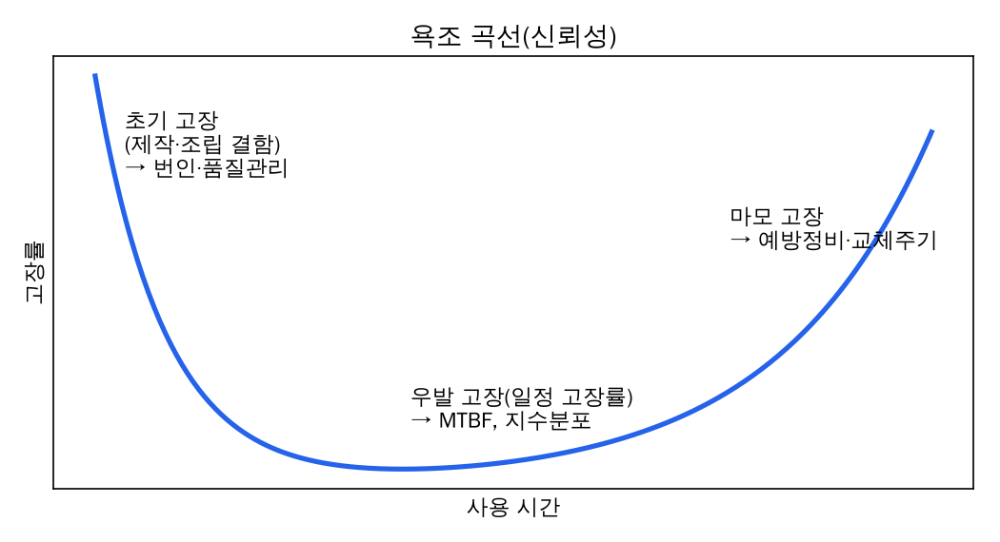{width=80%}

**욕조 곡선:** 초기 고장(제작·조립 결함, 고장률 감소) → 우발 고장(일정) → 마모 고장(증가). 초기 고장은 번인·스크리닝·품질관리로, 마모 고장은 예방정비·교체주기로 다룹니다.

**와이블 형상모수 β:** β < 1이면 초기 고장형, β ≈ 1이면 우발 고장형(지수분포), β > 1이면 마모 고장형입니다. 베어링·기어처럼 피로로 고장 나는 기계 부품은 보통 β > 1입니다. "기계 부품에 일정 고장률(지수분포)을 그대로 적용하면 마모 특성을 놓칠 수 있다"는 말을 할 수 있으면 좋습니다.

## 가속수명시험의 원리

실제 수명을 시험하기 어렵기 때문에 응력(온도·하중·진동)을 높여 고장을 빨리 일으키고, 모델로 사용 조건 수명을 추정합니다.

**온도 가속(아레니우스 모델):** AF = exp[(Ea/k)(1/T_use − 1/T_test)], 온도는 절대온도. 주로 화학 반응형 열화(전자부품, 고무·윤활 열화)에 쓰입니다.

**하중 가속(역누승 법칙):** 수명 ∝ 1/S^m. 피로에서 응력을 높여 시험하는 원리와 같습니다. 예: m = 3일 때 하중을 1.26배 높이면 수명은 약 1/2(1.26³ ≈ 2).

**주의:** 가속 조건에서 **실제와 다른 고장 모드**가 나오면 그 시험은 무효입니다. 예를 들어 온도를 너무 높여 사용 조건에서 일어나지 않는 재료 연화가 생기면 안 됩니다. "고장 모드가 같은지 먼저 확인한다"는 문장이 핵심입니다.

## MIL-STD-810 주요 시험 방법 ★

| 방법 | 환경 | 기계 설계에서 볼 점 |
|-----------------|-----------------|-----------------------------------------------------------------|
| 500 | 저압(고도) | 밀폐 부품 압력차, 냉각 공기 밀도 감소 |
| 501 / 502 | 고온 / 저온 | 열팽창 차이, 재료 강도·인성, 윤활·씰, 시동 |
| 503 | 온도 충격 | 이종 재료 접합부 균열, 열응력 |
| 505 | 일사 | 표면 온도 상승, 고분자 열화 |
| 507 | 습도 | 부식, 전기 절연, 결로 |
| 509 | 염수분무 | 부식, 이종금속 갈바닉 부식, 코팅 |
| 510 | 모래·먼지 | 마모, 필터 막힘, 씰 손상, 냉각 저하 |
| 512 | 침수 | 밀봉, 배수 |
| 514 | 진동 | 공진, 체결 풀림, 피로 |
| 516 | 충격 | 순간 가속도, 장착부 파손, 기능 유지 |
| 521 | 결빙·동결비 | 가동부 고착, 하중 증가 |

시험 방법 번호를 모두 외울 필요는 없습니다. 중요한 것은 원본에서 강조한 **tailoring**입니다. "제품의 수명주기 동안 실제로 겪는 환경(운송·보관·주행·사격)을 먼저 정의하고, 거기에 맞춰 시험 방법·수준·순서를 정한다"고 말하세요. \[14\]

함께 알아두면 좋은 규격: 전자파 적합성(MIL-STD-461), 소음(MIL-STD-1474), 인간공학(MIL-STD-1472). 기계 연구원이 직접 담당하지 않더라도 **차폐·접지 구조, 소음원 배치, 정비 자세와 손 접근 공간**은 기계 설계와 맞닿아 있습니다.

## 정비성 설계의 구체적 예

| 원칙 | 설계 예 |
|---------------------|-------------------------------------------------------------------------------|
| 접근성 | 자주 교체하는 필터·벨트를 장갑판 해체 없이 접근 가능한 위치에 |
| 모듈화 | 파워팩 일체 탈착(엔진+변속기+냉각)으로 야전 교체 시간 단축 |
| 오조립 방지 | 비대칭 핀·커넥터, 방향 표시(실수 방지 설계) |
| 공구 최소화 | 볼트 규격 통일, 특수 공구 최소화 |
| 고장 진단 | 압력·온도 점검 포트, 상태 센서(디지털 정비와 연결) |

"MTTR을 줄이는 설계"를 질문받으면 위 표에서 두 가지를 골라 본인 경험과 연결하세요.

```{=openxml}
<w:p><w:r><w:br w:type="page"/></w:r></w:p>
```

# 파트 4-1 AGV 리프트 논리 시나리오

**자소서 경험 보충 \| 직무역량 문항의 근거를 숫자와 논리로 완성**

**이 장의 원칙:** 본인이 말한 사실 + STL 모델에서 읽은 형상 + 공학 원리로 논리를 세웠습니다. **[가정]**은 계산 방법을 보여주기 위한 값이고, **[확인]**은 면접 전 본인이 사실을 맞춰야 하는 항목입니다. 계산 결과를 "당시 계산값"처럼 말하지 말고, "면접을 준비하며 다시 계산해 보니"라고 구분해서 말하세요.

## 1 사실 정리

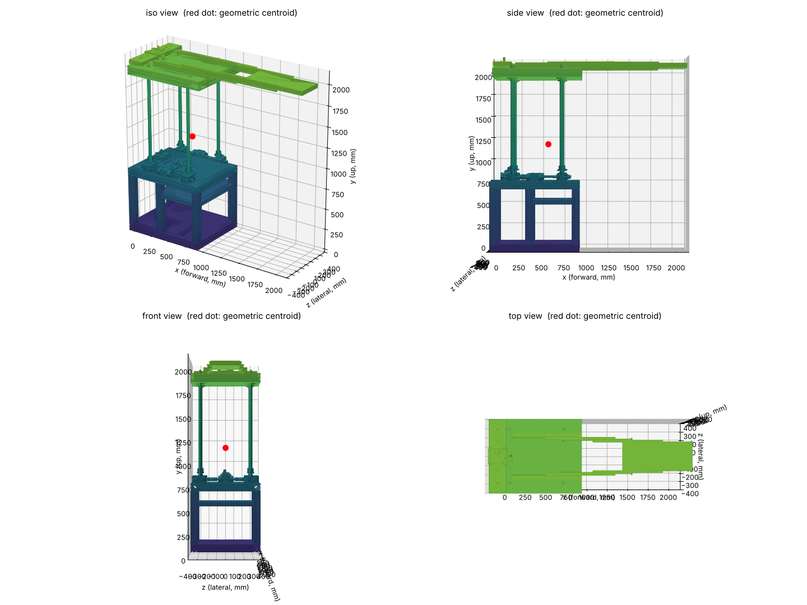{width=100%}

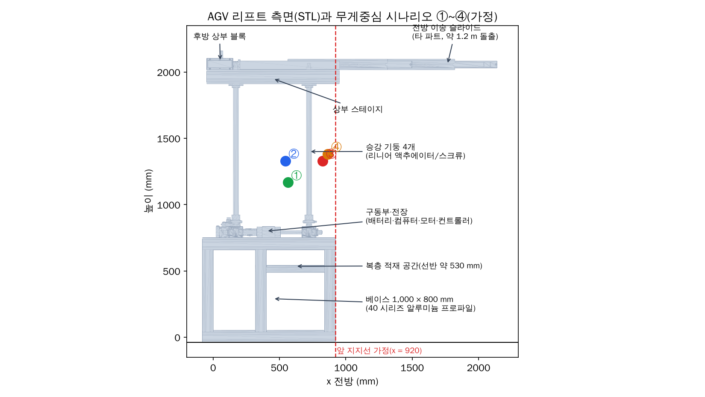{width=100%}

| 항목 | 내용 | 출처 |
|------------|----------------------------------------------------------------------------|-------------|
| 목적 | 조선소 블록 내부에서 용접로봇을 들어 올리고 작업 위치로 이송 | 자소서 |
| 외곽 제약 | **블록 내부에서 활동하기 위한 조건**으로 약 1.2 m 이내 | 본인 |
| 초기안 | 약 1.2 × 1.2 m에 가까운 외곽 | 본인 |
| 최종안 베이스 | 1,000(전후) × 800(좌우) mm, 높이 약 790 mm, 40 시리즈 알루미늄 프로파일(80×80, 40×80) + 10 mm 판 | STL |
| 복층 | 베이스 안쪽 약 530 mm 높이의 중간 선반(적재 공간) | STL·자소서 |
| 승강 | 4개 기둥, **리니어 액추에이터 또는 스크류 방식** 리프트, 모델의 최대 높이까지 상승(스테이지 하면 약 1.9 m) | 본인·STL [방식 확인] |
| 전방 이송 | 텔레스코픽 슬라이드(베이스 앞 끝보다 약 1.2 m 돌출) — **타 파트 담당** | STL·본인 |
| 하중 목표 | **적재 100 kg**(기타 장비 포함 추정), 로봇은 작업자가 **중심 근처**에 배치 | 본인 |
| 무게중심 대책 | **적재 공간, 배터리, 컴퓨터, 모터, 컨트롤러** 등 배치로 무게중심을 후방(·하부)으로 | 본인 |
| 설계 툴 | CATIA V5 설계, 해석 \[SolidWorks Simulation 확인\] | 이력·본인 |
| 검증 | 정적 하중 해석 → **프로토타입 제작**: 적재 후 이동 가능 여부, 모터 구동, 제어 확인 | 이력·본인 |
| 본인 역할 | **리프트 설계**. 리프트가 체계의 중심이자 타 파트(구동부·전방 이송부·전장)와 연결되는 부분이라 인터페이스 조율 | 본인 |

## 2 크기 축소, 어떻게 말할까

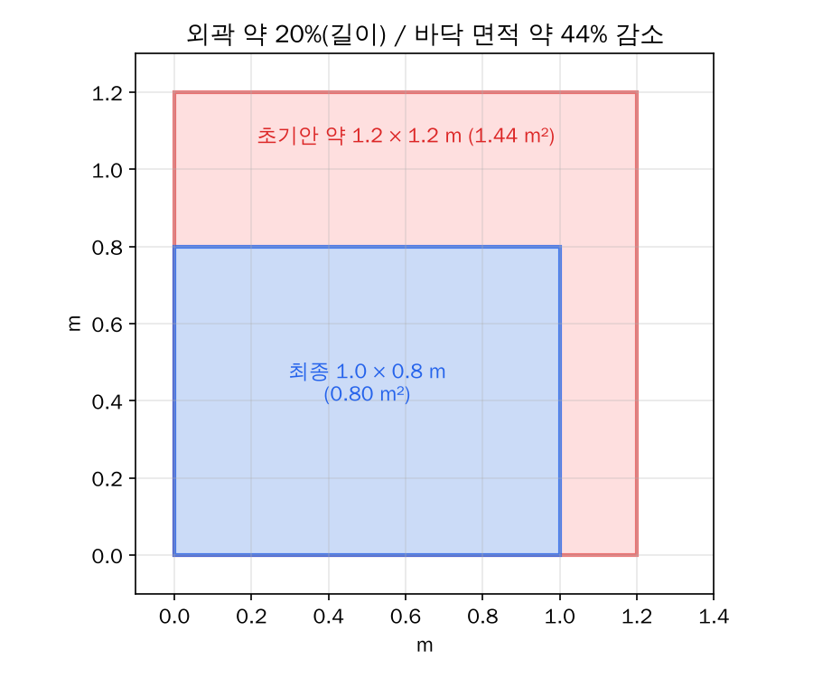{width=58%}

| 기준 | 초기안 | 최종안 | 변화 |
|--------------------|---------------------------|---------------------|---------------------------------|
| 길이 | 약 1.2 m | 1.0 m | 약 17% 감소 |
| 폭 | 약 1.2 m | 0.8 m | 약 33% 감소 |
| **바닥 면적** | 약 1.44 m² | 0.80 m² | **약 44% 감소** |

**권장 표현:** "자소서에는 외곽 치수 기준으로 보수적으로 **약 20%**라고 썼고, 바닥 면적 기준으로는 약 1.44 m²에서 0.8 m²로 **약 44%** 줄었습니다." [확인: 자소서의 20%를 무엇으로 계산했는지]

## 3 설계 논리 7단계

### 1단계: 제약을 요구조건으로 바꾸기

블록 내부 작업이라는 조건에서 네 가지 요구가 나옵니다.

1. **외곽 제한:** 블록 내부를 이동·작업하려면 약 1.2 m 이내
2. **높이:** 용접 위치까지 로봇을 들어 올릴 높이(모델 기준 스테이지 약 1.9 m)
3. **적재:** 100 kg + 로봇 외 장비를 실을 추가 공간
4. **안정성:** 높이 올리고 앞으로 이송할 때 넘어지지 않을 것

**면접 문장:** "블록 내부라는 공간 제약 때문에 외곽을 키울 수 없었고, 그 안에서 높이·적재 공간·안정성을 동시에 만족해야 했습니다."

### 2단계: 초기안의 문제 — 긴 액추에이터

**초기 접근:** 바닥 가까이에서 출발해 긴 액추에이터 하나로 높이를 확보.

**문제가 된 이유(공학적 근거)**

| 문제 | 원리 |
|---------------------|-------------------------------------------------------------------------------|
| 접힌 높이 증가 | 액추에이터는 접혀도 **본체 길이 + 행정 길이**가 남아, 행정이 길수록 접힌 상태 높이도 커짐 |
| 비용·크기 | 긴 행정 규격은 비싸고, 본체가 커져 다른 부품 배치 공간을 잠식 |
| **좌굴·옆 하중** | 압축 부재의 좌굴하중은 길이 제곱에 반비례. 길어질수록 더 굵은 로드·가이드 필요 |
| 적재 공간 부족 | 액추에이터 옆에 적재 공간을 두면 외곽이 1.2 × 1.2 m까지 커짐 |

**숫자 감각 \[가정\]:** 목표 스테이지 높이 약 1.9 m.

- 바닥(약 0.3 m)에서 출발 → 필요 행정 약 1.6 m
- 베이스 위(약 0.75 m)에서 출발 → 필요 행정 약 1.1 m
- 같은 로드라면 좌굴 강도는 (1.6/1.1)² ≈ **2.1배 차이** → 긴 쪽은 더 굵고 비싼 규격 필요

### 3단계: 발상 전환 — 복층 구조

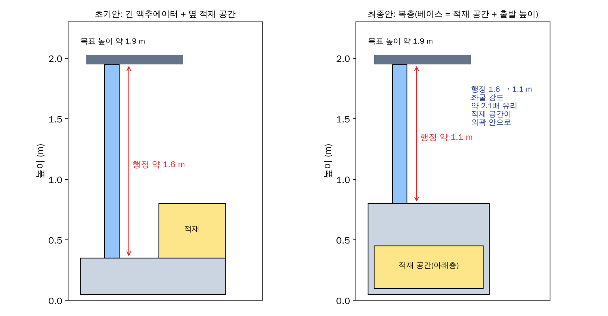{width=100%}

**아이디어:** 적재 공간을 액추에이터 **아래층(베이스 내부)**에 두고, 그 위를 구동부 장착면으로 사용.

**한 번에 두 가지가 해결되는 이유**

1. **베이스 높이 자체가 "공짜 초기 높이"가 됨:** 베이스가 약 0.75 m이므로 액추에이터는 그만큼 짧은 행정으로 목표 높이 도달 → 비용·크기·좌굴 동시 개선
2. **적재 공간이 외곽 안으로 들어감:** 옆에 붙어 있던 공간이 아래로 들어가 바닥 면적 감소(1.2 × 1.2 → 1.0 × 0.8 m)

**면접 문장:** "사양을 키우는 대신 구조를 바꿨습니다. 베이스를 적재 공간으로 쓰면서 동시에 리프트의 출발 높이로 써서, 행정은 줄이고 공간은 확보했습니다."

**예상 반론과 답:** "복층이면 무게중심이 올라가지 않나요?" → "구동부가 베이스 위로 올라간 대신, **무거운 배터리·컴퓨터·모터·컨트롤러를 아래층·후방에 배치**해 무게중심 상승과 전방 이동을 상쇄했습니다." (4단계)

### 4단계: 배치와 무게중심 — 체계설계의 핵심

**원리:** 전복을 막는 것은 **버티는 모멘트(무게 × 무게중심~앞 지지점 거리 d) vs 넘어뜨리는 모멘트(관성력 × 무게중심 높이 h)**입니다. 전후 전복 한계 감속도 **a = g × d / h**.

| 배치 원칙 | 효과 |
|---------------------------------------------------------|-------------------------------------------|
| 무거운 부품을 **뒤로** | d 증가 → 버티는 모멘트 증가 |
| 무거운 부품을 **아래로** | h 감소 → 넘어뜨리는 모멘트 감소 |
| 적재물을 아래층에 | 적재 하중이 높이 올라가지 않음 |
| 앞쪽 돌출 하중(슬라이드·로봇)은 타 파트와 범위 협의 | 최악 조건을 미리 정의 |

**본인이 옮긴 것:** 적재 공간, 배터리, 컴퓨터, 모터, 컨트롤러. **"충분한가?"** → 충분합니다. 이 부품들은 체계에서 가장 무겁고 위치를 바꿀 수 있는 항목이라, 체계설계에서 무게중심을 조정하는 대표 수단(파워팩·탄약·연료 배치)과 같은 방식입니다.

### 5단계: 전복 검토(정량화) \[가정\]

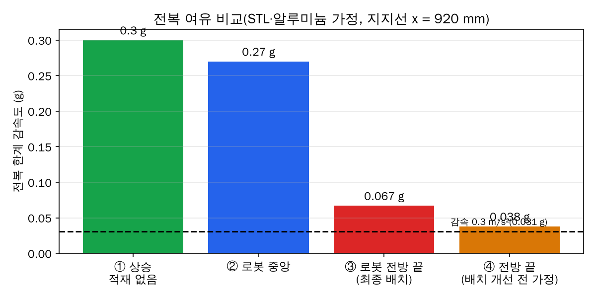{width=85%}

**기준 데이터:** STL 형상을 모두 알루미늄으로 가정한 질량 약 359 kg, 무게중심 x ≈ 563 mm(앞쪽이 +), 높이 ≈ 1,167 mm. 바퀴가 모델에 없어 **앞 지지선을 베이스 앞 끝(x = 920 mm)**으로 가정했습니다. 실제 지지점이 안쪽이면 여유는 더 줄어듭니다. [바퀴 위치 확인]

| 조건 | 총질량 | 무게중심 x | d | h | 전복 한계 감속 |
|-----------------------------------------|-----------|-----------|-----------|-----------|----------------|
| ① 리프트 상승, 적재 없음 | 359 kg | 563 mm | 357 mm | 1,207 mm | 약 0.30 g |
| ② 리프트 상승, 로봇 100 kg 중앙 | 459 kg | 543 mm | 377 mm | 1,410 mm | 약 0.27 g |
| ③ 로봇이 슬라이드 끝까지 이송(최악) | 459 kg | 825 mm | 95 mm | 1,410 mm | **약 0.067 g** |
| ④ ③에서 무거운 부품 60 kg이 300 mm 앞·400 mm 위에 있었다면 | 459 kg | 864 mm | 56 mm | 1,462 mm | **약 0.038 g** |

**읽는 법**

- **로봇이 중앙에 있을 때(②)는 여유가 큽니다.** 위험한 것은 **앞으로 이송한 상태(③)**입니다.
- 무거운 부품을 뒤·아래로 둔 효과: ④ → ③으로 **전복 한계가 약 1.75배**(0.038 → 0.067 g).
- 구동 모터의 감속을 0.3 m/s²(약 0.03 g)로 제한한다면, ④는 여유가 약 1.2배뿐이지만 ③은 **약 2.2배**입니다. **"배치 변경으로 감속 시 전복 여유를 약 2배로 확보"** 같은 논리가 가능합니다.
- 정적 기준으로 슬라이드 끝 허용 하중은 약 359 × 357 / (1,765 − 920) ≈ **150 kg**(여유 0 기준) → 100 kg 목표에 대해 정적 여유 약 1.5배.

**운용 대책(면접 가산점):** 이송 상태에서는 **주행 금지 인터록**, 리프트 높이·돌출량 조합 제한, 감속 제한, 필요 시 작업 중 **지지 다리(아웃리거)**. "설계와 운용 규칙을 함께 정해 안전을 확보한다"는 관점이 체계설계 관점입니다.

**말할 때 주의:** 위 수치는 면접 준비용 재계산입니다. 당시 실제로 한 검토(정적 해석인지, 무게중심 계산인지)를 정확히 말하고, "준비하며 감속 조건까지 다시 계산해 보니 ○○였다"로 구분하세요. [확인]

### 6단계: 구조 해석과 리프트 하중

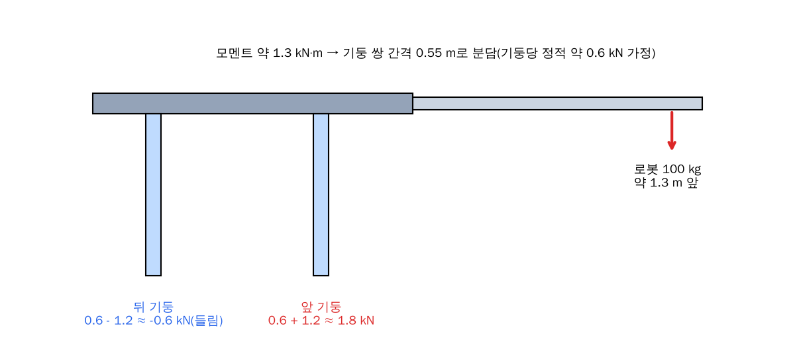{width=100%}

**하중 케이스:** 정지(자중 + 적재 100 kg), 가동(가감속 관성력 등가 정하중), **전방 이송**(슬라이드 하중의 모멘트).

**기둥 하중 감각 \[가정\]:** 스테이지 + 로봇 약 250 kg이 4개 기둥에 걸리면 기둥당 약 0.6 kN. 로봇 100 kg이 기둥 중심에서 약 1.3 m 앞으로 나가면 모멘트 약 1.3 kN·m → 앞·뒤 기둥 간격 약 0.55 m 기준 **앞쪽 기둥 쌍 합계 약 +2.3 kN(기둥당 약 +1.2 kN), 뒤쪽 쌍은 같은 크기만큼 감소**. 뒤쪽 기둥은 0.6 − 1.2 ≈ −0.6 kN으로 **들림(인장)**이 생길 수 있어 액추에이터·가이드가 인장도 견디거나 구속돼야 합니다.

**해석 절차(이전 정리):** 전체 모델은 작은 형상·체결 부품 때문에 메시 품질이 나빠 **하중 경로에 영향이 적은 형상을 단순화**하고 소형 부품은 질량으로 대체 → 응력집중부 확인 → 그 부위만 실제 형상을 살려 세분화 재해석 → 최대 응력 [ ] MPa, 안전율 [ ]. [확인]

**한계와 개선(먼저 말하면 강함):** 정적 해석만 수행, 체결부 본딩 가정, 슬라이드 끝 처짐·기둥 흔들림(모달)·피로 미평가 → 다시 한다면 모달 해석, 처짐 측정, 체결부 접촉 조건 반영.

### 7단계: 타 파트 조율 — 리프트는 체계의 중심

리프트는 **아래로는 구동부·전장(배터리·컴퓨터·모터·컨트롤러)**, **위로는 전방 이송부·로봇**과 연결됩니다. 그래서 조율 항목이 많았습니다.

| 인터페이스 | 조율 내용 |
|---------------------|-------------------------------------------------------------------------------|
| 기계적 | 슬라이드 모듈 장착 위치·볼트 패턴, 스테이지 강성 |
| 하중 | 전방 이송 시 모멘트 → 리프트 기둥·스테이지 설계 하중으로 반영 |
| 공간 | 배터리·컴퓨터·모터·컨트롤러 배치 공간, 적재 공간 |
| 전기 | 배선 경로, 승강 시 케이블 처리 |
| 무게중심 | 각 파트 부품 질량·위치 취합 → 전체 무게중심 관리 |

**조율 답변 틀:** "전장 담당은 배선이 짧은 [위치]를 원했지만, 그러면 무게중심이 [앞/위]로 이동해 전복 여유가 줄었습니다. 두 배치안의 무게중심을 비교한 자료를 공유했고, 배선 경로를 [바꾸는] 조건으로 [후방·하부]에 배치하기로 합의했습니다." [실제 사례로 채우기]

### 8단계: 프로토타입 검증

| 확인한 것 | 검증한 공학적 의미 |
|----------------------------|------------------------------------------------------------------------|
| 적재 후 이동 가능 | 구조가 적재 하중을 견디고, **견인력(모터 토크)이 충분** |
| 모터가 굴릴 수 있는지 | 구동계(모터·감속기·바퀴) 성능, 구름저항·기동 토크 |
| 제어가 되는지 | 속도·방향 제어, 승강 제어 동작 |

**아직 검증하지 못한 것(다음 단계):** 실제 무게중심·전복 여유 측정, 최대 높이·최대 이송 상태 흔들림, 슬라이드 끝 처짐, 장시간 반복 승강 내구, 블록 바닥 요철·경사 주행. → **"다음 시험절차서를 쓴다면"** 파트 3-4 표로 답하기.

## 4 설계 결정 요약표(이 표 하나로 3분 설명 가능)

| 결정 | 이유 | 버린 대안 | 대가(부담) |
|---------------------|---------------------------------|--------------------|---------------------------|
| 복층 구조 | 행정 단축 + 적재 공간 확보 + 외곽 축소 | 긴 액추에이터 | 구동부 위치가 높아짐 |
| 무거운 부품 후방·하부 | 전복 여유 확보(d↑, h↓) | 앞쪽·상부 배치(배선 짧음) | 배선 경로 길어짐, 접근성 검토 필요 |
| 알루미늄 프로파일 | 경량, 조립·수정 용이(시제품) | 강 용접 프레임 | 강성 1/3, 체결부 관리 |
| 4기둥 승강 | 스테이지 넓은 지지, 모멘트 분담 | 단일 기둥 | 동기화 필요 |
| 정적 해석 + 국부 재해석 | 저속 준정적 + 효율적 정밀 검토 | 전체 정밀 동해석 | 동적·피로 미평가 |

## 5 말하기 스크립트

**1분 버전:** "조선소 블록 내부에서 용접로봇을 올려 작업 위치로 보내는 AGV의 리프트를 설계했습니다. 블록 내부를 다니려면 외곽이 약 1.2 m 안이어야 했는데, 긴 액추에이터로 높이를 확보하니 행정이 길어져 비용·크기·좌굴 문제가 생겼고 적재 공간도 부족했습니다. 그래서 베이스를 적재 공간으로 쓰는 복층 구조로 바꿔, 베이스 높이만큼 출발 높이를 확보해 행정을 줄였고 적재 공간도 외곽 안에 넣었습니다. 초기 약 1.2 × 1.2 m에서 1.0 × 0.8 m로 줄었습니다. 또 로봇이 앞으로 이송될 때 전복 여유가 크게 줄어, 배터리·컴퓨터·모터·컨트롤러를 뒤쪽·아래쪽에 배치해 무게중심을 옮겼습니다. 리프트가 구동부와 이송부를 잇는 중심이라 각 파트와 배치·하중을 조율했고, 정적 해석 후 프로토타입으로 적재 이동과 구동·제어를 확인했습니다."

**30초 버전:** "외곽 1.2 m 제약 안에서 높이와 적재 공간을 확보하기 위해, 긴 액추에이터 대신 베이스를 적재 공간 겸 출발 높이로 쓰는 복층 구조로 바꿨고, 앞으로 이송할 때의 전복을 막기 위해 무거운 부품을 뒤·아래로 배치했습니다."

## 6 꼬리질문 30선

| 질문 | 답변 방향 |
|------------------------|----------------------------------------------------------------------------|
| 1.2 m 제한은 어디서 왔나? | 블록 내부 이동·작업 조건 [출입구·통로 치수 확인] |
| 리프트 방식은? | 리니어 액추에이터/스크류 [확인]. 스크류는 자기잠금으로 정전 시 하중 유지, 볼스크류·리니어는 브레이크 |
| 4기둥 동기화는? | 기계적 연결 또는 엔코더 위치 동기 [확인]. 안 맞으면 기울어짐·바인딩 |
| 액추에이터 추력 계산은? | 하중 + 가속 + 마찰 + 여유. 기둥당 정적 약 0.6 kN, 전방 이송 시 앞쪽 증가 |
| 행정이 길면 왜 불리? | 접힌 길이↑, 좌굴(길이²)·옆 하중 취약, 비용↑ |
| 복층의 단점? | 구동부가 높아짐 → 무거운 부품 하부 배치로 상쇄 |
| 20% 기준? | 외곽 치수 기준, 면적으로는 약 44% |
| 무게중심은 어떻게 구했나? | CAD 질량 특성 + 실제 부품 질량 보정 [확인] |
| 전복은 어떻게 판단? | 모멘트 평형, a = g·d/h, 최악 조건 = 최대 높이 + 최대 이송 |
| 바퀴 위치는? | [확인]. 안쪽일수록 여유 감소 |
| 경사·요철은? | 경사각만큼 여유 감소(tanθ = d/h 비교) [고려 여부 확인] |
| 다른 전복 대책은? | 아웃리거, 이송 중 주행 금지 인터록, 감속 제한, 높이·돌출 제한 |
| 정적 해석으로 충분? | 저속 준정적 근사. 진동·피로·충격은 한계 |
| 단순화 근거? | 하중 경로·강성 영향 작은 형상만, 응력집중부는 실제 형상 재해석 |
| 국부 해석 경계조건? | 전체 모델 결과(하중·변위)를 충분히 떨어진 경계에 적용 |
| 메시 수렴? | [확인]. 미수행 시 한계로 인정 |
| 특이점? | 날카로운 모서리·점구속 값은 판단에서 제외 |
| 체결부 모델링? | 본딩 가정이면 강성 과대·미끄럼 미반영 한계 |
| 최대 응력 위치·값? | [확인] |
| 슬라이드 끝 처짐? | 외팔보(L³), 레일 유격 누적 → 용접 정밀도. [검토 여부] |
| 진동은? | 높고 가는 구조 + 끝단 질량 → 낮은 고유진동수 → 모달 해석 필요 |
| 왜 알루미늄? | 경량·조립·수정 용이, 대신 강성 1/3·체결부 관리 |
| 프로파일 규격? | 40 시리즈(80×80, 40×80) |
| 시제품에서 문제는? | [실제 발견 문제와 수정] |
| 시제품에서 못 본 것? | 전복 여유 실측, 처짐·흔들림, 반복 내구 |
| 본인 역할 범위? | 리프트 설계 + 리프트 중심 인터페이스 조율 |
| 조율에서 갈등은? | 배치(무게중심) vs 배선·접근성, 비교 자료로 합의 |
| 전방 이송부는 몰라도 되나? | 타 파트 설계지만 **그 하중·돌출량은 리프트 설계 조건**으로 받아 반영 |
| 다시 한다면? | 바퀴 포함 무게중심 실측, 모달·처짐, 이송 중 인터록, 시험절차서 |
| 우리 업무와 연결? | 체계 레이아웃·중량·무게중심 최적화와 같은 구조의 문제 |

## 7 숫자 카드(면접 직전 암기)

| 항목 | 값 |
|---------------------|-------------------------------------------------------------------------------|
| 외곽 | 초기 약 1.2 × 1.2 m → 1.0 × 0.8 m(외곽 약 20%, 면적 약 44%) |
| 베이스 높이 | 약 0.79 m(복층 선반 약 0.53 m) |
| 스테이지 최대 높이 | 하면 약 1.9 m |
| 전방 돌출 | 베이스 앞 끝에서 약 1.2 m(타 파트) |
| 적재 목표 | 100 kg |
| 프레임 | 40 시리즈 알루미늄 프로파일 |
| 전복 한계 | a = g × d / h |
| 재계산 예 | 최악 조건 약 0.067 g, 배치 개선 전 약 0.038 g(약 1.75배) \[가정\] |

```{=openxml}
<w:p><w:r><w:br w:type="page"/></w:r></w:p>
```

# 파트 4-2 다른 경험 보충과 문항별 방어

**자소서 경험 보충 \| 주인의식·차별성·변화 수용성 문항**

## 로봇팔 병 던지기(주인의식)

**흐름:** 반복할수록 성공률 하락 → 영상 분석 → 원인 후보(병 초기 위치 편차, 누적 진동) → 지그 보강·위치 가이드·휴지 시간·속도/각도 조정 → **46 → 97회/100회**.

**기계 직무 연결:** 원인이 제어 파라미터가 아니라 **지그·고정 방식 같은 기구적 원인**이었다는 점을 강조. 체계 조립·시험 중 이상 현상을 데이터로 좁히는 태도와 같습니다.

| 꼬리질문 | 답변 방향 |
|--------------------------|--------------------------------------------------------------------------|
| 가장 효과가 컸던 개선은? | [위치 가이드 등 실제 항목과 성공률 변화]. 여러 개선을 연속 적용해 완전히 분리하지 못한 점은 한계, 다시 한다면 하나씩 바꿔 검증 |
| 누적 진동은 측정했나? | 영상 관찰 + 휴지 시간 추가 시 개선으로 확인 [사실대로] |
| 왜 반복할수록 떨어졌나? | 지그 흔들림·체결 풀림·위치 편차 누적 등 후보 중 확인한 것 |
| 휴지 시간의 대가는? | 사이클 타임 증가, 허용 범위 판단 [시간] |
| 성공 기준은? | 목표 위치 범위 정의, 100회 동일 조건 [확인] |

## 열화상 객체 인식(차별성)

**흐름:** 데이터·모델 개선 효과 미미 → **입력 영상 자체**를 의심 → 거리·각도 조절 플랫폼으로 촬영 조건 통제 → 강한 열원으로 저온 객체 대비 저하 확인 → 16bit Raw 기반 명암 범위 조정, CLAHE, 윤곽 강조 등 전처리 조합 비교 → 소화기 검출률 **약 40 → 70%**.

**차별성의 핵심:** 기법(CLAHE)이 아니라 **문제를 보는 관점의 전환**과 **조건을 통제한 비교 실험**. 시험평가 역량의 근거로 사용.

| 꼬리질문 | 답변 방향 |
|-----------------------|-----------------------------------------------------------------------------|
| 그게 차별화된 아이디어인가? | 모두가 모델을 키울 때 센서 입력 조건으로 원인 범위를 넓힌 것, 플랫폼으로 변수 통제 |
| 기계 직무와 관련? | 플랫폼 설계(본인 여부 확인), 센서 장착 조건이 성능을 좌우 → 유무인복합체계 |
| 검출률 정의? | Recall/mAP, 테스트 데이터 수 [확인] |
| 과적합 아닌가? | 다른 조건 검증 여부 [확인] |
| 70%면 낮지 않나? | 한계 인정 + 남은 실패 원인과 다음 방향 |

## Jetson 실시간화(변화 수용성)

**흐름:** 기구 설계 → AI·임베디드라는 **다른 분야를 맡게 된 변화** → YOLO 구조(Depth/Width) 학습, 단일 채널 반영, 경량화(**1.76M 파라미터, 3.9 GFLOPs**) → ONNX 변환, TensorRT FP16 → 온보드 실시간 검출.

| 꼬리질문 | 답변 방향 |
|--------------------------|--------------------------------------------------------------------------|
| 그게 큰 변화인가? | 기구 설계자가 전혀 다른 분야를 맡은 것 자체가 가장 큰 변화 |
| 생성형 AI vs 방산 보안? | 보조 도구였고 핵심은 실험 검증. 입사 후 보안 규정 준수, 사내 자료·규격·선배 검토로 학습 |
| 몇 FPS? 정확도 변화? | [반드시 준비] |
| FP16이면 정확도는? | 일반적으로 작은 손실, 실험으로 확인 [실제 값] |

## 무인 해상구조 로봇(이력 보조 경험, 팀장)

**흐름(이력 기준):** 팀장으로 부품 배치·전체 시스템 조정, 탑재 PC 연산 한계 → 외부 PC가 인명 탐지 담당, 로봇은 영상·정보 전달로 **기능 분담** → 실시간성 확보, 본선 시연.

**쓰임:** "협업·리더 경험", "자원 제약 속 시스템 구성" 질문의 보조 사례. **기능 배분(체계 관점)** 사례로도 좋습니다. [본인 역할·성과 확인]

## 지원동기 문항 방어

| 예상 질문 | 핵심 답변 |
|---------------------|-------------------------------------------------------------------------------|
| 왜 한화에어로스페이스? | 1파트 "왜 한화" 완성 답변(AGV 무게중심 경험 → 체계설계 → K9·천무) |
| 왜 방산·지상? | 극한 환경·장기 운용·높은 신뢰성 요구 속에서 운용 조건까지 고려하는 설계 |
| 형상관리를 아나? | 승인 기준 형상 + 변경 통제 → 시험 형상 = 생산 형상 보장 |
| 체계 완성도란? | 구성품 개별 최적이 아니라 인터페이스를 맞춰 전체 요구 만족 |
| 입사 후 5년? | 제품 구조·설계 기준·형상관리 습득 → 변경 영향(중량·조립성·운용 안정성) 판단 → 여러 분야 조율로 체계 완성도 |

## 1분 자기소개(최종)

> "장비의 배치와 무게중심까지 고려해 설계하는 지원자 [이름]입니다.
>
> 조선소 블록 내부에서 용접로봇을 들어 올리고 이송하는 AGV의 리프트를 CATIA V5로 설계했습니다. 외곽 1.2 m 제약 안에서 긴 액추에이터 대신 베이스를 적재 공간 겸 출발 높이로 쓰는 복층 구조로 바꿔 행정을 줄이고 공간을 확보했으며, 외곽을 약 20% 줄였습니다. 로봇이 앞으로 이송될 때의 전복을 막기 위해 배터리·컴퓨터·모터·컨트롤러를 뒤쪽·아래쪽에 배치해 무게중심을 옮겼고, 프로토타입으로 적재 이동과 구동을 확인했습니다.
>
> 또 로봇팔 반복 시험과 열화상 연구에서 조건을 통제하고 반복 측정해 원인을 좁히는 방법을 익혔습니다.
>
> LS사업부에서 체계 레이아웃과 중량·무게중심을 최적화하고, 해석과 시험으로 검증하는 연구원이 되겠습니다."

```{=openxml}
<w:p><w:r><w:br w:type="page"/></w:r></w:p>
```

# 파트 4-3 자기소개서 원문과 취약점 지도

**자소서 \| 제출본 그대로 다시 읽고, 면접관의 시선으로 구멍을 찾기**

## 문항별 원문 요약과 면접관 시선

| 문항 | 원문 핵심 | 강점 | 면접관이 찌를 곳 |
|-----------|----------------------------------------|--------------|----------------------------------|
| 지원동기·Vision | AGV 리프트·실험 장비에서 배치·운용 조건까지 고려하는 설계에 흥미 → 구조 설계·조립·시험평가 업무와 맞음 → 형상관리 학습 → 체계 완성도 | 직무 이해 정확, 단계적 계획 | **회사·제품 고유 이유가 없음**(→ 1파트 "왜 한화" 답변), 실험 장비가 무엇인지 |
| 직무역량 | 1.2 m 내 상승 거리·적재 공간 확보, 긴 액추에이터 → 복층 구조, 약 20% 축소, 전방 이송 정적 분석, 무게중심 후방 이동, 타 파트 조율 | 구조 변경으로 해결한 설계 사고, 전복 검토 | 20% 기준, 액추에이터 사양, **정적 분석이 FEM인지 전복 계산인지**, 바퀴 위치, 시제품 결과 |
| 주인의식 | 로봇팔 46 → 97회, 영상 분석, 지그 보강·가이드·휴지 시간 | 극적인 수치, 기구적 원인 해결 | 개선별 효과 분리, 누적 진동 근거, 사이클 타임 |
| 차별성 | 열화상 저온 객체, 촬영 조건 통제 플랫폼, 전처리 비교, 40 → 70% | 원인 범위 확장, 조건 통제 실험 | "차별화된 아이디어인가", 검출률 정의, 기계 직무 관련성 |
| 변화 수용성 | Jetson 실시간화, YOLO 경량화(1.76M, 3.9 GFLOPs), ONNX·TensorRT | 구체 수치·도구 | "큰 변화인가", 생성형 AI vs 방산 보안, FPS |

## 전체 관점의 약점 7가지와 대응

| 약점 | 대응 |
|---------------------|-------------------------------------------------------------------------------|
| 회사 고유 지원 이유 부재 | AGV 무게중심 경험 → 체계설계(공고 첫 줄) → K9·천무·K10 연결 |
| 기계 경험이 AGV 하나 | AGV를 깊게(4파트) + 로봇팔의 **기구적 원인** + 열화상 **플랫폼 설계** + 해상구조 로봇 배치 |
| 검증 수준 | 정적 해석 + **프로토타입 검증**(적재 이동·구동·제어) + 못 한 것과 다음 계획 |
| 본인 역할 범위 | "리프트 설계 + 리프트 중심 인터페이스 조율", 전방 이송은 타 파트 |
| 성과 수치 기준 | 20%(외곽)·44%(면적), 46 → 97(100회 동일 조건), 40 → 70%(정의 확인) |
| 갈등·실패 사례 부재 | 배치 조율(배선 vs 무게중심), 열화상 초기 데이터·모델 접근의 실패 |
| 생성형 AI와 보안 | 보조 도구 + 실험 검증, 보안 규정 준수 |

```{=openxml}
<w:p><w:r><w:br w:type="page"/></w:r></w:p>
```

# 파트 4-4 모의면접 대본

**실전 리허설 \| 면접관 질문 → 의도 → 모범 답변 → 꼬리질문**

## 1단계 자기소개

**Q. 1분 자기소개 해주세요.** → 4-2 "1분 자기소개(최종)". 50~60초, 숫자 1개 이상, 공고 키워드(레이아웃·무게중심·검증).

## 2단계 지원동기

**Q. 왜 한화에어로스페이스, 왜 LS인가요?** → 1-3 "왜 한화" 완성 답변.

| 꼬리질문 | 답변 |
|------------------------|----------------------------------------------------------------------------|
| 다른 방산 기업도 지상장비를 만드는데요? | 지상 제품군이 화력·기동·대공·발사·유무인까지 넓고, K9처럼 여러 나라 환경에 맞춰 개량한 경험이 가장 많이 쌓인 곳 |
| 관심 제품은? | K9(무게중심·사격/주행 하중) 또는 천무(발사 반력·차량 안정성), 유무인복합(센서 장착) |
| 창원 근무 괜찮나요? | 시험·생산 현장과 가까워 설계를 검증하며 배울 수 있는 환경이라 긍정적 |

## 3단계 AGV 심층(가장 길게)

| 순서 | 면접관 질문 | 핵심 답변 |
|-----------|--------------------|---------------------------------------------------------------------|
| 1 | 어떤 장비였나요? | 블록 내부 용접로봇 승강·이송 AGV, 베이스 1.0 × 0.8 m, 4기둥 승강, 전방 슬라이드(타 파트), 적재 100 kg, CATIA V5 설계 |
| 2 | 본인 역할은? | 리프트 설계, 리프트가 중심이라 구동부·이송부와 인터페이스 조율 |
| 3 | 복층 구조로 바꾼 이유는? | 긴 행정 → 접힌 길이·비용·좌굴 문제 → 베이스를 적재 공간 겸 출발 높이로(행정 약 1.6 → 1.1 m) |
| 4 | 20% 기준은? | 외곽 치수, 면적으로는 약 44% |
| 5 | 액추에이터는? | 리니어 액추에이터/스크류 [확인], 자기잠금·브레이크, 4기둥 동기 |
| 6 | 복층이면 무게중심이 높아지지 않나요? | 무거운 배터리·컴퓨터·모터·컨트롤러를 아래·뒤에 배치해 상쇄 |
| 7 | 전복은 어떻게 검토했나요? | 최악 조건(최대 높이 + 최대 이송)에서 모멘트 평형, a = g·d/h. 준비하며 재계산: 배치 개선으로 한계 약 1.75배 |
| 8 | 바퀴 위치는? 경사는? | [확인] / 경사각만큼 여유 감소 |
| 9 | 다른 전복 대책은? | 아웃리거, 이송 중 주행 금지 인터록, 감속 제한 |
| 10 | 구조 해석은? | 정지·가동·이송 하중 케이스, 단순화 → 응력집중부 국부 재해석, 최대 [ ] MPa |
| 11 | 정적 해석으로 충분? | 저속 준정적 근사, 진동·피로·충격은 한계 |
| 12 | 슬라이드 끝 처짐은? | 외팔보 L³, 레일 유격 누적 → 정밀도, [검토 여부] |
| 13 | 시제품에서 무엇을 확인? | 적재 이동, 모터 구동, 제어 → 견인력·구동계·제어 검증 |
| 14 | 못 한 검증은? | 전복 여유 실측, 처짐·흔들림, 반복 내구 → 시험절차서로 계획 |
| 15 | 조율 갈등은? | 배선 짧은 배치 vs 무게중심, 비교 자료로 합의 |

## 4단계 다른 경험

| 질문 | 핵심 답변 |
|----------------------------------|------------------------------------------------------------------|
| 로봇팔에서 가장 효과가 컸던 개선? | [항목]. 분리 검증 못 한 점은 한계, DOE로 개선 |
| 기계 직무인데 AI 경험이 많네요? | 중심은 기계. 열화상의 핵심도 촬영 조건(센서 장착)이었고, 유무인복합체계에 도움 |
| 생성형 AI를 방산에서 못 쓰면? | 보조 도구였고 핵심은 실험 검증, 보안 규정 준수 |

## 5단계 직무 지식

| 질문 | 핵심 답변 |
|----------------------------|------------------------------------------------------------------------|
| 체계 레이아웃 고려사항? | 기능, 중량·무게중심, 하중 경로, 인터페이스, 정비성, 생존성, 수송성, 환경 |
| 무게중심 관리? | Σmx/Σm, 중량 예산·여유, 추정 → 계산 → 실측, 기울기법 |
| 부가장갑 달면? | 중량↑, 무게중심 이동 → 현수·자세·기동·전복·수송 영향 |
| 방탄강 특징? | 경도↑ 인성↓, 용접 열영향부, 저온 인성 |
| 시험절차서 구성? | 목적·시험품 형상·장비·조건·절차·판정 기준·안전·기록 |
| 형상관리? | 기준 형상 + 변경 통제 → 시험 = 생산 = 배치 형상 |
| CATIA 써봤나요? | AGV 리프트를 CATIA V5로 설계, CREO 2년 |
| Abaqus·ANSYS는? | 원리 이해 + 비선형·명시적 해석 학습 계획 |

## 6단계 전공 즉답(교과목 기준)

| 질문 | 즉답 |
|------------------------|----------------------------------------------------------------------------|
| 강도와 강성 차이? | 파손 저항 vs 변형 저항, 강성은 E와 형상 |
| 처짐 줄이는 법? | 높이↑(I ∝ h³), 길이↓·지지점↑, 박스·I형 |
| 좌굴 결정 요인? | E, I, 길이², 지지 조건(강도 무관) |
| 피로가 위험한 이유? | 항복 이하 반복에서도 파손, 응력집중이 수명 좌우 |
| 공진 대책? | 가진력↓, 고유진동수 이동, 감쇠↑, 방진, 동흡진기 |
| 볼트 예하중 이유? | 분리·미끄럼 방지, 피로 수명 향상 |
| 열역학 1·2법칙? | 에너지 보존 / 방향성, 열을 100% 일로 못 바꿈 → 냉각 필요 |
| 베르누이 가정? | 정상·비압축·비점성·같은 유선 |
| PID? | P 빠름, I 정상상태 오차 제거, D 감쇠 |
| 고유값의 의미? | 고유진동수, 주응력, 좌굴하중 |

## 7단계 압박·마무리

| 질문 | 대응 |
|----------------------|------------------------------------------------------------------------------|
| 학교 과제 수준 아닌가요? | 규모는 작지만 높이·이송·전복·공간 제약을 동시에 푸는 구조는 체계 설계와 같음 |
| 전복 계산 정말 했어요? | 당시 한 것과 준비하며 재계산한 것을 구분해 사실대로 |
| 고체역학 학점이 높지 않은데? | 이후 프로젝트(AGV 해석·전복 검토)로 보완해 실제로 썼음을 근거로 |
| 마지막 한마디 | "슬라이드를 1 m 넘게 뻗을 때 무게중심 하나가 장비 안정성을 좌우하는 것을 경험했습니다. 체계 레이아웃과 무게중심을 근거 있게 설계하고 해석·시험으로 증명하는 연구원이 되겠습니다." |

**역질문:** "신입 연구원이 체계설계와 구조 설계 중 어떤 업무부터 시작하는지, 처음 1~2년 동안 가장 먼저 익혀야 할 역량이 궁금합니다."

```{=openxml}
<w:p><w:r><w:br w:type="page"/></w:r></w:p>
```

# 파트 5-1 PT 면접 해결 구조

**PT \| 어떤 주제든 같은 틀로 — 문제 정의부터 검증까지**

## PT 형식(알려진 사례, 확정 아님)

후기 기준으로 노트북에서 여러 문제 중 하나를 골라 약 30분 동안 풀이·자료를 준비하고 발표, 이어서 꼬리질문을 받는 형식이 알려져 있습니다. **실제 안내문이 우선**입니다.

## 만능 5단계 구조

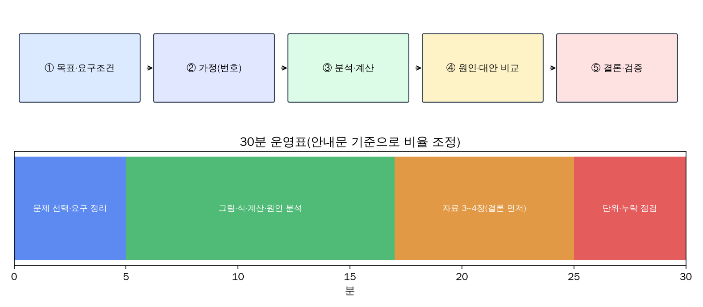{width=100%}

| 단계 | 할 일 | 발표 문장 틀 |
|------------|-------------------------------------|---------------------------------------------------|
| ① 목표·요구조건 | 무엇을 만족해야 하나, 하위 질문 목록 | "이 문제의 목표는 ○○이고, △△ 조건을 만족하는 대안을 제안하겠습니다." |
| ② 가정(번호) | 없는 값은 가정, 번호를 붙임 | "자료에 없는 값은 세 가지를 가정했습니다. 첫째 …" |
| ③ 분석·계산 | 자유물체도 → 식 → 숫자 → 단위 → 의미 | "이 식은 ○○ 조건에서 성립하고, 대입하면 △△입니다." |
| ④ 원인·대안 비교 | 후보 2~4개 × 기준(성능·중량·비용·일정·위험) | "A는 효과가 크지만 중량이 늘고, B는 …" |
| ⑤ 결론·검증 | 추천안, 검증 방법·판정 기준, 결론이 바뀌는 조건 | "○○ 조건에서 △△ 지표로 확인하고, 가정 2가 틀리면 결론이 바뀝니다." |

## 30분 운영표

| 시간 | 할 일 | 산출물 |
|------------|---------------------------------------------------|-------------------------------------|
| 0~5분 | 문제 선택(하위 질문을 **빠짐없이** 답할 수 있는 문제), 요구·조건 정리 | 질문 목록, 가정 |
| 5~17분 | 그림·식·계산·원인 분석 | 핵심 풀이, 대안 |
| 17~25분 | 자료 3~4장 작성(결론 먼저) | 문제 정의 / 계산 / 대안 비교 / 결론·검증 |
| 25~30분 | 단위·누락 점검, 예상 질문 3개 | 수정본 |

## 주제 유형별 해결 방향(LS 직무 맞춤)

| 유형 | 예상 주제 | 핵심 개념 | 풀이 방향 |
|------------|----------------------|--------------------------|-----------------------------------------|
| **무게중심·전복** | 장비 추가 시 무게중심 변화, 경사·감속 전복 검토 | Σmx/Σm, a = g·d/h, SSF = T/2h | 구성품 표 → 무게중심 → 최악 조건 → 대책(배치·지지·운용 제한) |
| **경량화** | 브래킷·프레임 중량 감소 | 강도 vs 강성, I ∝ h³, 좌굴, 피로 | 하중 경로 유지, 일괄 두께 감소 X, 단면·리브 최적화 |
| **해석-시험 불일치** | 항복 이하인데 균열 | 피로, 응력집중, 경계조건, 체결부 | 원인 4분류(하중·모델·재료/제작·평가기준) → 계측으로 판별 |
| **진동·공진** | 특정 회전수·속도에서 진동 | 공진 vs 가진력, 전달률, 모드 | 회전수별 측정·FFT → 원인별 대책 → 전체 범위 재검증 |
| **반동·충격** | 장약 증가 시 반동, 사격 안정성 | 운동량, E = p²/2M, 주퇴력 | 운동량 → 에너지 → 평균력 → 전복 모멘트 → 포구제퇴기·주퇴거리 |
| **냉각** | 고온 과열, 하이브리드 통합냉각 | Q = ṁcpΔT, ITD, 팬 법칙 | 발열/냉각수/공기/열교환기로 분해 → 병목 개선 → 고온 시험 |
| **현수·승차감** | 승차감 개선, 현수 사양 | 1/4 모델, fn ∝ 1/√δ, 감쇠 | 지표 정의 → 강성·감쇠·작동거리 원인 구분 → 조합 튜닝 |
| **체결부** | 볼트 풀림·파단 | 예하중, 미끄럼, 외력 분담 | 미끄럼 안전율 → 전단 핀 분리 → 축력 관리 |
| **기동·동력** | 중량 증가 시 등판·속도 | 주행저항, 등판, 출력 대 중량비 | 견인력 → 접지 한계 → 출력 → 연쇄 영향(현수·제동·수명) |
| **환경 적합** | 혹한·사막 수출형 | DBTT, 열수축, 점도, ITD, 먼지 | 환경별 위험 → 구성품 시험 → 체계 시험(tailoring) |
| **메커니즘** | 자동장전·이송 장치 | 가속도, 좌굴, 유압·축압기, 신뢰성 | 운동 프로파일 → 힘 → 구동기 크기 → 좌굴 → 고장 대응 |
| **체계 상충** | 방호 강화 vs 기동, 차륜형 탑재 | 중량 연쇄 영향, 인터페이스 | 영향 지도(1차·2차) → 대안 → 변경 패키지 관리 |

## 무게중심 PT 미니 예시(가장 가능성 높은 유형)

**문제(연습용):** 기존 차량 전방에 장비 800 kg을 추가하려 한다. 무게중심 변화와 영향을 분석하고 대책을 제시하라.

**가정:** 기존 47 t, 무게중심 앞에서 2.95 m·높이 1.2 m, 추가 장비 위치 앞에서 0.6 m·높이 2.0 m.

**계산:** 새 x = (47 × 2.95 + 0.8 × 0.6)/47.8 ≈ (138.65 + 0.48)/47.8 ≈ **2.91 m(약 4 cm 앞으로)**. 새 높이 = (47 × 1.2 + 0.8 × 2.0)/47.8 ≈ **1.21 m(약 1.3 cm 상승)**.

**영향:** 앞쪽 로드휠 하중↑(현수 작동거리·바닥침), 차체 앞 숙임 자세, 측면 안정계수 소폭↓, 제동 시 앞 하중 이동↑.

**대책:** 장비 위치를 무게중심 쪽으로 이동, 경량화, 후방 균형(최후 수단), 현수 가스압·차고 재설정, 변경 후 축하중 실측.

**검증:** 계산 → 축하중 측정·기울기법 실측 → 기동·경사 시험.

## 발표 후 꼬리질문 대응

| 유형 | 대응 |
|------------------------|----------------------------------------------------------------------------|
| 가정 공격 | 가정의 목적(1차 추정) 인정 → 더 현실적인 값이면 결과 방향 → 확인 방법 |
| 오류 지적 | 즉시 재확인 → "○○를 빠뜨렸습니다. 수정하면 △△이고 결론은 □□" |
| 확장(열·진동 관점은?) | 같은 문제를 에너지·온도·재료·주파수 관점으로 연결 |
| 대안 | 준비한 탈락 대안과 탈락 이유 |
| 실무(어떻게 시험?) | 시험절차서 항목(목적·조건·계측·판정·안전) |
| 압박 | 감정 없이 근거 제시 + 배울 점 인정 |

**절대 하지 말 것:** 모르는 수치 지어내기, 틀린 계산 고집, "안전율을 크게 주면 됩니다"로 끝내기, 하위 질문 누락.

```{=openxml}
<w:p><w:r><w:br w:type="page"/></w:r></w:p>
```

# PT 발표 실전 기술

**발표 기술 \| 원본의 5단계 구성을 실제 화면·판서로 옮기기**

## 발표자료 한 장 구성 틀

PT 준비 환경(노트북·A4·화이트보드)이 정해지지 않았으므로 **3~5장 분량**을 기본으로 연습합니다. 장표가 많으면 시간 안에 풀이를 끝내지 못합니다.

| 장 | 제목 | 들어갈 내용 |
|-----------|-------------|----------------------------------------------------------------------------|
| 1 | 문제 정의 | 목표 한 줄, 주어진 조건, **내가 세운 가정(번호 매기기)**, 하위 질문 목록 |
| 2 | 분석·계산 | 자유물체도·개략도, 사용한 식, 대입 숫자와 단위, 결과(박스 표시) |
| 3 | 원인·대안 비교 | 대안 2~4개 × 평가 기준(성능·중량·비용·일정·위험) 표, 선택 근거 |
| 4 | 결론·검증 | 추천안, 검증 방법(해석·시험·판정기준), 결론이 바뀌는 조건, 한계 |
| (5) | 예비 | 시간이 남으면 민감도(가정이 ±20% 바뀌면?) 또는 추가 고려사항 |

**가정에 번호를 붙이는 이유:** 꼬리질문에서 "가정 2를 바꾸면 결과는 이렇게 달라집니다"라고 바로 대답할 수 있습니다. 면접관은 정답보다 **가정을 의식하고 있는지**를 봅니다.

## 발표 시간별 스크립트 분량

| 발표 시간 | 문제 정의 | 분석·계산 | 대안·결론 | 검증·한계 |
|--------------------|--------------------|--------------------|----------------------|--------------------|
| 3분 | 30초 | 1분 | 1분 | 30초 |
| 5분 | 40초 | 2분 | 1분 30초 | 50초 |
| 7분 | 1분 | 3분 | 2분 | 1분 |

1분에 보통 250~300자(한국어 기준) 정도를 말합니다. **발표 연습은 반드시 타이머와 녹음으로** 하고, 계산 장표에서 말이 빨라지는 습관을 확인하세요.

## 문장 단위 화법

**시작:** "제가 선택한 문제는 ○번, △△입니다. 목표는 □□이고, 결론부터 말씀드리면 ○○안을 제안합니다."

**가정:** "자료에 없는 값은 세 가지를 가정했습니다. 첫째 ○○, 둘째 △△, 셋째 □□입니다. 실제 값이 다르면 결과가 어떻게 바뀌는지는 마지막에 말씀드리겠습니다."

**계산:** "이 식은 ○○ 조건에서 성립합니다. 대입하면 △△이고, 단위는 □□입니다. 이 값은 ○○와 비교하면 크기가 타당합니다."

**대안 비교:** "A는 효과가 크지만 중량이 늘고, B는 효과는 작지만 기존 구조를 유지할 수 있습니다. 필수 요구조건인 ○○를 만족하는 범위에서 B를 우선 추천합니다."

**마무리:** "정리하면 ○○가 원인일 가능성이 높고, △△로 확인한 뒤 □□안을 적용하겠습니다. 이 결론은 ○○ 가정이 틀리면 바뀔 수 있습니다."

## 꼬리질문 유형별 대응

| 유형 | 예 | 대응 |
|-----------|--------------------|--------------------------------------------------------------------|
| 가정 공격 | "그 가정은 비현실적이지 않나요?" | 가정의 목적(1차 추정) 인정 → 더 현실적인 값이면 결과 방향 → 확인 방법 |
| 오류 지적 | "그 계산 틀렸는데요?" | 바로 재확인, 맞으면 "제가 ○○를 빠뜨렸습니다. 수정하면 △△이고 결론은 □□" |
| 확장 | "열 관점에서도 보세요" | 원래 문제의 에너지·온도·재료 영향으로 연결, 모르면 접근 방법 제시 |
| 대안 | "다른 방법은 없나요?" | 미리 준비한 탈락 대안과 탈락 이유 제시 |
| 실무 | "실제로 어떻게 시험하죠?" | 시험 6항목(목적·시편·입력·계측·재현성·이상대응) 중 2~3개로 답변 |
| 압박 | "그건 학생 수준 답이네요" | 감정 반응 없이 "현장 기준을 아직 모르는 부분이 있습니다. 제가 판단한 근거는 ○○이고, 입사 후 △△를 배우겠습니다" |

**절대 하지 말 것:** 모르는 수치를 지어내기, 면접관의 지적을 반박만 하기, 틀린 계산을 끝까지 고집하기, "그냥 안전율을 크게 주면 됩니다"로 끝내기.

## 자주 나오는 실수 10가지

1\. 하위 질문 중 하나를 빼먹음 → 시작 전 질문 목록에 체크 표시.

2\. 단위 혼동(rpm과 rad/s, kW와 kJ, MPa와 N/mm² — 같은 값임을 알기, %경사와 각도).

3\. 결론 없이 분석만 나열 → 첫 문장에 결론.

4\. 원인을 하나로 단정 → 후보와 판별 방법 제시.

5\. 대안의 부작용 미검토 → 표에 '부담' 열을 반드시 둠.

6\. 검증 계획이 "시험해보겠습니다" 한 줄 → 무엇을, 어떤 조건에서, 어떤 기준으로.

7\. 그림 없이 식만 씀 → 자유물체도·개략도 한 장이 설명 시간을 절반으로 줄임.

8\. 시간 초과 → 25분 시점에 무조건 정리 시작.

9\. 장표 디자인에 시간 소모 → 흑백 텍스트·표면 충분.

10\. 숫자를 너무 정밀하게 씀(0.4761904 kg/s) → 유효숫자 2~3자리, "약"을 붙임.

```{=openxml}
<w:p><w:r><w:br w:type="page"/></w:r></w:p>
```

# PT 예시 1 경량화와 구조 성능

**연습 상황 \| 장비 지지 브래킷의 하중과 장착 위치를 유지하며 경량화**

## 1 목표와 조건 확인

"경량화 목표, 허용응력·변위, 반복하중과 수명을 확인하겠습니다. 여기서는 기존 재료와 장착 위치를 유지하고 형상을 개선한다고 가정하겠습니다."

강도는 항복·파손 저항, 강성은 변형 저항입니다. 강도를 만족해도 변형 때문에 정렬이나 기능이 나빠질 수 있으므로 둘을 별도로 평가합니다.

## 2 구조를 분석하기

하중 작용점에서 체결부까지 자유물체도와 하중경로를 그립니다. 응력·변형 분포로 재료 제거 후보를 찾되, 낮은 응력만 보고 제거하지 않습니다. 좌굴 저항, 체결, 조립, 제조에 필요한 부분인지 확인합니다.

  -----------------------------------------------------------------------------------
  **대안**                **기대 효과**                **검토 사항**
  ----------------------- ---------------------------- ------------------------------
  전체 두께 감소          간단한 중량 감소             강성 저하, 좌굴, 국부 응력

  선택적 제거·단면 변경   필요한 위치에 재료 집중      응력집중, 제조와 검사 가능성

  재료 변경               밀도·강도 개선 가능          탄성계수, 비용, 접합·부식
  -----------------------------------------------------------------------------------

## 3 해결안 선택

"이번 조건에서는 재료 변경보다 선택적 재료 제거와 단면 변경을 우선 검토하겠습니다. 굽힘 부위는 필요한 단면 특성을 유지하고 체결부에는 국부 하중을 반영하겠습니다."

가능하면 중량 감소율과 응력·변위 변화를 표로 비교합니다. 아직 계산하지 않았다면 구체적인 감소율을 성과처럼 제시하지 않습니다.

## 4 검증 계획

기존안과 개선안을 동일한 하중·구속조건으로 비교합니다. 중량, 응력, 변위와 필요 시 피로·좌굴을 확인합니다. 제작·조립 가능한지 검토한 뒤 시제품 시험으로 성능을 확인합니다.

## 마무리 발표 예시

"하중 전달에 필요한 부분을 유지하면서 재료 배치를 개선하겠습니다. 전체 두께를 일괄적으로 줄이기보다 단면과 형상을 조정하고, 중량 감소뿐 아니라 허용응력·변위·내구 요구조건을 만족하는지로 판단하겠습니다."

## 꼬리질문과 답변

Q. 고강도 재료로 바꾸면 강성도 좋아지나요?

A. 강도와 강성은 별개입니다. 탄성계수와 형상에 따라 변형이 달라지므로 고강도라는 이유만으로 강성이 높아진다고 판단할 수 없습니다.

Q. 응력이 낮은 부분을 모두 제거해도 되나요?

A. 다른 하중조건과 좌굴, 진동, 조립·제조 기능을 확인해야 합니다. 한 조건의 해석 결과만으로 제거하지 않겠습니다.

```{=openxml}
<w:p><w:r><w:br w:type="page"/></w:r></w:p>
```

# PT 예시 2 해석과 시험의 불일치

**연습 상황 \| 항복 이하로 해석됐으나 반복 시험에서 체결부 근처 균열 발생**

## 1 문제를 정확하게 정의하기

"시험을 안전하게 중단하고 균열 위치·방향·발생 시점, 하중 이력과 시험품 형상을 확보하겠습니다. 해석이 평가한 파손 형태와 실제 파손 형태가 같은지 확인하겠습니다."

정적 항복 검토를 통과했다는 사실은 반복하중에 대한 피로수명까지 충족했다는 뜻이 아닙니다.

## 2 원인 후보 나누기

  ------------------------------------------------------------------------
  **후보**           **확인할 내용**
  ------------------ -----------------------------------------------------
  실제 하중의 차이   충격·반복하중, 방향, 크기, 시험 지그 영향

  모델의 차이        구속, 볼트 축력, 접촉·마찰, 형상 단순화

  재료·제작의 차이   물성, 표면 상태, 결함, 잔류응력

  평가 기준의 차이   항복만 확인했는지, 피로·균열 영향 포함 여부
  ------------------------------------------------------------------------

## 3 가설의 우선순위와 확인 방법

"균열이 체결부 근처이므로 체결부의 실제 거동과 반복하중을 우선 조사하겠습니다. 위치만으로 원인을 확정하지 않고 변형률 측정, 체결 상태 확인, 파손면 관찰 등으로 가설을 검증하겠습니다."

계측값의 교정·위치·단위와 해석 출력의 비교 위치도 맞춥니다. 시험과 다른 곳의 해석값을 비교하면 차이를 잘못 해석할 수 있습니다.

## 4 원인에 맞춰 개선하기

응력집중이 원인이면 곡률·단면을 개선합니다. 체결부 움직임이 원인이면 체결·접촉 조건을 개선합니다. 하중이 누락됐다면 모델과 평가기준부터 수정합니다. 수정 모델이 기존 시험의 변형과 파손 위치를 설명하는지 확인한 뒤 개선품을 재시험합니다.

## 마무리 발표 예시

"실제 시험과 해석 가정의 차이를 확인하겠습니다. 반복하중과 체결부 거동을 우선 조사하되 측정 근거로 원인을 좁히겠습니다. 이후 설계와 모델을 수정하고 동일 조건의 재시험으로 효과를 확인하겠습니다."

## 꼬리질문과 답변

Q. 두께를 늘리면 해결되지 않나요?

A. 응력이 낮아질 수 있지만 하중 누락이나 체결 문제가 남을 수 있습니다. 원인을 확인한 뒤 중량과 다른 부품에 대한 영향까지 비교하겠습니다.

Q. 해석을 시험에 맞추면 충분한가요?

A. 한 결과에 맞추기 위한 임의 조정보다 물리적 근거가 필요합니다. 별도의 하중조건이나 측정점에서도 모델의 설명력을 확인하겠습니다.

```{=openxml}
<w:p><w:r><w:br w:type="page"/></w:r></w:p>
```

# PT 예시 3 특정 조건의 큰 진동

**연습 상황 \| 회전 장치가 특정 회전수 구간에서만 큰 진동을 보임**

## 1 발생 조건 확인

"진동이 커지는 회전수, 방향, 측정 위치와 부하를 확인하겠습니다. 회전수를 올릴 때와 내릴 때 동일한 현상이 나타나는지도 보겠습니다."

회전수만이 아니라 온도, 조립 상태, 장착 조건이 같은지 확인합니다. 큰 진동이 발생한다는 사실만으로 공진을 확정하지 않습니다.

## 2 원인 가설과 측정

회전 불평형·정렬 문제로 가진력이 증가했을 가능성, 가진 주파수와 고유진동수가 가까워졌을 가능성, 체결 풀림·접촉 같은 비선형 거동을 후보로 둡니다.

회전수와 진동을 동기 측정하고 주파수 성분이 회전수에 따라 어떻게 이동하는지 분석합니다. 필요하면 모달시험으로 고유진동수·모드형상·감쇠를 확인합니다.

  -------------------------------------------------------------------------------
  **대안**           **검토할 상황**                 **동시에 볼 점**
  ------------------ ------------------------------- ----------------------------
  밸런싱·정렬 개선   회전 장치 가진력이 원인         작업 후 재현성

  강성·질량 조정     고유진동수 이동이 필요          다른 모드·중량·접합 영향

  감쇠 증가          공진 부근 응답 억제가 필요      온도·내구·주파수별 효과

  방진·경로 개선     주변으로 전달되는 진동이 문제   변위·정렬·전달률
  -------------------------------------------------------------------------------

## 3 해결안과 검증

"공진이 주원인으로 확인되면 강성·질량 조정과 감쇠 증가를 비교하겠습니다. 가진력이 주원인이면 밸런싱과 정렬 개선을 우선 검토하겠습니다."

변경 뒤 전체 운전 범위를 다시 측정합니다. 문제 회전수의 진동만 줄고 다른 회전수나 부품의 응답이 커지지 않았는지, 변위·내구·정렬 요구조건을 만족하는지 확인합니다.

## 마무리 발표 예시

"회전수별 진동 측정으로 가진 원인과 구조 응답을 구분하겠습니다. 원인에 따라 가진력 저감 또는 구조 변경을 선택하고, 전체 운전 범위에서 진동과 내구성을 재검증하겠습니다."

## 꼬리질문과 답변

Q. 강성을 높이면 항상 좋아지나요?

A. 고유진동수가 이동하면서 다른 가진 성분과 가까워질 수 있습니다. 중량과 전달진동도 달라지므로 전체 범위에서 검토하겠습니다.

Q. 고유진동수 하나만 알면 되나요?

A. 가진 방향·주파수와 모드형상, 감쇠, 응답 위치가 중요합니다. 고유진동수의 일치 여부만으로 응답 크기를 판단하지 않겠습니다.

```{=openxml}
<w:p><w:r><w:br w:type="page"/></w:r></w:p>
```

# PT 예시 4 고온 환경의 냉각 부족

**연습 상황 \| 상온에서는 정상이나 고온에서 장시간 운전하면 냉각수 과열**

## 1 과열 조건과 계측 확인

"온도센서의 정확도·위치를 확인하고, 냉각수 입출구 온도·유량, 외기온도, 장비 부하를 함께 측정하겠습니다. 과열이 정상상태인지 계속 상승하는 과도상태인지도 구분하겠습니다."

## 2 열 발생과 방출을 나누기

• 발열 측: 예상보다 큰 부하 또는 구성품 손실이 있는가?

• 냉각수 측: 유량 부족, 막힘, 공기 혼입, 유량 분배 문제가 있는가?

• 공기 측: 풍량 부족, 우회유동, 뜨거운 공기의 재유입이 있는가?

• 열교환기 측: 오염, 성능 저하, 용량 부족이 있는가?

  -------------------------------------------------------------------------------
  **대안**              **기대 효과**                **함께 검토할 부담**
  --------------------- ---------------------------- ----------------------------
  덕트·공기 흐름 개선   실제 냉각공기 이용 개선      배치와 압력손실

  팬·펌프 운전 개선     풍량·유량 조절               소비동력, 소음, 부품 부담

  열교환기 변경         열 방출 능력 개선            공간, 중량, 비용

  손실·발열 저감        처리해야 할 열 감소          다른 구성품 변경 영향
  -------------------------------------------------------------------------------

## 3 해결안 선택

"유량 부족과 재유입 등 실제 성능 저하 원인을 먼저 확인하겠습니다. 이를 개선해도 요구 온도를 만족하지 못하면 열교환기 용량과 팬·펌프 사양을 재검토하겠습니다."

단상 냉각수의 열수송량은 Q̇ = ṁ cp ΔT로 확인할 수 있습니다. 이 값만으로 열교환기의 방열성능이 보장되는 것은 아니므로 공기 측과 열교환 조건도 확인합니다.

## 4 검증 계획

고온·고부하·장시간 조건에서 온도가 허용범위에 안정되는지 봅니다. 냉각성능과 함께 소비동력, 압력손실, 누설, 다른 구성품의 온도도 평가합니다.

## 마무리 발표 예시

"냉각장치를 바로 키우기보다 발열량과 열 방출 경로를 확인하겠습니다. 유량과 공기 흐름으로 원인을 좁히고, 성능·소비동력·설치공간을 비교해 개선안을 선정하겠습니다."

## 꼬리질문과 답변

Q. 팬을 더 빨리 돌리면 되지 않나요?

A. 공기 측이 병목일 때 효과가 있을 수 있지만 냉각수 유량이나 재유입이 주원인이면 효과가 제한적일 수 있습니다. 소비동력 증가도 함께 보겠습니다.

Q. 온도차가 작으면 냉각이 나쁜가요?

A. 유량과 측정 위치를 함께 봐야 합니다. 온도차 하나만으로 전달 열량이나 냉각계통 전체 성능을 판단할 수 없습니다.

```{=openxml}
<w:p><w:r><w:br w:type="page"/></w:r></w:p>
```

# PT 예시 5 승차감과 차체 운동

**연습 상황 \| 거친 노면에서 탑승 충격과 차체 상하·피치 운동이 큼**

## 1 개선의 기준 정의

"주행속도, 노면, 적재량을 확인하고 승차감과 자세 안정성을 별도 지표로 평가하겠습니다." 탑승 위치의 가속도, 차체 상하·피치 운동, 현수 작동거리·바닥침, 접지와 동적 하중을 비교합니다.

## 2 원인을 구분하기

충격이 큰 원인이 과도한 강성인지, 감쇠 특성인지, 작동거리 부족인지 확인합니다. 탑승 위치의 가속도와 차체·현수장치 움직임을 함께 측정합니다. 좌석에서만 큰 응답과 차체 전체의 큰 운동을 구분합니다.

  --------------------------------------------------------------------------------------
  **대안**                 **기대 효과**                **주의할 점**
  ------------------------ ---------------------------- --------------------------------
  스프링 특성 조정         차체 응답과 충격 전달 변화   정적 처짐, 작동거리, 자세 유지

  댐퍼 특성 조정           차체 운동과 충격 전달 조절   작동 속도 영역별 상충관계

  작동거리·범프스톱 개선   큰 입력에서 바닥침 완화      공간과 구조 제약

  좌석·탑재부 절연         해당 위치 전달 충격 감소     차체 운동 자체 개선과 구분
  --------------------------------------------------------------------------------------

## 3 해결안 선택

"스프링을 무조건 부드럽게 하기보다 실제 노면 입력과 현수 응답을 확인한 뒤 스프링·댐퍼 조합을 검토하겠습니다. 큰 입력에서 바닥침이 주원인이면 작동거리와 범프스톱 특성도 살펴보겠습니다."

## 4 검증 계획

동일 노면·속도·적재량으로 기존안과 비교합니다. 이후 적재량, 주행속도와 조향·제동 조건을 바꾸어 개선 범위와 부작용을 확인합니다. 하나의 승차감 지표만 좋아지고 접지·안정성·내구성이 나빠지지 않았는지 봅니다.

## 마무리 발표 예시

"승차감과 자세 안정성을 측정 가능한 지표로 정의하겠습니다. 충격 전달과 큰 차체 운동의 원인을 구분해 현수 특성을 조정하고, 다양한 적재·주행 조건에서 요구조건을 함께 만족하는지 확인하겠습니다."

## 꼬리질문과 답변

Q. 감쇠를 크게 하면 무조건 좋은가요?

A. 차체 운동 억제에 도움이 될 수 있지만 입력 조건에 따라 전달 충격이 커질 수 있습니다. 작동 속도와 주파수 영역에 따른 특성을 검토하겠습니다.

Q. 현수장치를 부드럽게 하면 승차감이 좋아지나요?

A. 일부 조건에서 도움이 될 수 있지만 처짐·바닥침·자세 변화가 커질 수 있습니다. 요구 작동거리와 다른 성능을 함께 확인하겠습니다.

```{=openxml}
<w:p><w:r><w:br w:type="page"/></w:r></w:p>
```

# PT 예시 6 포 사격 반동과 차체 안정성

**연습 상황 \| 자주포의 포 발사 시 반동 에너지와 주퇴장치, 차체 들림 가능성 검토**

**문제(연습용):** 155 mm급 자주포의 사거리 증대를 위해 장약을 늘리려 한다. ① 반동이 얼마나 커지는지 1차로 추정하고 ② 주퇴장치와 차체에 미치는 영향, ③ 대응 방안을 제시하라.

## 1 조건과 가정

가정 1: 포탄 질량 m = 45 kg, 포구속도 v = 900 m/s. 가정 2: 주퇴부(포신·포미 등 뒤로 밀리는 부분) 질량 M = 3,000 kg. 가정 3: 1차 추정에서는 장약 가스의 운동량을 무시하고, 이후 보정계수로 반영. 가정 4: 주퇴거리 L = 0.9 m 동안 일정한 저항력으로 정지. **모든 수치는 학습용이며 실제 제원이 아닙니다.**

## 2 계산

**운동량 보존:** 발사 순간 포탄 운동량 = 주퇴부 운동량. p = m·v = 45 × 900 = 40,500 N·s.

자유 주퇴속도 V = p/M = 40,500 / 3,000 = **13.5 m/s**.

**주퇴 에너지:** E = ½MV² = ½ × 3,000 × 13.5² ≈ **273 kJ**.

**평균 주퇴 저항력:** F = E / L = 273,000 / 0.9 ≈ **304 kN**(일정 저항력 가정).

**장약 가스 효과:** 포구를 떠나는 가스도 운동량을 가지므로 실제 운동량은 더 큽니다. 운동량이 1.4배가 되면 V = 18.9 m/s, **에너지는 1.4² ≈ 1.96배인 약 536 kJ**, 평균 저항력은 약 595 kN입니다.

**핵심 통찰:** 에너지는 운동량의 제곱에 비례(E = p²/2M)합니다. 포구속도를 높이면 반동 에너지는 그 제곱으로 커집니다. 반대로 **포구제퇴기(머즐브레이크)가 가스를 옆·뒤로 돌려 운동량을 30% 줄이면 에너지는 0.7² ≈ 0.49배**로 거의 절반이 됩니다.

**주퇴부 질량의 효과:** 같은 운동량에서 M을 키우면 V와 E가 모두 줄어듭니다(E = p²/2M). 대신 포탑 중량이 늘고 고각 구동 부하가 커집니다.

## 3 차체 영향 1차 검토

**전복 모멘트(정적 근사):** 트러니언(포 회전축) 높이 h = 2.2 m라고 가정하면 후방 사격 시 M_전복 ≈ 304 kN × 2.2 m ≈ 669 kN·m.

**복원 모멘트:** 차량 중량 47 t(W ≈ 461 kN), 무게중심에서 후방 접지 끝까지 수평거리 2.5 m 가정 → 461 × 2.5 ≈ 1,153 kN·m. 기본 조건에서는 복원 모멘트가 큽니다.

**장약 증가 시:** 가스 효과 1.4배 조건이면 595 × 2.2 ≈ 1,309 kN·m로 **복원 모멘트를 넘을 수 있어 차체 들림 가능성**이 생깁니다. 측방 사격은 접지 끝까지 거리가 짧아(궤도 간격의 절반 정도) 더 불리합니다.

**주의:** 반동은 수십 ms 단위의 짧은 충격이므로 정적 비교는 1차 판단입니다. 실제로는 차체 관성, 현수 강성, 지면 조건을 포함한 **과도 동해석과 사격 시험**으로 확인합니다.

## 4 대안 비교

| 대안 | 효과 | 부담·검토 사항 |
|-----------------------|-------------------------|---------------------------------------------------|
| 포구제퇴기 효율 개선 | 운동량 감소, 에너지 제곱으로 감소 | 후폭풍·소음·충격파가 승무원·차체 장비에 미치는 영향 |
| 주퇴거리 증가 | 저항력 감소(F ∝ 1/L) | 포탑 내부 공간, 고각 사격 시 포미와 바닥 간섭, 복좌 시간 증가로 발사속도 저하 |
| 주퇴부 질량 증가 | 주퇴속도·에너지 감소 | 포탑 중량, 고각 구동 부하, 차량 중량 |
| 주퇴 저항력 곡선 최적화 | 최대 저항력 감소(평균값에 가깝게) | 주퇴기 오리피스 설계, 온도에 따른 유체 특성 |
| 사격 시 현수 강성 확보·차체 지지 | 차체 운동·들림 감소 | 기구 추가, 사격 준비 시간 |

## 5 결론 발표 예시

"장약 증가로 반동 운동량이 늘면 에너지는 제곱으로 늘어나므로 주퇴장치만으로 흡수하는 것은 한계가 있다고 판단했습니다. 1차 추정에서 기존 조건은 약 270 kJ, 가스 효과를 고려한 증가 조건은 약 2배 수준이었습니다. 따라서 **포구제퇴기로 운동량 자체를 줄이는 방안을 우선 검토**하고, 남는 에너지는 주퇴 저항력 곡선을 평탄화해 최대 하중을 낮추겠습니다. 차체 들림은 정적 근사로 가능성이 확인되었으므로 과도 동해석과 실사격 시험에서 차체 가속도와 접지 하중을 계측해 판정하겠습니다."

## 6 꼬리질문과 답변

Q. 왜 운동량 보존을 썼나요? 에너지 보존은 안 되나요?

A. 발사는 화약의 화학에너지가 들어오는 과정이라 역학적 에너지가 보존되지 않습니다. 외력이 작은 짧은 시간에서는 운동량이 보존되므로 운동량으로 주퇴속도를 구한 뒤, 그 이후 주퇴 과정의 에너지를 계산했습니다.

Q. 주퇴거리를 2배로 하면 문제가 해결되나요?

A. 평균 저항력은 절반이 되지만 포탑 공간과 고각 사격 시 간섭, 복좌 시간이 늘어 발사속도가 떨어질 수 있습니다. 요구 발사속도와 공간 제약을 함께 만족하는 범위에서 정하겠습니다.

Q. 연속 사격하면 무엇이 문제인가요?

A. 주퇴기 유체 온도가 올라가 점도가 떨어지면 저항력 특성이 변합니다. 포신 온도 상승, 체결부 반복하중에 의한 피로도 검토 대상입니다.

Q. 이 하중이 포탑 링이나 트러니언에 어떤 영향을 주나요?

A. 주퇴력이 트러니언 베어링과 포탑 지지 구조로 전달되므로 그 경로의 체결부·용접부에 반복 충격하중에 대한 피로 평가가 필요합니다. 사격 횟수를 하중 반복수로 바꿔 Miner 손상을 계산하는 방식을 생각할 수 있습니다.

```{=openxml}
<w:p><w:r><w:br w:type="page"/></w:r></w:p>
```

# PT 예시 7 자동 탄약 이송장치 설계

**연습 상황 \| 자동장전 포탑의 탄 이송(장전) 메커니즘 구동력과 유압 실린더 좌굴 검토**

**문제(연습용):** 탄을 장전 위치까지 정해진 시간 안에 이송하는 장치를 설계하라. ① 필요한 구동력과 ② 유압 실린더 크기, ③ 로드 좌굴 여부, ④ 신뢰성 확보 방안을 제시하라.

## 1 조건과 가정

가정 1: 탄 45 kg + 이송 트레이 15 kg → 이동 질량 m = 60 kg. 가정 2: 이송거리 s = 1.2 m, 이송시간 t = 0.6 s. 가정 3: 삼각형 속도 프로파일(절반 가속·절반 감속). 가정 4: 마찰계수 0.2, 장전 경사 45°(고각 상태에서 위로 이송). 가정 5: 유압 공급압 10 MPa. **학습용 수치입니다.**

## 2 운동과 힘

삼각형 프로파일: 최대속도 v_max = 2s/t = **4 m/s**, 가속도 a = 4s/t² = 4 × 1.2 / 0.36 ≈ **13.3 m/s²(약 1.36 g)**.

관성력 m·a = 60 × 13.3 ≈ 800 N.

경사 성분 m·g·sin45° = 60 × 9.81 × 0.707 ≈ 416 N.

마찰 μ·m·g·cos45° = 0.2 × 60 × 9.81 × 0.707 ≈ 83 N.

합계 ≈ **1,300 N**. 효율·여유를 고려한 설계 하중 1.5배 → **약 1.95 kN**.

**실무 통찰:** 실제 장전은 탄을 멈춰 세우는 것이 아니라, 탄 띠(driving band)가 포신 시작부에 **정해진 속도로 밀려 들어가 고정(안착)**되도록 해야 고각에서 탄이 미끄러져 내려오지 않습니다. 그래서 감속 구간의 끝 속도와 충격이 중요한 설계 변수입니다. 이 점을 언급하면 "메커니즘을 실제 기능으로 이해한다"는 인상을 줍니다.

## 3 유압 실린더 크기와 유량

필요 면적 A = F/p = 1,950 / (10 × 10⁶) ≈ 1.95 × 10⁻⁴ m² → 지름 약 16 mm. 여유와 표준 규격을 고려해 **보어 25 mm**(A ≈ 4.9 × 10⁻⁴ m²)를 선택.

최대속도에서 순간 유량 Q = v·A = 4 × 4.9 × 10⁻⁴ ≈ 1.96 × 10⁻³ m³/s ≈ **118 L/min**. 순간 유압동력 P = p·Q ≈ **20 kW**.

**통찰:** 0.3초 동안만 필요한 큰 유량을 위해 펌프를 키우는 것은 비효율적입니다. **축압기**로 순간 유량을 공급하고 장전 사이에 펌프로 재충전하는 방식, 또는 전동 서보 구동을 대안으로 비교합니다.

## 4 로드 좌굴 검토

로드 길이(유효 길이) L = 1.3 m, 양단 핀(K = 1), 강재 E = 210 GPa 가정.

| 로드 지름 | I = πd⁴/64 | Pcr = π²EI/L² | 설계 하중 1.95 kN 대비 |
|------------|----------------------------|---------------------------|---------------------------------|
| 12 mm | 1.02 × 10⁻⁹ m⁴ | 약 1.25 kN | **좌굴 발생(부족)** |
| 16 mm | 3.22 × 10⁻⁹ m⁴ | 약 3.9 kN | 안전율 약 2.0 |
| 20 mm | 7.85 × 10⁻⁹ m⁴ | 약 9.6 kN | 안전율 약 4.9 |

세장비 확인: d = 16 mm에서 r = d/4 = 4 mm, L/r = 325 ≫ 109이므로 Euler 식 적용이 타당합니다.

**통찰:** 힘은 작아도 **긴 스트로크 때문에 좌굴이 지배**합니다. 지름 4/3배(12→16 mm)에 좌굴하중은 (4/3)⁴ ≈ 3.2배가 됩니다. 스트로크가 긴 경우 체인식·텔레스코픽 실린더·랙피니언 등 압축 부재가 길어지지 않는 메커니즘을 대안으로 검토합니다. 차량 진동에 의한 횡하중과 로드 가이드 지지도 고려 대상입니다.

## 5 신뢰성·안전 방안

| 위험 | 대책 |
|--------------------------------|--------------------------------------------------------------------|
| 탄 걸림(jam) | 위치 센서·하중 감시로 이상 감지 시 정지, 역동작 해제, 수동 장전 모드 |
| 저온 유압 응답 지연 | 작동유 예열, 점도지수 높은 유압유, 저온 시험 |
| 반복 작동 마모·피로 | 수명 요구 작동 횟수만큼 내구시험, 마모 부품 교체 주기 |
| 사격 충격·차량 진동 중 작동 | 진동·충격 환경 시험 중 기능 확인 |
| 사람 끼임 | 인터록, 안전 구역, 비상 정지 |

## 6 결론 발표 예시

"요구 이송시간 0.6초를 만족하려면 약 1.4 g 가속이 필요하고 설계 하중은 약 2 kN입니다. 힘보다 긴 스트로크에 따른 좌굴이 지배적이므로 로드 지름 16 mm 이상, 안전율 2 이상을 확보하거나 압축 부재가 길어지지 않는 체인식 메커니즘을 비교하겠습니다. 순간 유량이 크므로 축압기를 적용하고, 탄 안착 속도와 걸림 대응 모드를 포함해 반복 작동 내구시험과 저온 시험으로 검증하겠습니다."

## 7 꼬리질문과 답변

Q. 사다리꼴 속도 프로파일을 쓰면 무엇이 달라지나요?

A. 같은 시간·거리에서 최대속도는 낮아지고 등속 구간이 생기는 대신, 가속 구간이 짧아져 가속도는 커질 수 있습니다. 실제로는 저크(가속도 변화율)를 줄여 충격과 진동을 낮추는 프로파일(S-커브)을 검토합니다.

Q. 전동식과 유압식 중 무엇을 추천하나요?

A. 유압은 힘 밀도가 높고 충격에 강하지만 누유·저온 응답 문제가 있고, 전동은 제어 정밀도·정비성이 좋지만 순간 출력을 위한 전력 공급과 열 관리가 필요합니다. 차량의 기존 유압·전력 계통 용량과 정비 체계를 보고 판단하겠습니다.

Q. 좌굴 계산에서 K = 1로 둔 이유는?

A. 실린더 양 끝이 핀으로 연결되는 일반적인 장착을 가정했습니다. 한쪽이 고정에 가까우면 K가 작아져 유리하지만, 실제 고정도는 불확실하므로 보수적인 값을 썼습니다.

```{=openxml}
<w:p><w:r><w:br w:type="page"/></w:r></w:p>
```

# PT 예시 8 등판능력과 파워팩 요구 출력

**연습 상황 \| 방호 강화로 중량이 늘어난 궤도차량의 등판·속도 성능 검토**

**문제(연습용):** 차량 중량이 47 t일 때 60% 경사 등판과 평지 최고속도를 만족하는지 검토하고, 중량이 10% 늘어나면 어떤 영향이 있는지 설명하라.

## 1 가정

질량 47 t(W ≈ 461 kN), 구름저항계수 f = 0.05(비포장 경사로)·0.03(포장 평지), 접지 마찰계수 μ = 0.7, 엔진 1,000 hp(약 746 kW), 구동계 전체 효율 0.7, 공기저항 C_d·A = 8 m², 스프로킷 반경 0.33 m. **학습용 수치입니다.**

## 2 60% 경사 등판

θ = tan⁻¹(0.6) ≈ 31°, sinθ ≈ 0.515, cosθ ≈ 0.857.

경사저항 W·sinθ ≈ 237 kN, 구름저항 f·W·cosθ ≈ 20 kN → **필요 견인력 ≈ 257 kN**.

접지 한계 μ·W·cosθ ≈ 0.7 × 461 × 0.857 ≈ **277 kN**. 여유가 약 8%로 작습니다. **필요 마찰계수 ≈ tanθ + f ≈ 0.65.** 노면이 젖거나 느슨하면 출력이 충분해도 미끄러집니다.

등판 속도: 스프로킷 출력 ≈ 746 × 0.7 ≈ 522 kW → v = P/F ≈ 522 / 257 ≈ **2.0 m/s(약 7.3 km/h)**.

필요 스프로킷 토크: 257 kN × 0.33 m ≈ **85 kN·m**. 엔진 토크를 3,000 N·m로 가정하면 전체 감속비는 85,000 / (3,000 × 0.7) ≈ **40** 수준이 필요합니다. 변속기 저단과 최종감속기, 토크컨버터 토크 증대의 역할을 설명할 수 있습니다.

## 3 평지 최고속도

67 km/h(18.6 m/s)에서 구름저항 0.03 × 461 ≈ 13.8 kN, 공기저항 ½ × 1.2 × 8 × 18.6² ≈ 1.7 kN → 합계 약 15.5 kN, 필요 출력 ≈ 15.5 × 18.6 ≈ **288 kW**. 가용 522 kW보다 작으므로 출력 측면에서는 여유가 있고, 실제 최고속도는 **변속기 최고단 기어비·엔진 최고회전수·궤도 속도 한계·승차감·안전**에 의해 정해진다고 볼 수 있습니다.

## 4 중량 10% 증가(51.7 t) 영향

| 항목 | 변화 |
|---------------------|-------------------------------------------------------------------------------|
| 출력 대 중량비 | 21.3 → 19.3 hp/t(약 9% 감소), 가속 성능 저하 |
| 등판 필요 견인력 | 257 → 283 kN, 등판 속도 약 7.3 → 6.6 km/h |
| 등판 접지 한계 | 필요 마찰계수는 거의 같음(중량에 비례해 함께 증가) |
| 현수 | 정적 처짐 증가 → 작동거리 감소, 바닥침 위험, 스프링 재설정 |
| 접지압 | 약 10% 증가 → 연약지 기동성 저하 |
| 제동·냉각 | 제동 에너지 10% 증가, 고부하 운전 시간 증가로 냉각 부담 |
| 구동계 수명 | 토크·하중 증가로 기어·베어링 수명 감소(볼베어링은 하중 세제곱에 반비례) |

**통찰:** 등판 한계가 접지력이라면 중량이 늘어도 '등판 가능 여부'는 크게 변하지 않지만, **속도·가속·현수·제동·수명**은 모두 영향을 받습니다. 방호를 늘리는 결정은 기동 체계 전체를 다시 보는 결정입니다.

## 5 결론 발표 예시

"60% 경사 등판에는 약 257 kN의 견인력이 필요하고, 출력 기준 약 7 km/h로 등판 가능하지만 필요 마찰계수가 0.65로 접지력 여유가 작습니다. 중량이 10% 늘면 등판 가능 여부보다 가속·현수 작동거리·제동·구동계 수명이 더 큰 문제가 됩니다. 따라서 중량 증가 시 파워팩 출력 상향만 검토하지 않고 현수 재설정과 구동계 수명 재평가를 함께 진행하고, 실차 등판·가속 시험으로 확인하겠습니다."

## 6 꼬리질문과 답변

Q. 엔진 출력을 1,200 hp로 올리면 해결되나요?

A. 속도·가속은 좋아지지만 냉각 열량이 늘어 냉각계통이 커지고, 파워팩 공간·중량·연비도 바뀝니다. 등판 접지력 한계는 출력으로 해결되지 않습니다.

Q. 궤도 접지 마찰을 높이려면?

A. 궤도 패드 형상·재질, 그라우저(돌기) 설계, 접지압 분포 개선을 생각할 수 있습니다. 대신 포장도로 손상·소음·마모와의 상충을 검토해야 합니다.

Q. 구동계 효율 0.7은 어디서 나왔나요?

A. 변속기(토크컨버터 포함), 최종감속기, 궤도 구름손실을 합친 1차 가정입니다. 운전점에 따라 크게 달라지므로 실제 설계에서는 구성품별 효율 맵을 사용하겠습니다.

```{=openxml}
<w:p><w:r><w:br w:type="page"/></w:r></w:p>
```

# PT 예시 9 중량 궤도차량의 제동과 열부하

**연습 상황 \| 반복 제동·장경사 하강 시 제동력 저하(페이드) 문제**

**문제(연습용):** 시험 중 긴 내리막에서 제동력이 점점 약해지는 현상이 보고됐다. ① 제동 에너지를 추정하고 ② 원인을 분석하며 ③ 개선안과 검증 계획을 제시하라.

## 1 가정

질량 47 t, 제동 시작 속도 60 km/h(16.7 m/s), 목표 감속 0.5 g, 좌우 브레이크 각 1조(마찰 디스크 팩 질량 30 kg, 비열 460 J/(kg·K)), 하강로 경사 30%, 길이 2 km, 하강 속도 20 km/h. **학습용 수치입니다.**

## 2 1회 정지 제동

운동에너지 E = ½mv² = ½ × 47,000 × 16.7² ≈ **6.5 MJ**.

정지거리 s = v²/(2a) = 16.7² / (2 × 4.9) ≈ **28 m**, 정지시간 ≈ 3.4 s, 평균 제동동력 ≈ 6.5 MJ / 3.4 s ≈ **1.9 MW**.

한쪽 브레이크가 3.3 MJ를 열용량만으로 흡수한다면(단열 가정) 온도 상승 ΔT = E/(m·c) ≈ 3.3 × 10⁶ / (30 × 460) ≈ **236 K**. 1회는 견딜 수 있어도, 식기 전에 반복하면 온도가 누적됩니다.

## 3 장경사 연속 하강

경사 30% → θ ≈ 16.7°, 2 km 주행 시 높이 차 ≈ 2,000 × sinθ ≈ 575 m.

위치에너지 m·g·Δh ≈ 47,000 × 9.81 × 575 ≈ **265 MJ**. 구름저항(f = 0.03)이 약 27 MJ를 소모하므로 **제동으로 처리할 에너지 ≈ 238 MJ**.

하강 시간 = 2,000 m / 5.56 m/s ≈ 360 s → 평균 제동동력 ≈ **660 kW**를 6분간 지속.

**통찰:** 238 MJ를 브레이크 열용량만으로 흡수하는 것은 불가능합니다(계산상 수천 K). 연속 제동 에너지는 **유체식 리타더·엔진 브레이크**가 받아 냉각계통으로 버려야 합니다. 그러면 **리타더 발열이 냉각계통의 설계 부하**가 됩니다. 제동 문제가 동력·냉각 문제와 연결되는 지점입니다.

## 4 원인 후보

| 후보 | 확인 방법 |
|-----------------------------------------------|-----------------------------------------------------|
| 마찰재 과열에 의한 마찰계수 저하(페이드) | 브레이크 온도 계측, 마찰재 온도-마찰계수 특성 비교 |
| 리타더 용량 부족 또는 미작동 | 리타더 작동 신호·유온·제동 토크 분담 확인 |
| 냉각계통 포화로 리타더 성능 제한 | 냉각수·리타더 오일 온도가 보호 한계에 도달했는지 |
| 브레이크 유압 계통 문제(유체 비등, 누설) | 유압 측정, 작동유 상태 |
| 운용 방식(저단 미사용, 브레이크 의존) | 주행 데이터 분석, 운용 절차 |

## 5 개선 대안

| 대안 | 효과 | 부담 |
|------------------------------------------|------------------------|---------------------------------|
| 리타더 용량·제어 개선 | 연속 제동 분담 증가 | 냉각 부하 증가 → 냉각계통 재검토 |
| 브레이크 열용량·방열 증대(습식 다판·오일 냉각) | 온도 상승 억제 | 중량·공간·유압 계통 |
| 고온 안정 마찰재 | 페이드 개시 온도 상승 | 마모·소음·비용 |
| 저단 유지·하강 속도 제한 운용 | 즉시 적용 가능 | 운용 제약, 근본 해결은 아님 |

## 6 결론 발표 예시

"1회 제동은 약 6.5 MJ로 브레이크 열용량으로 처리할 수 있지만, 2 km 장경사 하강은 약 240 MJ를 6분간 처리해야 해 마찰 브레이크만으로는 불가능합니다. 따라서 현상의 주원인은 리타더 분담 부족이나 냉각 포화로 인한 마찰 브레이크 과열일 가능성이 높다고 봅니다. 브레이크·리타더·냉각수 온도를 동시 계측해 원인을 좁히고, 리타더 제어 개선과 냉각 용량 재검토를 함께 진행하겠습니다. 검증은 동일 경사로에서 하강 속도별 온도 수렴 여부와 제동 토크 유지로 판정하겠습니다."

## 7 꼬리질문과 답변

Q. 감속도를 1 g로 하면 정지거리가 절반이 되나요?

A. 계산상으로는 그렇지만 감속도는 접지 마찰계수를 넘을 수 없습니다. 노면 μ가 0.7이면 0.7 g 이상은 미끄러지고, 궤도차량은 하중 이동으로 앞쪽 접지 하중이 커지는 점도 고려해야 합니다.

Q. 회전부 관성을 무시해도 되나요?

A. 엔진·변속기·궤도·로드휠의 회전 에너지가 추가로 있으므로 1차 추정에서는 등가 질량 보정계수(수 % ~ 10% 이상)를 곱해 보수적으로 잡는 것이 좋습니다.

```{=openxml}
<w:p><w:r><w:br w:type="page"/></w:r></w:p>
```

# PT 예시 10 유기압 현수장치 사양 결정

**연습 상황 \| 승차감 목표를 만족하는 현수 강성·가스 체적·감쇠 1차 설계**

**문제(연습용):** 궤도차량의 차체 바운스 고유진동수를 약 1.2 Hz로 하려 한다. 바퀴당 현수 강성, 정적 처짐, 가스 스프링의 기본 사양, 감쇠계수를 추정하고 설계상 고려사항을 설명하라.

## 1 가정

스프렁 질량 40 t, 로드휠 양측 각 6개(총 12개)에 균등 분배 → 바퀴당 약 3,333 kg. 레버비 1(현수 유닛 힘 = 바퀴 하중, 학습용 단순화), 피스톤 지름 80 mm, 가스 폴리트로픽 지수 n = 1.4, 목표 감쇠비 ζ = 0.3. **학습용 수치입니다.**

## 2 강성과 정적 처짐

k = m(2πf)² = 3,333 × (2π × 1.2)² ≈ **190 kN/m**(바퀴당).

정적 처짐 δ = mg/k ≈ 3,333 × 9.81 / 190,000 ≈ **173 mm**. 확인: fn ≈ 15.76 / √173 ≈ 1.2 Hz.

**통찰:** 낮은 고유진동수는 큰 정적 처짐을 요구합니다. 금속 스프링으로 이 처짐과 큰 하중을 동시에 만족시키면 스프링이 커지고 무거워집니다. **가스 스프링은 작은 부피로 큰 하중을 지지하면서 낮은 강성을 구현**할 수 있습니다.

## 3 가스 스프링 1차 사양

피스톤 면적 A = π × 0.08² / 4 ≈ 5.0 × 10⁻³ m². 정적 하중 32.7 kN → 정적 가스압 p ≈ **6.5 MPa**.

강성 k ≈ n·p·A²/V → 필요 가스 체적 V = n·p·A²/k ≈ 1.4 × 6.5 × 10⁶ × (5.0 × 10⁻³)² / 190,000 ≈ **1.2 L**.

**점진형 강성 확인:** 피스톤이 100 mm 더 들어가면 체적이 약 0.5 L 줄어 V ≈ 0.71 L, 압력은 6.5 × (1.21/0.71)¹·⁴ ≈ 13.8 MPa, 강성은 약 680 kN/m로 **약 3.6배**가 됩니다. 작은 입력은 부드럽게, 큰 입력은 단단하게 받아 바닥침을 막는 자연스러운 특성입니다.

## 4 감쇠

c = 2ζ√(km) = 2 × 0.3 × √(190,000 × 3,333) ≈ **15 kN·s/m**.

**속도 의존성:** 오리피스 댐퍼는 속도가 커질수록 감쇠력이 급증하므로, 큰 장애물 통과 시 차체 충격이 커질 수 있습니다. 블로오프 밸브로 고속 감쇠력을 제한하고, 압축·인장 감쇠를 다르게(일반적으로 인장 측을 크게) 설정합니다.

## 5 노면과 속도의 관계

파장 5 m의 노면 굴곡을 21.6 km/h(6 m/s)로 지나면 가진 주파수 = v/λ = 1.2 Hz로 **차체 바운스 공진**이 생깁니다. 궤도차량은 여러 로드휠이 같은 굴곡을 시간차(τ = 휠 간격 / 속도)를 두고 지나므로 바운스와 피치가 서로 다른 속도에서 커질 수 있습니다.

## 6 설계 고려사항

| 항목 | 고려 내용 |
|--------------------|--------------------------------------------------------------------------------|
| 작동거리 | 정적 처짐 + 범프 측 여유 + 리바운드 측 여유, 차체 하부 공간과 지상고 |
| 온도 | 가스 온도 상승 시 압력·차고 상승. 연속 험지 주행 시 댐퍼 발열 |
| 적재 변화 | 탄약 적재량 변화로 하중이 바뀌면 차고·고유진동수 변화. 가스 체적 조절식(차고 조절) 검토 |
| 사격 시 | 반동으로 차체가 크게 움직이지 않도록 강성 확보 또는 현수 고정 기능 검토 |
| 신뢰성·정비 | 가스 누설, 씰 마모, 압력 점검 포트, 유닛 단위 교체 |
| 승차감 평가 | 탑승 위치 가속도(주파수 가중), 군용 차량 평가에 쓰이는 흡수전력 지표 등 |

## 7 결론 발표 예시

"바운스 1.2 Hz를 목표로 하면 바퀴당 강성 약 190 kN/m, 정적 처짐 약 170 mm가 필요합니다. 피스톤 지름 80 mm 기준 정적 가스압 약 6.5 MPa, 가스 체적 약 1.2 L로 1차 사양을 잡을 수 있고, 가스 스프링의 점진형 강성으로 큰 입력에서 바닥침을 줄일 수 있습니다. 감쇠는 ζ 0.3 기준 약 15 kN·s/m로 시작하되, 블로오프 특성과 압축·인장 비대칭을 노면 시험으로 튜닝하겠습니다. 온도·적재 변화에 따른 차고 변화와 사격 시 차체 거동을 함께 검증하겠습니다."

## 8 꼬리질문과 답변

Q. 고유진동수를 1.0 Hz로 더 낮추면?

A. 승차감은 좋아질 수 있지만 정적 처짐이 약 250 mm로 늘어 작동거리와 차체 자세 변화(가감속 시 피치, 선회 시 롤)가 커집니다. 사격 안정성에도 불리합니다.

Q. 레버비를 무시했는데 실제로는?

A. 현수암 레버비 R(바퀴 이동/유닛 이동)이 있으면 바퀴 기준 강성은 유닛 강성의 1/R²이 됩니다. 실제 설계에서는 암 기하에 따른 레버비 변화까지 반영합니다.

```{=openxml}
<w:p><w:r><w:br w:type="page"/></w:r></w:p>
```

# PT 예시 11 탑재 전자장비 방진 마운트

**연습 상황 \| 차량 진동으로 탑재 장비 고장이 반복되어 방진 마운트를 설계**

**문제(연습용):** 질량 20 kg 장비 박스를 4개 마운트로 지지한다. 주요 가진은 30 Hz 이상이며, 30 Hz에서 전달률 0.2 이하를 목표로 한다. 마운트 사양을 제시하고 위험 요소를 설명하라.

## 1 계산

비감쇠 근사에서 TR = 1/(r² − 1) ≤ 0.2 → r² ≥ 6 → r ≥ 2.45 → **fn ≤ 30 / 2.45 ≈ 12 Hz**.

fn = 10 Hz로 선택: 전체 강성 k = m(2πfn)² = 20 × (62.8)² ≈ **79 kN/m**, 마운트당 약 **20 kN/m**. 정적 처짐 δ = g/(2πfn)² ≈ **2.5 mm**.

감쇠 영향(r = 3): ζ = 0.1이면 TR ≈ 0.15, ζ = 0.3이면 TR ≈ 0.25. **고무 마운트 감쇠를 너무 크게 하면 목표를 못 맞출 수 있습니다.**

## 2 숨은 위험: 저주파 차량 운동과의 충돌

궤도차량은 차체 바운스 1~2 Hz, 휠 홉·궤도 관련 성분 수~15 Hz 대역에도 큰 진폭이 있습니다. **fn = 10 Hz는 이 대역과 겹쳐 오히려 공진으로 증폭**될 수 있습니다. 또한 저주파 큰 진폭에서 마운트 변위가 커져 장비가 주변과 충돌하거나 마운트가 바닥치기(bottoming)할 수 있습니다.

**궤도 링크 통과 주파수:** f = v/p(p: 궤도 링크 피치). 피치 0.15 m, 속도 10 m/s면 약 67 Hz. 속도에 따라 이동하므로 **운용 속도 범위 전체**의 가진 주파수 대역을 정리해야 합니다.

## 3 대안 비교

| 대안 | 장점 | 단점 |
|-------------------------------------|--------------------|-------------------------------------------|
| 연질 마운트(fn 약 10 Hz) | 고주파 차단 우수 | 차량 저주파 대역과 공진 가능, 큰 변위, 스웨이 공간 필요 |
| 경질 마운트(fn을 주요 가진 대역 위로) | 변위 작음, 공진 회피 | 고주파 차단 효과 없음, 장비 자체 내진 설계 필요 |
| 연질 + 스너버(변위 제한) + 적정 감쇠 | 차단과 변위 제어 절충 | 스너버 접촉 시 충격 발생, 비선형 |
| 장비 내부 보강(경질 장착) | 근본적 내구성 확보 | 장비 설계 변경 범위 큼 |

## 4 결론과 검증

"30 Hz 이상 차단만 보면 fn 10 Hz 연질 마운트가 적합하지만, 궤도차량 저주파 대역과의 공진과 큰 변위 위험이 있습니다. 실차에서 장착 위치의 진동 PSD를 측정해 가진 대역을 먼저 확인하고, 연질 마운트 + 스너버 + 적정 감쇠 조합을 1안으로 검토하겠습니다. 장착 상태에서 3축 진동 시험과 충격 시험을 실시하고, 장비 응답 가속도·마운트 변위·장비 기능을 동시에 확인하겠습니다. 마운트는 **질량중심과 탄성중심을 일치**시켜 병진·회전 모드가 연성되지 않게 배치하겠습니다."

## 5 꼬리질문과 답변

Q. 고무 마운트의 강성은 일정한가요?

A. 고무는 주파수가 높을수록 강성이 커지는 동특성(동적 배율)이 있고, 온도가 낮으면 크게 단단해집니다. 혹한 환경에서 fn이 올라가 방진 성능이 달라질 수 있으므로 온도별 동특성을 확인해야 합니다.

Q. 질량중심과 탄성중심을 맞추는 이유는?

A. 어긋나면 한 방향 가진이 회전 운동을 함께 일으켜 예상하지 못한 모드와 큰 변위가 생깁니다.

```{=openxml}
<w:p><w:r><w:br w:type="page"/></w:r></w:p>
```

# PT 예시 12 랜덤진동 환경의 브래킷 내구

**연습 상황 \| 주행 진동 환경 시험에서 부품 지지 브래킷 균열**

**문제(연습용):** 2 kg 부품을 지지하는 외팔 브래킷(길이 80 mm, 폭 40 mm, 두께 5 mm 강판)이 랜덤진동 시험 중 뿌리부에서 균열이 났다. 입력 PSD는 0.04 g²/Hz(평탄), 브래킷 고유진동수 150 Hz, Q = 10이다. 원인을 정량적으로 설명하고 개선하라.

## 1 응답 추정(Miles 식)

Grms,응답 ≈ √[(π/2) × 150 × 10 × 0.04] ≈ √94.2 ≈ **9.7 g**. 3σ ≈ **29 g**.

등가 정하중(3σ) F ≈ 2 × 9.81 × 29 ≈ **570 N**. 뿌리 굽힘모멘트 M ≈ 570 × 0.08 ≈ 46 N·m. 단면계수 Z = bh²/6 = 40 × 5² / 6 ≈ 167 mm³ → **σ(3σ) ≈ 274 MPa**, 1σ ≈ 91 MPa, 2σ ≈ 183 MPa.

## 2 해석

3σ 응력은 일반 구조용강 항복강도 부근으로 **정적으로는 버틸 것처럼 보여도 피로가 문제**입니다. 150 Hz로 진동하면 1시간에 약 54만 회 반복됩니다. 뿌리부의 굽힘 가공부·용접부·구멍이 응력집중을 더합니다.

**Steinberg 3구간법:** 응답이 가우스 분포라 가정하고 전체 반복수의 약 68.3%를 1σ, 27.1%를 2σ, 4.33%를 3σ 응력으로 보고 S-N 곡선과 Miner 법칙으로 손상을 합산합니다.

## 3 개선 대안

| 대안 | 효과 | 주의 |
|-----------------------------|---------------------------------------|--------------------------------|
| 두께 5 → 6 mm | Z 약 1.44배, 응력 약 30% 감소 | fn 상승으로 입력 대역 내 위치 변화, 중량 |
| 리브·접힘(플랜지) 추가 | 강성·강도 크게 증가, 상대 변위 감소 | 가공성, 리브 끝 응력집중 |
| 길이 단축·지지점 추가 | 모멘트 감소, fn 상승 | 배치 공간 |
| 감쇠 추가(구속층 감쇠 등) | Q 감소 → 응답 √Q에 비례 감소 | 온도 의존성, 장기 내구 |
| 뿌리부 형상 개선 | Kf 감소 | 필렛 반경, 용접 위치 이동 |

**통찰:** Miles 식에서 응답 가속도는 √fn에 비례해 커지지만, 상대 변위(따라서 응력)는 Grms/(2πfn)²에 비례하므로 **강성을 높여 fn을 올리면 전체적으로 응력은 줄어드는 경우가 많습니다.** 단, 입력 PSD가 고주파에서 높으면 결과가 달라지므로 실제 PSD로 확인합니다.

## 4 결론 발표 예시

"Miles 식으로 응답은 약 10 g rms, 3σ 응력은 약 270 MPa로 추정됩니다. 정적으로는 항복 부근이지만 시간당 50만 회 이상 반복되므로 피로가 균열의 주원인으로 판단됩니다. 리브 추가로 강성과 단면계수를 높이고 뿌리부 필렛을 키우는 안을 1순위로 하되, 변경 후 고유진동수를 다시 계산해 입력 PSD와의 관계를 확인하겠습니다. Steinberg 3구간법으로 목표 시험 시간의 손상을 계산하고 동일 조건 랜덤진동 시험으로 검증하겠습니다."

## 5 꼬리질문과 답변

Q. Miles 식은 언제 쓰면 안 되나요?

A. 여러 모드가 가깝게 붙어 있거나, 입력 PSD가 고유진동수 부근에서 급변하거나, 비선형(접촉·풀림)이 있으면 단자유도 근사가 맞지 않습니다. 이때는 FEM 랜덤진동 해석을 씁니다.

Q. Q = 10은 어디서 나왔나요?

A. 감쇠비 5% 가정입니다. 실제 Q는 구조·체결 상태에 따라 다르므로 모달 시험이나 시험 중 응답 측정으로 확인해야 합니다. 볼트 체결 구조는 Q가 더 클 수도 있습니다.

```{=openxml}
<w:p><w:r><w:br w:type="page"/></w:r></w:p>
```

# PT 예시 13 장비 장착부 볼트 체결 설계

**연습 상황 \| 포탑·탑재 장비 장착면의 볼트가 시험 중 풀리고 일부 파단**

**문제(연습용):** M16 강도등급 10.9 볼트 8개로 장비 베이스를 고정한다. 사격·주행 시 장착면에 전단 150 kN이 작용한다. 체결 토크를 정하고 풀림·파단의 원인과 대책을 제시하라.

## 1 가정

인장응력단면적 As = 157 mm², 보증응력 830 MPa(10.9 등급), 재사용 체결 기준 예하중 0.75 × 보증하중, 건조 너트계수 K = 0.2, 접합면 마찰계수 μ = 0.3(마찰면 1개), 볼트 하중분담계수 C = 0.2. **학습용 수치입니다.**

## 2 예하중과 토크

예하중 Fi = 0.75 × 830 × 157 ≈ **97.7 kN**. 토크 T = K·d·Fi = 0.2 × 0.016 × 97,700 ≈ **313 N·m**.

**윤활 상태 함정:** 같은 313 N·m를 윤활된 볼트(K = 0.15)에 주면 Fi ≈ 130 kN, 볼트 응력 ≈ 830 MPa로 **보증응력에 도달**합니다. 반대로 도장·녹이 낀 면(K가 큼)은 예하중이 부족해집니다. **토크 관리만으로는 축력 산포가 ±25% 이상**일 수 있어 중요 체결부는 토크-각도법, 축력 측정 와셔·초음파 측정 등을 검토합니다.

## 3 미끄럼 검토

미끄럼 저항 = n·μ·Fi = 8 × 0.3 × 97.7 ≈ 234 kN → 전단 150 kN 대비 **안전율 약 1.56**.

전복 모멘트로 볼트당 외부 인장 P = 20 kN이 동시에 걸리면 접합면 압축은 (1 − C)P = 16 kN씩 줄어 미끄럼 저항 ≈ 8 × 0.3 × 81.7 ≈ 196 kN, **안전율 약 1.31**로 떨어집니다. 볼트 하중은 Fi + C·P ≈ 101.7 kN로 조금만 증가합니다.

**피로 관점:** P가 0~20 kN으로 반복될 때 볼트 응력 진폭은 C·P/2/As ≈ 12.7 MPa입니다. 그러나 예하중이 사라져 접합면이 벌어지면 진폭은 P/2/As ≈ 63.7 MPa로 **5배**가 됩니다. **예하중 유지가 곧 피로 수명**입니다.

## 4 풀림·파단 원인 후보

| 후보 | 근거·확인 |
|----------------------------------------------------|------------------------------------------------|
| 접합면 미끄럼에 의한 회전 풀림 | 미끄럼 안전율이 작음, 마킹(토크 마크) 어긋남 확인 |
| 예하중 부족(토크 관리·윤활 산포) | 체결 기록, 잔류 축력 측정 |
| 좌면 함몰·도장막 크리프로 축력 감소 | 좌면 자국, 도장면 체결 여부 |
| 볼트가 전단을 직접 받음(미끄럼 후 지압) | 구멍 변형, 볼트 굽힘 흔적 |
| 피로 파단 | 파단면 비치마크(조개껍질 무늬) 관찰 |

## 5 개선 대안

미끄럼 저항 확보(볼트 수·등급 증가, 마찰면 처리, **전단 핀·키·턱으로 전단을 별도 부담**), 축력 관리 개선(체결 절차·윤활 규정·재조임 주기), 좌면 처리(도장 제거·경화 와셔), 풀림 방지(나사 고정제, 기계적 잠금).

## 6 결론 발표 예시

"예하중 약 98 kN, 토크 약 310 N·m로 계산되지만 전복 모멘트가 동시에 작용하면 미끄럼 안전율이 1.3까지 떨어집니다. 미끄럼이 생기면 볼트가 풀리고, 예하중이 사라지면 볼트 응력 진폭이 약 5배가 되어 피로 파단으로 이어질 수 있습니다. 따라서 전단은 전단 핀이나 턱으로 따로 받게 하고, 체결은 윤활 조건을 규정한 축력 관리로 바꾸겠습니다. 개선 후 동일 하중 시험에서 잔류 축력과 마킹 변화로 풀림 여부를 확인하겠습니다."

## 7 꼬리질문과 답변

Q. 볼트를 더 굵게 하면 되지 않나요?

A. 예하중을 키우면 미끄럼 저항이 늘지만, 원인이 윤활 산포나 좌면 크리프라면 굵게 해도 반복됩니다. 원인을 먼저 확인하고, 전단을 볼트 체결력에만 의존하지 않는 구조를 우선 검토하겠습니다.

Q. C = 0.2는 어떻게 정하나요?

A. 볼트 강성과 피체결물(압축 원뿔 영역) 강성으로 계산하거나 FEM으로 구합니다. 피체결물이 얇거나 개스킷이 있으면 C가 커져 볼트가 외력을 더 많이 받습니다.

```{=openxml}
<w:p><w:r><w:br w:type="page"/></w:r></w:p>
```

# PT 예시 14 방호력 강화와 중량 증가의 상충

**연습 상황 \| 고객이 하부·측면 방호 강화를 요구, 중량과 기동성 영향 검토**

**문제(연습용):** 기존 차량에 하부·측면 방호를 추가하라는 요구가 있다. 체계 관점에서 영향을 분석하고 설계 방향을 제시하라.

## 1 문제 정의

"먼저 **위협 수준과 방호 요구를 정량적으로 정의**하겠습니다. 어떤 위협을 어느 방향에서 어느 수준까지 막아야 하는지, 그리고 중량·크기·수송 조건 같은 제약이 무엇인지 확인하겠습니다." 방호 수준은 일반적으로 국제 표준화 문서나 사업 요구서에서 등급으로 정의됩니다. 근거 없이 수치를 말하지 않습니다.

## 2 중량 영향 1차 추정

강판 추가 중량 = 면적 × 두께 × 밀도. 하부 6 m²에 10 mm 강판 추가 → 6 × 0.01 × 7,850 ≈ **471 kg**. 측면 양쪽 14.4 m²에 10 mm 추가 → 약 **1,130 kg**. 합계 약 1.6 t(학습용).

## 3 연쇄 영향 지도

| 변경 | 1차 영향 | 2차 영향 |
|--------------------|-----------------------|---------------------------------------------------------|
| 중량 +1.6 t | 출력 대 중량비 약 3% 감소 | 가속·등판 속도 저하 |
| | 현수 정적 처짐 증가 | 작동거리 감소 → 승차감·바닥침 |
| | 접지압 증가 | 연약지 기동성 저하 |
| | 제동 에너지 증가 | 브레이크·리타더·냉각 부하 |
| 하부 형상 변경(V형 등) | 폭발 압력 분산 | 지상고·차고 증가 → 무게중심 상승 → 전복 안정성 저하 |
| 측면 부가장갑 | 폭 증가 | 수송(철도·항공·선박) 제원 초과 가능, 교량 통과 |
| 내부 좌석·바닥 | 탑승자 충격 감소 필요 | 에너지흡수 좌석(바닥이 아닌 벽·천장 장착), 바닥 이격 |

## 4 설계 방향

1\. **경량 방호재 조합:** 세라믹 타격면 + 복합재 배면 등 다층 구조로 같은 방호 수준에서 중량 절감. 비용·손상 후 교체성 검토.

2\. **모듈형 부가장갑:** 임무·위협에 따라 탈부착. 수송 시 분리해 중량·폭 제한 충족. 장착 인터페이스(볼트·브래킷)의 충격·진동 설계 필요.

3\. **하중경로 재검토:** 부가장갑 하중이 차체 구조에 미치는 영향, 체결부 피로.

4\. **기동 체계 재조정:** 현수 가스압·차고 재설정, 필요 시 파워팩·냉각 영향 검토.

## 5 결론 발표 예시

"방호 강화는 중량 1~2 t 수준의 증가로 이어질 수 있고, 이는 기동·현수·제동·냉각·수송성까지 연쇄적으로 영향을 줍니다. 따라서 방호 요구를 먼저 정량화한 뒤, 경량 다층 방호재와 모듈형 부가장갑을 우선 검토하고, 현수 재설정과 기동 성능 재검증을 같은 변경 패키지로 관리하겠습니다. 형상 변경 이력과 해석·시험 근거를 함께 관리해 어느 형상이 어떤 조건으로 검증됐는지 추적하겠습니다."

## 6 꼬리질문과 답변

Q. 알루미늄 장갑으로 바꾸면 무게가 줄지 않나요?

A. 같은 방호 성능을 내려면 두께가 커지므로 실제 절감 폭은 위협 종류에 따라 다릅니다. 두께 증가로 내부 공간이 줄고, 강재 차체와의 접합·갈바닉 부식도 검토해야 합니다.

Q. 방호를 위해 무엇을 포기하겠습니까?

A. 필수 요구조건은 포기할 수 없으므로, 요구서의 우선순위와 허용 범위를 고객·체계 담당과 확인하겠습니다. 엔지니어가 혼자 정할 문제가 아니라 근거 자료를 만들어 의사결정을 돕는 것이 제 역할이라고 생각합니다.

```{=openxml}
<w:p><w:r><w:br w:type="page"/></w:r></w:p>
```

# PT 예시 15 하이브리드 파워팩 통합냉각

**연습 상황 \| 하이브리드화로 열원이 늘어난 차량의 냉각계통 설계, 고온 환경 대응**

**문제(연습용):** 엔진·변속기에 모터·인버터·배터리가 추가된다. 외기 49 °C에서도 모든 구성품이 허용 온도를 지키도록 냉각계통 구성 방향을 제시하라.

## 1 열부하 정리(학습용 가정)

| 열원 | 열량 | 허용 온도 수준 |
|----------------------------|----------------------|--------------------------------------------------|
| 엔진 냉각수·오일 | 520 kW | 높음(약 100 °C 전후) |
| 변속기(저속 고부하) | 150 kW | 중간~높음 |
| 인터쿨러 | 80 kW | 중간 |
| 모터·인버터 | 15 kW | 낮음(약 60 °C 전후) |
| 배터리 | 5 kW | 매우 낮음(약 20~40 °C) |
| 합계 | 약 770 kW | |

## 2 공기 유량과 팬 동력

외기 온도 상승 25 K 허용 시 ṁ_air = 770 / (1.005 × 25) ≈ **31 kg/s**, 고온 공기 밀도 약 1.1 kg/m³ → 약 **28 m³/s**.

팬 정압 1,500 Pa 가정 → 공기동력 ≈ 28 × 1,500 ≈ 42 kW, 팬 효율 0.6 → **팬 소비동력 약 70 kW**. 냉각에만 엔진 출력의 약 10%를 쓰는 셈입니다.

## 3 고온 환경의 벽

외기 25 °C → 49 °C에서 엔진 회로 ITD는 80 K → 56 K, 같은 열교환기·유량이면 방열 능력 약 0.7배. **팬 회전수로만 1.43배 유량을 얻으면 동력은 1.43³ ≈ 2.9배(약 200 kW)**로 현실성이 없습니다. → **열교환기 면적(UA) 증대, 공기 유로 저항 감소, 재유입 차단**이 우선입니다.

**배터리 회로:** 허용 온도가 20~40 °C인데 외기가 49 °C면 **공기로는 냉각할 수 없습니다.** 냉동 사이클(칠러)을 써야 하고, 칠러 압축기 동력과 그 응축열이 다시 냉각계통 부하가 됩니다.

## 4 구성 방향

1\. **온도 레벨별 회로 분리:** 고온(엔진·변속기) / 중온(인터쿨러) / 저온(전장) / 칠러(배터리).

2\. **공기 흐름 배치:** 저온 열교환기를 공기 상류에, 고온을 하류에 두어 온도 레벨을 활용.

3\. **운전 모드별 우선순위:** 정숙 감시(엔진 정지·배터리 구동) 시에는 소형 전동 팬·펌프로 전장만 냉각, 고부하 기동 시 전체 냉각.

4\. **제어:** 가변 속도 팬·펌프로 필요한 만큼만 냉각해 소비동력 절감.

## 5 결론 발표 예시

"하이브리드화로 열원의 수와 온도 레벨이 다양해지므로 하나의 냉각 회로로 묶기 어렵습니다. 1차 추정으로 약 770 kW, 팬 동력 약 70 kW가 필요하며, 외기 49 °C에서는 방열 능력이 약 30% 줄어 팬 속도만으로는 대응할 수 없습니다. 열교환기 면적과 유로 저항 개선을 우선하고, 배터리는 칠러 회로로 분리하겠습니다. 고온 챔버와 실차 고부하 시험에서 각 회로 온도의 수렴 여부와 팬 소비동력을 함께 판정하겠습니다."

```{=openxml}
<w:p><w:r><w:br w:type="page"/></w:r></w:p>
```

# PT 예시 16 궤도 이탈 반복 문제

**연습 상황 \| 특정 시험 조건에서 궤도가 반복적으로 이탈**

## 1 발생 조건 확인

"어떤 조건에서 이탈하는지 먼저 정리하겠습니다. 선회 중인지, 후진·제동 중인지, 측경사인지, 진흙·눈 같은 노면인지, 좌우 어느 쪽인지, 궤도 장력과 마모 상태는 어땠는지 확인하겠습니다."

## 2 원인 후보와 확인

| 후보 | 메커니즘 | 확인 방법 |
|------------------|----------------------------------------------------|-------------------------------|
| 궤도 장력 부족 | 느슨한 궤도가 선회 측력에 밀려 로드휠 가이드를 넘음 | 장력 측정, 장력조절 실린더 누유·압력 |
| 고속 선회·측경사 측력 | 측방 하중이 가이드 높이를 넘김 | 주행 데이터(조향·속도·경사) |
| 정렬 불량 | 스프로킷·아이들러·로드휠이 일직선이 아님 | 정렬 측정, 장착부 변형 |
| 부품 마모 | 가이드 돌기·휠 림 마모, 스프로킷 이 마모 | 마모량 측정, 정비 이력 |
| 이물질 끼임 | 진흙·돌이 휠과 궤도 사이에 끼어 궤도를 들어 올림 | 이탈 현장 관찰, 배토 구조 |
| 현수 작동 범위 | 큰 휠 상하 변위 시 궤도 처짐 변화 | 현수 변위 계측 |

## 3 대안과 검증

장력 관리(자동·반자동 장력 조절, 점검 주기), 가이드 형상·높이 개선, 아이들러 위치 최적화, 배토 구조, 운용 지침(고속 선회 제한). 검증은 **이탈이 발생한 조건을 재현하는 시험**(동일 노면·속도·조향)에서 장력·측력·현수 변위를 계측하고, 개선 후 같은 조건과 더 가혹한 조건에서 재시험합니다.

## 4 결론 발표 예시

"궤도 이탈은 장력, 측력, 정렬, 마모, 이물질이 겹쳐 일어나는 경우가 많으므로 한 가지로 단정하지 않겠습니다. 발생 조건을 재현하는 시험에서 장력과 현수 변위를 계측해 원인을 좁히고, 장력 관리와 가이드 형상 개선을 우선 검토하겠습니다."

```{=openxml}
<w:p><w:r><w:br w:type="page"/></w:r></w:p>
```

# PT 예시 17 혹한과 사막 환경 적합 설계

**연습 상황 \| 수출형 차량을 −40 °C 혹한과 +49 °C 사막에서 운용하려 함**

**문제(연습용):** 같은 플랫폼을 혹한국과 사막국에 수출할 때 기계 설계에서 검토할 항목과 검증 방법을 제시하라.

## 1 혹한(−40 °C 가정)

**재료:** 탄소강은 연성-취성 천이온도 아래에서 충격 인성이 급감합니다. 저온 샤르피 충격 기준을 만족하는 강재·용접재 선정, 응력집중부 저감.

**열수축 차이:** ΔL = α·L·ΔT. 지름 200 mm 끼워맞춤에서 20 → −40 °C(ΔT = −60 K)일 때 강(α ≈ 12 × 10⁻⁶/K)은 약 −0.14 mm, 알루미늄(α ≈ 23 × 10⁻⁶/K)은 약 −0.28 mm 수축합니다. **차이 약 0.13 mm**는 H7/g6 끼워맞춤 틈새(수십 μm)보다 큽니다. 알루미늄 하우징-강 축 조합이면 틈새가 사라지거나 억지가 생길 수 있습니다.

**유체·고무:** 유압유·윤활유 점도 급증(응답 지연·흡입 불량), 고무 씰 경화·유리전이로 누유, 고무 마운트 강성 증가.

**시동·전원:** 배터리 용량 저하와 엔진 회전 저항 증가가 겹쳐 시동 곤란 → 냉각수·오일 예열기, 배터리 보온.

**결빙:** 가동부(해치·포탑 구동부) 고착, 착빙 하중.

## 2 사막(+49 °C, 모래·먼지)

**냉각:** ITD 감소로 방열 능력 약 30% 저하(예시 15 참고), 일사로 표면·내부 온도 추가 상승.

**흡기 여과:** 사이클론 사전 정화기 + 필터, 필터 차압 감시와 교체 주기. 필터가 막히면 엔진 출력 저하.

**마모·밀봉:** 모래 침입에 의한 베어링·씰·궤도 핀 마모, 와이퍼 씰·부츠.

**재료:** 고무·고분자 열화, 고온에서 윤활유 점도 저하.

## 3 검증 계획

| 단계 | 내용 |
|--------------------|--------------------------------------------------------------------------------|
| 해석 | 열해석(고온 냉각 성능), 열응력·틈새 변화 계산 |
| 구성품 시험 | 저온 챔버 기능 시험(유압 응답·씰 누유), 고온·먼지 시험 |
| 체계 시험 | 저온 냉시동(정해진 시간 방치 후 시동), 고온 고부하 연속 주행, 현지 환경 시험 |
| 규격 | 운용 프로파일에 맞춰 tailoring한 환경시험 조건 |

## 4 결론 발표 예시

"혹한은 재료 인성·열수축 차이·유체 점도·시동, 사막은 냉각 능력·흡기 여과·마모가 핵심입니다. 같은 플랫폼이라도 고객 환경에 따라 공통 설계와 지역별 사양(키트)을 구분하는 것이 효율적이라고 생각합니다. 구성품 챔버 시험으로 위험을 먼저 확인하고, 체계 수준에서 냉시동·고온 고부하 시험으로 검증하겠습니다."

```{=openxml}
<w:p><w:r><w:br w:type="page"/></w:r></w:p>
```

# 개념형 PT 체계통합 3제

**연습 상황 \| 계산보다 체계 관점·상충관계·검증 전략을 묻는 문제**

## 개념형 1 궤도형 자주포의 화력을 차륜형 플랫폼에 탑재

**핵심 쟁점:** ① 사격 반동을 지지할 안정성(타이어·현수 변형, 들림) ② 축하중과 타이어 하중 한계 ③ 포탑·탄약 중량 대비 차량 총중량 ④ 고속 도로 주행 안정성과 사격 정확도 ⑤ 사격 준비·이탈 시간.

**대안:** 사격 시 지지 장치(잭·아웃리거)로 하중을 지면에 직접 전달, 주퇴거리·포구제퇴기 최적화로 반동 저감, 현수 잠금, 사격 방향 제한(측방 사격 시 안정성 검토), 경량 소재 포탑.

**검증:** 반동 하중 과도해석 → 축소·실물 사격 시험(차체 가속도, 바퀴 하중, 들림량) → 반복 사격 피로 평가.

**발표 문장:** "궤도형은 넓은 접지 면적과 큰 중량으로 반동을 받았지만, 차륜형은 접지점이 몇 개의 바퀴로 줄어 반동이 타이어와 현수를 크게 변형시킵니다. 반동 자체를 줄이는 설계와 사격 시 하중을 지면으로 직접 보내는 설계를 함께 검토하겠습니다."

## 개념형 2 자동화 포탑(승무원 감소)의 신뢰성

**핵심 쟁점:** 사람이 하던 탄약 취급을 메커니즘이 대신하면, 메커니즘 고장은 곧 **화력 상실**입니다. 직렬 구성품이 늘어 체계 신뢰도가 떨어질 수 있습니다(구성품 0.99 × 20개 ≈ 0.82).

**대안:** 고장 모드 분석(FMEA)으로 치명 고장 식별, 핵심 구성품 이중화 또는 **수동 백업 모드**, 걸림 감지와 자동 복구 시퀀스, 모듈 단위 교체로 MTTR 단축, 상태 감시 센서.

**검증:** 반복 작동 내구시험(요구 사격 수의 배수), 환경(진동·저온·먼지) 중 기능 시험, 고장 주입 시험(걸림 상황에서 안전 정지·복구 확인).

**발표 문장:** "자동화의 가치는 발사속도와 인력 절감이지만, 신뢰성이 받쳐주지 않으면 운용 가용도가 떨어집니다. FMEA로 치명 고장을 먼저 찾아 백업 경로를 설계하고, 환경 조건을 포함한 반복 작동 시험으로 검증하겠습니다."

## 개념형 3 디젤 차량의 하이브리드화

**기대 효과:** 정숙 감시(엔진 정지 상태 운용), 연비·항속거리 개선, 순간 가속 보조, 탑재 장비 전력 공급.

**기계적 과제:** 배터리·모터·인버터 추가 중량과 공간, 통합냉각(예시 15), 배터리 충격·진동·열폭주 안전, 전자파 차폐, 정비 인력·절차 변화.

**검증:** 구성품 환경시험(배터리 진동·충격·열), 체계 열관리 시험, 모드 전환 시 동력 계통 과도 응답, 안전 시험.

**발표 문장:** "하이브리드화의 기계적 핵심은 늘어난 중량을 수용하면서 서로 다른 온도 레벨의 열을 처리하는 것입니다. 배터리는 진동·충격과 열 안전을 함께 만족해야 하므로 장착 구조와 냉각을 동시에 설계하겠습니다."

```{=openxml}
<w:p><w:r><w:br w:type="page"/></w:r></w:p>
```

# 10분 계산 드릴 25문항

**계산 연습 \| 답을 가리고 풀기, 단위와 유효숫자까지 말하기**

계산기 없이 어림셈으로 먼저 크기를 예상하고, 그다음 정확히 계산하세요. PT에서 "값이 상식적인가"를 판단하는 감각이 여기서 생깁니다. 모든 수치는 학습용입니다.

| 번호 | 문제 | 답 |
|-----------|-----------------------------------------------|------------------------------------------|
| 1 | 1,500 rpm은 몇 rad/s인가? | 2π × 1,500 / 60 ≈ 157 rad/s |
| 2 | 200 kW, 2,000 rpm 엔진의 토크는? | T = P/ω = 200,000 / 209 ≈ 955 N·m |
| 3 | 60 km/h는 몇 m/s인가? | 60 / 3.6 ≈ 16.7 m/s |
| 4 | 30% 경사는 몇 도인가? | tan⁻¹(0.3) ≈ 16.7° |
| 5 | 지름 20 mm 강봉에 인장 50 kN. 응력은? | 50,000 / 314 ≈ 159 MPa |
| 6 | 5번 봉의 길이 1 m, E = 210 GPa. 늘음량은? | σL/E = 159 × 1,000 / 210,000 ≈ 0.76 mm |
| 7 | 20 × 20 mm 정사각 강 외팔보, 길이 0.5 m, 끝단 1 kN. 처짐과 최대응력은? | I ≈ 13,333 mm⁴, δ = FL³/(3EI) ≈ 14.9 mm, σ = Mc/I ≈ 375 MPa(과대 → 단면 재검토) |
| 8 | 지름 40 mm 원형축, 토크 1 kN·m. 최대 전단응력은? | τ = 16T/(πd³) ≈ 79.6 MPa |
| 9 | σ = 120 MPa, τ = 50 MPa. von Mises 응력은? | √(120² + 3 × 50²) ≈ 148 MPa |
| 10 | 양단 핀 강봉 지름 30 mm, 길이 2 m. Euler 좌굴하중은? | I ≈ 39,761 mm⁴, Pcr ≈ 20.6 kN |
| 11 | m = 100 kg, k = 400 kN/m. 고유진동수는? | √(k/m)/(2π) = 63.2 / 6.28 ≈ 10.1 Hz |
| 12 | 정적처짐 10 mm인 스프링-질량계의 고유진동수는? | 15.76 / √10 ≈ 5.0 Hz |
| 13 | 비감쇠, 주파수비 r = 3의 전달률은? | 1/(r² − 1) = 1/8 = 0.125 |
| 14 | 4기통 4행정 엔진 1,200 rpm의 점화 주파수는? | 회전당 2회 점화 × 20 Hz = 40 Hz |
| 15 | 냉각수로 50 kW 제거, 온도차 10 K, cp = 4.18 kJ/(kg·K). 유량은? | ṁ = 50 / (4.18 × 10) ≈ 1.2 kg/s |
| 16 | 팬 회전수 20% 증가 시 소비동력은? | 1.2³ ≈ 1.73배 |
| 17 | MTBF 400 h, MTTR 2 h. 고유가용도는? | 400 / 402 ≈ 0.995 |
| 18 | 신뢰도 0.95 구성품 4개 직렬. 체계 신뢰도는? | 0.95⁴ ≈ 0.81 |
| 19 | M12, 8.8 등급(As = 84.3 mm², 보증응력 600 MPa). 예하중(0.75)과 토크(K = 0.2)는? | Fi ≈ 37.9 kN, T ≈ 0.2 × 0.012 × 37,900 ≈ 91 N·m |
| 20 | 볼베어링 하중이 1.5배가 되면 수명은? | 1/1.5³ ≈ 0.30배 |
| 21 | 10 t 차량 36 km/h의 운동에너지는? | ½ × 10,000 × 10² = 500 kJ |
| 22 | 실린더 지름 63 mm, 압력 16 MPa. 추력은? | A ≈ 3,117 mm² → 약 49.9 kN |
| 23 | 알루미늄 1 m가 50 K 오르면 늘음량은? | 23 × 10⁻⁶ × 1,000 × 50 ≈ 1.15 mm |
| 24 | 판 굽힘 강성을 같게 할 때 알루미늄/강 두께비와 무게비는? | 두께 (3)^(1/3) ≈ 1.44배, 무게 약 0.5배 |
| 25 | 20~2,000 Hz 평탄 PSD 0.01 g²/Hz의 Grms는? | √(0.01 × 1,980) ≈ 4.4 g |

**채점 기준:** 20문항 이상 정답이고 각 문항을 30초 안에 "식 → 대입 → 의미"로 말할 수 있으면 계산형 PT 준비가 된 것입니다. 틀린 문항은 해당 심화 장으로 돌아가 식의 가정을 다시 확인하세요.

```{=openxml}
<w:p><w:r><w:br w:type="page"/></w:r></w:p>
```

# 전공 꼬리질문 은행 1

**질의응답 \| 질문을 보고 10초 안에 핵심 한두 문장을 말하는 연습**

## 재료역학·구조

| 질문 | 핵심 답변 |
|--------------------------|--------------------------------------------------------------------------|
| 응력과 압력의 차이는? | 둘 다 단위면적당 힘이지만 압력은 유체가 면에 수직으로 작용하는 스칼라량, 응력은 고체 내부의 방향성을 가진 텐서량입니다. |
| 공칭응력과 진응력은? | 공칭은 초기 단면적 기준, 진응력은 순간 단면적 기준입니다. 넥킹 이후 차이가 커집니다. |
| 항복강도를 0.2% 오프셋으로 정하는 이유는? | 뚜렷한 항복점이 없는 재료에서 0.2% 영구변형이 생기는 응력을 실용적 항복 기준으로 씁니다. |
| 연성재료와 취성재료의 파손 차이는? | 연성은 큰 소성변형 후 전단 지배 파손, 취성은 소성변형 거의 없이 인장 지배 파손입니다. |
| 푸아송비란? | 축방향 변형률에 대한 횡방향 변형률 비의 음수입니다. 금속은 약 0.3입니다. |
| 주응력이란? | 전단응력이 0이 되는 면의 수직응력입니다. 모어원으로 구합니다. |
| 모어원에서 최대전단응력은? | 반지름, 즉 (σ1 − σ2)/2입니다. |
| 박막 압력용기 원주응력과 축응력의 비는? | 원주응력 pr/t가 축응력 pr/2t의 2배입니다. 그래서 원통은 축방향으로 갈라집니다. |
| 단면2차모멘트와 극관성모멘트 차이는? | 전자는 굽힘 강성, 후자는 원형축의 비틀림 강성과 관련된 단면 성질입니다. |
| I형 단면이 굽힘에 유리한 이유는? | 굽힘응력이 중립축에서 먼 곳에서 크므로 재료를 플랜지에 모아 같은 무게로 큰 I를 얻습니다. |
| 보의 처짐을 줄이는 방법 3가지는? | 길이 단축·지지점 추가, 단면 높이 증가(I ∝ h³), 탄성계수가 큰 재료. 고강도 재료는 처짐을 줄이지 못합니다. |
| 열응력은 언제 생기나요? | 온도 변화로 인한 팽창·수축이 구속될 때, 또는 온도 분포가 불균일할 때 생깁니다. σ = EαΔT(완전 구속). |
| 잔류응력의 원인과 영향은? | 용접·열처리·가공으로 생기며, 인장 잔류응력은 피로·응력부식에 불리하고 압축 잔류응력은 유리합니다. |
| 크리프란? | 고온에서 일정 하중에도 시간에 따라 변형이 증가하는 현상입니다. 보통 녹는점의 약 0.4배 이상 온도에서 중요합니다. |
| 피로 파단면의 특징은? | 균열 시작점, 비치마크가 있는 평탄한 성장 영역, 거친 최종 파단 영역으로 구분됩니다. |
| 내구한도가 없는 재료는? | 알루미늄 등 비철금속은 뚜렷한 내구한도가 없어 정해진 반복수 기준 피로강도를 씁니다. |
| 평균응력이 피로에 미치는 영향은? | 인장 평균응력은 허용 진폭을 줄입니다. Goodman·Gerber 선도로 보정합니다. |
| 노치 민감도란? | 이론 응력집중이 실제 피로강도 저하에 얼마나 반영되는지를 나타내는 0~1의 값입니다. |
| 안전율과 신뢰도 설계의 차이는? | 안전율은 결정론적 여유, 신뢰도 설계는 하중·강도의 분포를 고려한 파손 확률 기반 설계입니다. |
| 좌굴과 항복 중 무엇이 먼저 일어나나요? | 세장비가 크면 좌굴, 작으면 항복이 먼저입니다. 경계 세장비를 계산해 판단합니다. |
| 쉘 구조에서 좌굴 해석 시 주의점은? | 선형 좌굴 해석은 초기결함을 반영하지 못해 비보수적일 수 있어 결함을 넣은 비선형 해석으로 보완합니다. |
| 충격하중이 정하중보다 위험한 이유는? | 같은 크기의 하중도 갑자기 가해지면 동적 증폭(이상적으로 2배)이 생기고 변형률 속도에 따라 재료 거동도 달라집니다. |
| 응력부식균열이란? | 인장응력과 부식 환경, 민감한 재료가 동시에 있을 때 항복 이하에서 균열이 진전되는 현상입니다. |
| 파괴인성이란? | 균열이 있는 재료가 불안정 파괴에 저항하는 능력으로 K_IC로 나타냅니다. 저온에서 떨어질 수 있습니다. |
| 경도와 강도의 관계는? | 강재에서는 경도와 인장강도가 대략 비례하지만, 경도가 높을수록 인성이 낮아지는 경향이 있습니다. |

## 기계설계·요소

| 질문 | 핵심 답변 |
|----------------------------|------------------------------------------------------------------------|
| 볼트에 예하중을 주는 이유는? | 접합면 분리·미끄럼을 막고, 외력 중 볼트가 받는 변동 하중을 줄여 피로 수명을 늘리기 위해서입니다. |
| 조임토크와 축력의 관계를 결정하는 요인은? | 나사부·좌면 마찰(윤활·표면처리), 나사 형상입니다. 토크의 대부분은 마찰로 소모됩니다. |
| 볼트가 전단을 직접 받으면 왜 안 좋은가요? | 미끄럼이 생긴 뒤 지압·굽힘이 걸리고 풀림·피로가 생깁니다. 마찰 체결이나 전단 핀으로 처리하는 것이 바람직합니다. |
| 키와 스플라인 비교는? | 키는 간단·저가, 스플라인은 큰 토크와 축방향 미끄럼에 유리하고 응력집중이 분산됩니다. |
| 구름 베어링과 미끄럼 베어링 선택 기준은? | 구름은 기동 마찰·정비가 유리, 미끄럼은 충격·고하중·감쇠·소형화에 유리합니다. |
| 베어링 예압의 목적은? | 내부 틈새 제거로 강성·회전 정밀도를 높이고 진동을 줄입니다. 과도하면 발열·수명 저하가 생깁니다. |
| 기어 백래시가 필요한 이유는? | 열팽창·제작오차·윤활유막을 위한 여유입니다. 너무 크면 충격·소음, 위치 정밀도 저하가 생깁니다. |
| 헬리컬 기어의 장단점은? | 물림률이 높아 조용하고 강하지만 축방향 하중이 생겨 스러스트 베어링이 필요합니다. |
| 유성기어를 쓰는 이유는? | 동축 배치, 하중 분산으로 소형·고감속비, 변속기와 최종감속기에 널리 쓰입니다. |
| 공차를 무조건 작게 하면? | 제조비·검사비·불량률이 증가합니다. 기능 치수만 엄격히 관리합니다. |
| 데이텀을 정하는 원칙은? | 실제 조립·기능 기준면을 데이텀으로 하고 측정 가능해야 합니다. |
| 억지 끼워맞춤의 조립 방법은? | 압입, 가열 끼움(박음), 냉각 끼움. 열팽창을 이용하면 표면 손상이 적습니다. |
| 용접 대신 볼트를 쓰는 경우는? | 정비·교체가 필요할 때, 이종재료, 열변형·열영향부를 피하고 싶을 때입니다. |
| 스프링 설계에서 피로를 고려하는 이유는? | 반복 하중이 기본 작동 조건이므로 전단응력 진폭과 평균응력으로 피로 수명을 평가합니다. |
| O-링 설계에서 중요한 것은? | 압축률(스퀴즈), 홈 치수, 재질의 온도·유체 적합성, 고압 시 백업링입니다. |
| 마찰 브레이크 설계 시 고려사항은? | 제동 토크, 열용량·방열, 마찰계수의 온도 안정성, 마모, 소음입니다. |
| 체인과 벨트 비교는? | 체인은 미끄럼 없는 동기 전달·고하중, 벨트는 정숙·완충·윤활 불필요입니다. |
| 축의 위험속도란? | 회전수가 축계의 굽힘 고유진동수와 일치해 휘돌림이 커지는 속도입니다. 운전 범위와 충분히 떨어뜨립니다. |
| 기구 설계에서 자유도 계산은? | 평면 기구는 Grübler 식 M = 3(n − 1) − 2j1 − j2로 구합니다. |
| 설계 검토(DR)에서 무엇을 확인하나요? | 요구조건 충족 근거, 인터페이스, 제조·조립성, 위험 요소와 대책, 시험 계획입니다. |

## 동역학·진동

| 질문 | 핵심 답변 |
|---------------------------|-------------------------------------------------------------------------|
| 고유진동수와 공진의 차이는? | 고유진동수는 구조의 성질, 공진은 가진 주파수가 그 근처일 때 응답이 커지는 현상입니다. |
| 감쇠의 종류는? | 점성 감쇠, 쿨롱(마찰) 감쇠, 구조(히스테리시스) 감쇠입니다. |
| 공진을 피하는 방법은? | 가진 주파수 변경, 고유진동수 이동(강성·질량), 감쇠 증가, 가진력 감소, 동흡진기입니다. |
| 동흡진기란? | 주 구조에 작은 질량-스프링을 달아 특정 주파수 응답을 줄이는 장치입니다. 대신 양옆에 새 공진이 생깁니다. |
| 모드형상이 중요한 이유는? | 같은 고유진동수라도 어디가 크게 움직이는지 알아야 가진 위치·센서 위치·보강 위치를 정할 수 있습니다. |
| 강체 모드란? | 변형 없이 움직이는 0 Hz 모드입니다. 구속 없는 자유-자유 해석에서 6개가 나옵니다. |
| 진동 방진과 진동 저감의 차이는? | 방진은 전달 경로 차단, 저감은 가진원 또는 구조 응답 자체를 줄이는 것입니다. |
| 위상이 90도가 되는 지점은? | 단자유도계 공진에서 변위 응답 위상이 가진력보다 90도 늦습니다. 고유진동수 판별에 씁니다. |
| 랜덤진동에서 PSD를 쓰는 이유는? | 시간 신호가 불규칙해 주파수별 에너지 분포로 통계적으로 표현하기 위해서입니다. |
| 충격과 진동 시험의 차이는? | 진동은 지속적 반복 응답과 피로, 충격은 짧은 순간의 최대 응답과 파손·기능 이상을 봅니다. |
| 차량에서 피치와 바운스는? | 바운스는 상하 병진, 피치는 앞뒤 회전 운동입니다. 축거와 속도에 따라 연성됩니다. |
| 회전체 밸런싱의 종류는? | 정적(한 평면) 밸런싱과 동적(두 평면 이상) 밸런싱입니다. 긴 회전체는 동적 밸런싱이 필요합니다. |
| 자이로 효과란? | 회전체 축을 기울이면 각운동량 변화로 수직 방향 모멘트가 생기는 현상입니다. |
| 운동량과 충격량의 관계는? | 충격량(힘 × 시간)은 운동량 변화와 같습니다. 같은 충격량이라도 시간을 늘리면 힘이 줄어듭니다. |
| 라그랑주 방정식의 장점은? | 에너지로 운동방정식을 세워 구속력 없이 일반좌표로 다자유도 계를 다룰 수 있습니다. |
| 차량 롤 강성을 키우면? | 선회 시 롤이 줄지만 한쪽 바퀴 입력이 반대쪽으로 전달돼 승차감이 나빠질 수 있습니다. |
| 비선형 진동의 예는? | 체결부 틈새, 접촉·마찰, 고무 마운트, 큰 변형입니다. 주파수 응답이 진폭에 따라 달라집니다. |
| 진동 측정 시 변위·속도·가속도 중 무엇을? | 저주파는 변위, 중주파는 속도(진동 심각도), 고주파는 가속도가 유리합니다. |
| 동적 배율(고무)이란? | 고무의 동적 강성이 정적 강성보다 큰 비율입니다. 방진 설계에서 고유진동수 예측에 반영합니다. |
| 구조 감쇠비는 보통 얼마인가요? | 볼트 체결 금속 구조는 수 % 수준, 용접 일체 구조는 더 작을 수 있습니다. 시험으로 확인합니다. |

```{=openxml}
<w:p><w:r><w:br w:type="page"/></w:r></w:p>
```

# 전공 꼬리질문 은행 2

**질의응답 \| 열유체·해석·시험·방산·상황 질문**

## 열역학·열전달·유체·동력

| 질문 | 핵심 답변 |
|--------------------------|--------------------------------------------------------------------------|
| 열역학 1법칙과 2법칙은? | 1법칙은 에너지 보존, 2법칙은 열이 자연적으로 고온에서 저온으로 흐르며 열을 모두 일로 바꿀 수 없다는 방향성입니다. |
| 디젤과 가솔린 엔진 차이는? | 디젤은 압축착화·높은 압축비로 열효율과 저속 토크가 높아 중량 차량에 적합합니다. |
| 터보차저의 역할은? | 배기 에너지로 흡기를 압축해 같은 배기량에서 출력을 높입니다. 압축 공기 온도가 오르므로 인터쿨러를 씁니다. |
| 엔진 출력이 고도에서 떨어지는 이유는? | 공기 밀도가 낮아 흡입 산소량이 줄기 때문입니다. 냉각 공기 질량유량도 줄어듭니다. |
| 토크컨버터의 장점과 단점은? | 저속 토크 증대와 충격 완화가 장점, 미끄럼 손실로 발열이 크다는 것이 단점입니다. 그래서 잠금 클러치를 씁니다. |
| 전도·대류·복사를 예로 설명하면? | 벽을 통한 열 흐름(전도), 라디에이터 공기 냉각(대류), 햇빛에 의한 차체 가열(복사)입니다. |
| 열전도율과 열확산율의 차이는? | 열전도율은 열을 전달하는 능력, 열확산율(k/ρc)은 온도 변화가 퍼지는 속도입니다. |
| 핀을 달면 항상 방열이 늘어나나요? | 핀 효율이 낮거나 핀 간격이 좁아 유동이 막히면 효과가 작거나 오히려 나빠질 수 있습니다. |
| 대향류 열교환기가 유리한 이유는? | 전 구간에서 온도차를 크게 유지해 같은 면적에서 더 많은 열을 전달할 수 있습니다. |
| 냉각수에 부동액을 넣으면? | 어는점이 낮아지고 끓는점이 높아지지만 비열과 열전도율이 낮아져 같은 유량의 열수송 능력은 줄어듭니다. |
| 라디에이터 압력캡의 역할은? | 냉각계통을 가압해 비등점을 높이고 캐비테이션을 줄입니다. |
| 베르누이 방정식의 가정은? | 정상, 비압축, 비점성, 같은 유선을 따름입니다. 손실이 있으면 손실수두를 추가합니다. |
| 층류와 난류의 차이는? | 층류는 질서 있는 흐름, 난류는 섞임이 큰 흐름입니다. 난류는 열전달이 좋지만 압력손실이 큽니다. |
| 유량을 2배로 하면 압력손실은? | 난류에서는 대략 4배(속도 제곱)입니다. |
| 펌프 직렬과 병렬 연결 차이는? | 직렬은 양정 증가, 병렬은 유량 증가입니다. 실제 증가량은 시스템 곡선과의 교점으로 정해집니다. |
| 캐비테이션 방지 방법은? | 흡입 압력을 높이고(가압·흡입 높이), 흡입 배관 손실을 줄이고, 유체 온도를 낮춥니다. |
| 유압 시스템에서 발열 원인은? | 릴리프 밸브·스로틀 손실, 펌프 효율, 배관 마찰입니다. 손실 동력은 모두 열이 됩니다. |
| 유압유 점도가 너무 낮거나 높으면? | 낮으면 누설·마모, 높으면 압력손실·응답 지연·흡입 불량입니다. |
| 정상상태와 과도상태 열해석 차이는? | 정상은 시간에 따른 변화가 없는 평형 온도, 과도는 시간에 따른 온도 변화와 도달 시간을 봅니다. |
| 열저항을 줄이기 위한 접촉면 처리는? | 접촉 압력 증가, 표면 거칠기 감소, 서멀 패드·그리스 같은 열전달 재료 사용입니다. |

## 해석·CAE

| 질문 | 핵심 답변 |
|------------------------------|----------------------------------------------------------------------|
| FEM의 기본 원리는? | 연속체를 유한 개 요소로 나누고 절점 변위를 미지수로 강성 방정식 [K]{u} = {F}를 풉니다. |
| 메시 수렴성 검토 방법은? | 요소 크기를 줄여가며 관심 위치의 결과 변화가 일정 범위 안에 들어오는지 확인합니다. |
| 응력 특이점이란? | 날카로운 모서리·점하중·점구속에서 메시를 줄일수록 응력이 무한히 커지는 수치 현상입니다. |
| 특이점을 어떻게 다루나요? | 실제 필렛을 모델링하거나, 그 지점은 평가에서 제외하고 조금 떨어진 위치나 선형화 응력으로 판단합니다. |
| 쉘 요소를 쓰는 기준은? | 두께가 다른 치수보다 충분히 작은 얇은 판 구조(대략 1/10 이하)입니다. |
| 대칭 조건을 쓸 수 있는 조건은? | 형상·재료·하중·구속이 모두 대칭일 때입니다. 모달 해석에서는 비대칭 모드를 놓칠 수 있습니다. |
| 접촉 해석이 어려운 이유는? | 접촉 상태가 해에 따라 바뀌는 비선형이라 수렴이 어렵고 마찰·초기 틈새 설정에 민감합니다. |
| 볼트를 해석에서 어떻게 모델링하나요? | 단순하게는 빔 요소와 강체 연결, 정밀하게는 솔리드 볼트에 예하중 단계와 접촉을 적용합니다. |
| 모달 해석에 하중이 필요한가요? | 일반 모달은 하중 없이 질량·강성으로 고유값을 구합니다. 예하중이 강성을 바꾸면 예응력 모달을 씁니다. |
| 해석 결과의 응력이 시험보다 크게 나온 이유는? | 경계조건 과구속, 하중 과대, 국부 특이점, 측정 위치·방향 불일치 등을 확인합니다. |
| 선형 해석으로 충분한지 판단 기준은? | 응력이 항복 이하, 변형이 작음, 접촉 상태가 변하지 않음, 좌굴 위험 없음이면 선형으로 충분합니다. |
| 위상최적화 결과를 그대로 쓰지 않는 이유는? | 제조성·응력집중·다른 하중조건·좌굴이 반영되지 않았을 수 있어 해석적 형상을 설계 형상으로 재해석해야 합니다. |
| 해석 모델 검증(V&V)이란? | 코드·수치 오류를 확인하는 검증과, 실제 물리를 잘 나타내는지 시험과 비교하는 타당성 확인입니다. |
| 피로해석에 필요한 입력은? | 응력 결과, 하중 이력(또는 PSD), 재료 S-N 또는 ε-N 데이터, 표면·평균응력 보정입니다. |
| 열-구조 연성 해석 순서는? | 열해석으로 온도 분포를 구하고, 그 온도를 구조 해석 하중으로 넣어 열응력·변형을 계산합니다. |
| 명시적 해석의 질량 스케일링이란? | 시간 간격을 키우려고 작은 요소에 질량을 인위적으로 더하는 기법입니다. 관성 효과가 왜곡되지 않는지 확인해야 합니다. |
| CFD에서 y+가 중요한 이유는? | 벽 근처 격자가 난류 모델의 벽 처리 방식에 맞아야 마찰·열전달을 정확히 예측합니다. |
| 다물체동역학 결과를 구조 해석에 쓰는 방법은? | 조인트 반력 시간 이력을 추출해 FEM 하중으로 넣고 과도·피로 해석에 사용합니다. |
| 해석 보고서에 반드시 넣을 것은? | 목적, 형상·버전, 물성, 하중·경계조건과 근거, 메시·수렴, 결과, 한계와 가정입니다. |
| 해석이 틀렸다는 걸 어떻게 빨리 알 수 있나요? | 반력 합이 하중과 같은지, 변형 형상이 상식적인지, 단순 계산과 크기가 맞는지 먼저 봅니다. |

## 시험·계측

| 질문 | 핵심 답변 |
|------------------------|----------------------------------------------------------------------------|
| 스트레인게이지 온도 보상 방법은? | 자기온도보상 게이지, 더미 게이지를 쓴 하프 브리지, 풀 브리지 구성입니다. |
| 로제트 게이지를 쓰는 경우는? | 주응력 방향을 모를 때 세 방향 변형률로 주응력 크기와 방향을 구합니다. |
| 샘플링 주파수를 어떻게 정하나요? | 관심 최고 주파수의 2배 이상(실무에서는 더 여유 있게), 과도 신호는 피크를 잡을 만큼 충분히 높게 정합니다. |
| 앨리어싱이란? | 샘플링이 부족해 높은 주파수 성분이 낮은 주파수로 잘못 나타나는 현상입니다. 샘플링 전 필터로 막습니다. |
| 센서 교정이 필요한 이유는? | 측정값의 정확도와 추적성을 보장하기 위해서입니다. 교정 기한과 성적서를 확인합니다. |
| 측정 불확도란? | 측정값이 참값 주변에 있을 것으로 기대되는 범위입니다. 센서·계측기·설치·환경 요인을 합성합니다. |
| 시험 반복성과 재현성 차이는? | 반복성은 같은 조건·같은 사람의 반복 일치, 재현성은 다른 장소·사람·장비에서의 일치입니다. |
| 시험 지그가 결과에 미치는 영향은? | 지그 강성·고유진동수가 실제 장착과 다르면 응답이 달라집니다. 지그 공진을 시험 대역 밖에 둡니다. |
| 내구시험을 가속하는 방법은? | 손상에 기여하지 않는 작은 진폭 제거, 하중 수준 증가, 반복 압축입니다. 고장 모드가 같아야 합니다. |
| 시험 중 이상이 생기면? | 안전 확보 → 중단 → 상태 보존·기록 → 보고 → 원인 분석 → 승인 후 재개입니다. |
| 비파괴검사 종류는? | 육안, 침투탐상, 자분탐상, 초음파, 방사선 검사입니다. 표면·내부 결함에 따라 선택합니다. |
| 파단면 분석으로 알 수 있는 것은? | 균열 시작 위치, 피로·과하중 여부, 하중 방향, 재료 결함 유무입니다. |
| 시험 결과가 산포가 크면? | 시편·조립·초기조건·계측 차이를 확인하고, 통계적으로 충분한 시편 수로 평가합니다. |
| 실차 시험과 리그 시험의 장단점은? | 실차는 실제 조건을 반영하지만 재현성과 비용이 불리, 리그는 재현성·가속이 유리하지만 경계조건 단순화가 있습니다. |
| 데이터 처리 시 주의할 점은? | 단위·좌표계·시간 동기, 필터링 조건, 이상치 처리 근거를 기록해야 합니다. |

## 방산·체계·RAM

| 질문 | 핵심 답변 |
|------------------------------|----------------------------------------------------------------------|
| 체계공학이 왜 필요한가요? | 여러 구성품의 요구를 배분하고 인터페이스 충돌을 관리해 전체 성능을 보장하기 위해서입니다. |
| 요구사항 추적성이란? | 상위 요구가 어떤 설계·해석·시험으로 만족됐는지 연결해 확인할 수 있는 성질입니다. |
| 인터페이스 관리 문서에 들어가는 것은? | 기계적(장착·하중·공간), 전기적(전원·신호), 열적(발열·냉각), 유체(배관) 조건입니다. |
| 형상관리를 왜 하나요? | 시험한 형상과 양산·배치 형상이 같은지 보장하고 변경 영향을 추적하기 위해서입니다. |
| 기술변경 시 해야 할 일은? | 변경 사유, 영향 분석, 재검증, 승인, 도면·BOM 갱신, 적용 시점 관리입니다. |
| 시험평가에서 결함이 나오면? | 원인 분석, 시정 조치, 재시험, 결과 문서화로 같은 결함 재발을 막습니다. |
| 수명주기비용에서 가장 큰 비중은? | 일반적으로 운용·유지 비용이 획득 비용보다 큰 비중을 차지하는 경우가 많다고 알려져 있습니다. |
| 정비도를 높이는 설계 방법은? | 접근성, 모듈화, 표준 부품, 오조립 방지, 진단 포트입니다. |
| 운용가용도와 고유가용도 차이는? | 고유는 설계 고장·수리 시간만, 운용은 예방정비·부품 대기·행정 지연까지 포함합니다. |
| FMEA의 위험우선순위(RPN)란? | 심각도 × 발생도 × 검출도로 개선 우선순위를 정하는 지표입니다. 심각도가 높은 항목은 RPN과 무관하게 관리합니다. |
| 고장 데이터가 부족하면 신뢰도를 어떻게 예측하나요? | 유사 장비 데이터, 부품 고장률 데이터베이스, 물리 기반 수명 모델, 가속시험을 활용합니다. |
| 국산화의 의미는? | 공급망 안정, 수출 자유도, 원가·정비 지원 개선입니다. 동등 성능 입증이 필요합니다. |
| 방산 보안에서 지킬 것은? | 승인된 경로로만 자료 저장·전송, 접근권한 준수, 외부 반출 금지, 보안 교육 이수입니다. |
| 수출 장비 개발에서 다른 점은? | 고객 환경·요구에 맞춘 개조, 현지 생산·기술이전, 고객 시험 대응, 장기 후속 지원입니다. |
| 무인화가 기계 설계에 주는 변화는? | 사람이 하던 기능을 메커니즘·센서로 대체하므로 신뢰성·고장 대응·원격 진단이 핵심이 됩니다. |

## 직무 상황 질문

| 질문 | 답변 흐름 |
|------------------------------|----------------------------------------------------------------------|
| 상사가 지시한 설계에 문제가 있어 보이면? | 근거(계산·데이터)를 준비 → 대안과 함께 보고 → 최종 결정을 따르되 위험은 기록으로 남김 |
| 해석 결과가 요구를 겨우 만족하면? | 입력·가정의 불확실성 검토 → 민감도 분석 → 여유가 부족하면 보고하고 시험 확인 계획 |
| 시험 일정이 촉박한데 시편 결함 발견 시? | 안전·결과 신뢰성에 영향이 있으면 시험 보류 → 영향·대안 일정 공유 → 승인된 조치 |
| 협력업체 부품이 도면과 다르면? | 기능 영향 평가 → 품질 부서와 부적합 처리 절차 → 원인과 재발 방지 |
| 다른 팀이 인터페이스 조건을 바꿨다면? | 변경 내용 확인 → 내 구성품 영향 분석 → 공식 변경 절차로 반영 |
| 선배와 해석 방법이 다르면? | 각 방법의 가정을 비교 → 단순 계산·시험으로 검증 → 근거 있는 쪽 채택 |
| 내가 실수한 것을 늦게 발견했다면? | 즉시 보고 → 영향 범위 확인 → 수정 → 재발 방지(체크리스트) |
| 모르는 업무를 맡으면? | 기존 자료·규격 학습 → 질문 목록 정리 → 담당자에게 확인 → 작은 단위로 검증하며 진행 |
| 업무량이 많아 다 못할 때는? | 우선순위를 상사와 합의 → 일정 영향 사전 공유 → 반복 업무 자동화·개선 |
| 고객이 요구 밖의 기능을 원하면? | 요구 변경 절차로 연결 → 영향(일정·비용·중량) 분석 자료 제공 → 결정은 승인 체계에 따름 |
| 지방 시험장·출장이 잦다면? | 실제 현장 경험이 설계 역량을 키운다는 점을 연결, 솔직한 의사 표현 |
| 원하는 팀에 배치되지 않으면? | 체계 이해가 넓어지는 기회로 보고 해당 업무의 전공 연결점 제시 |
| 동료가 보안 규정을 어기는 것을 보면? | 원칙에 따라 바로 알리고 필요 시 보고. 정도(正道)를 지키는 태도 |
| 입사 후 5년 목표는? | 담당 구성품의 설계·해석·시험 전 과정을 책임질 수 있는 연구원, 구체적 학습 계획 제시 |
| 연구원으로서 가장 중요한 역량은? | 근거 기반 판단과 검증, 그리고 협업·기록. 본인 경험 예시 하나 연결 |

```{=openxml}
<w:p><w:r><w:br w:type="page"/></w:r></w:p>
```

# D-7 학습 계획과 면접 당일

**실행 계획 \| 날짜가 남은 만큼 앞에서부터 줄이기**

## D-7 계획표

| 날 | 오전(이론) | 오후(연습) | 저녁(점검) |
|-----------|---------------------------|---------------------------------|-----------------------------|
| D-7 | 공고·안내문·자소서 재확인, 세부 직무 확정 | 프로젝트 STAR 2개 작성 | 1분 자기소개 초안 3종 |
| D-6 | 구조 기초 + 구조 심화 | 계산 드릴 1~13번 | 꼬리질문 은행 '재료역학·구조' 소리 내어 답하기 |
| D-5 | 진동·차량동역학·유압 심화 | 계산 드릴 14~25번, PT 예시 1개(30분 타이머) | '동역학·진동' 질문 |
| D-4 | 열유체·동력 심화, 해석·시험 심화 | 지원 직무 PT 예시 2개 | '해석·시험' 질문 |
| D-3 | 회사 현황·제품 카드·방산 개념 | 모의 PT 1회 녹화 → 복기 | 지원동기·회사 질문 답변 |
| D-2 | 약점 영역 재학습 | 모의 PT 2회(처음 보는 예시 포함) | 인성 질문 30 중 15개 |
| D-1 | 공식 요약 1장, 체크리스트 | 가벼운 PT 1회, 자기소개 최종 | 준비물·이동 경로 확인, 일찍 취침 |

**모의 PT 복기 기준:** 하위 질문을 모두 답했는가, 가정에 번호를 붙였는가, 단위 오류는 없는가, 결론이 첫 1분 안에 나왔는가, 대안의 부담을 말했는가, 검증 계획에 판정기준이 있는가.

## 면접 당일 타임라인

| 시점 | 할 일 |
|---------------------|-------------------------------------------------------------------------------|
| 출발 전 | 신분증·안내문 준비물 확인, 공식 요약 1장 휴대, 최신 회사 뉴스 한 번 훑기 |
| 대기 중 | 1분 자기소개 속으로 1회, 지원 직무 핵심 개념 5개 떠올리기 |
| PT 문제 선택(약 5분) | 각 문제의 하위 질문 수와 내가 계산할 수 있는 부분 비교 → **계산 근거를 낼 수 있는 문제** 선택 |
| 풀이(약 12분) | 그림 → 가정 번호 → 식 → 숫자 → 의미 |
| 자료 작성(약 8분) | 3~4장, 결론 먼저 |
| 마지막 5분 | 단위·하위 질문 누락 점검, 예상 꼬리질문 3개 생각 |
| 발표 | 천천히, 면접관을 보며, 숫자는 "약"과 단위를 붙여서 |
| 질의응답 | 질문을 끝까지 듣고 2~3초 정리 후 결론부터 |

**문제 선택 팁:** 익숙한 주제보다 **하위 질문을 빠짐없이 답할 수 있는 문제**가 낫습니다. 30분 안에 끝낼 수 없는 문제는 아무리 흥미로워도 피하세요.

```{=openxml}
<w:p><w:r><w:br w:type="page"/></w:r></w:p>
```

# 파트 6-1 알면 좋은 용어 150

**용어 \| 면접에서 쓰기 전에 뜻을 정확히 — 한 줄 정의**

## 방산 사업·획득

| 용어 | 한 줄 정의 |
|-----------------------------|-----------------------------------------------------------------------|
| 체계 / 구성품 | 여러 장치가 함께 기능하는 전체 / 그 하위 요소 |
| 소요 | 군이 필요하다고 결정한 무기체계 요구 |
| 선행연구 / 탐색개발 / 체계개발 | 개념 검토 / 핵심 기술 검증 / 실제 체계 설계·시제 제작·시험 |
| 개발시험평가(DT&E) | 기술적 요구성능 달성 여부 확인 |
| 운용시험평가(OT&E) | 실제 운용 환경에서의 적합성 확인 |
| 전투용 적합 판정 | 시험평가 결과 군 운용에 적합하다는 판정 |
| 양산 / 운영유지 | 대량 생산 / 배치 후 정비·지원 |
| 성능개량 | 기존 장비의 능력 향상(K9 → K9A1 → K9A2) |
| 국산화 | 해외 구성품을 국내 개발품으로 대체(공급망·수출 자유도) |
| 수출통제 | 해외 구성품이 들어가면 그 나라 승인이 필요할 수 있음 |
| 절충교역(오프셋) | 수입국에 기술이전·현지 생산 등 반대급부 제공 |
| 현지 생산 | 수출국 현지 공장 생산(호주 H-ACE 등) |
| 이행계약 / 시제품 계약 | 실제 공급 계약 / 시험용 소량 계약(양산과 구분) |
| 수주잔고 | 계약했지만 아직 매출로 인식되지 않은 물량 |

## 체계공학·관리

| 용어 | 한 줄 정의 |
|------------------------|----------------------------------------------------------------------------|
| 체계공학(SE) | 요구를 구성품에 배분하고 통합·검증하는 공학 |
| 요구사항 추적성 | 상위 요구가 어떤 설계·해석·시험으로 만족됐는지 연결 |
| 인터페이스 | 구성품이 만나는 조건(장착·하중·공간·전기·열·유체) |
| ICD | 인터페이스 관리 문서 |
| 레이아웃 | 체계 내 구성품 배치 |
| 스켈레톤(골격) 모델 | 대형 어셈블리의 위치·인터페이스 기준이 되는 상위 모델 |
| 중량 예산 | 체계 목표 중량을 구성품별로 배분·관리 |
| 무게중심(CG) | 질량의 평균 위치, Σmx/Σm |
| 축하중 | 각 축·로드휠에 걸리는 하중 |
| 기울기법 | 차량을 기울여 무게중심 높이를 측정하는 방법 |
| 형상관리(CM) | 승인된 형상과 변경을 통제·추적 |
| 베이스라인 | 승인된 기준 형상 |
| ECP | 기술변경 제안 |
| BOM | 자재 명세서 |
| SRR / PDR / CDR | 요구사항 / 기본설계 / 상세설계 검토 |
| V&V | 요구 만족 확인(Verification) / 용도 적합성 확인(Validation) |
| 기술검토서 | 기술 문제의 현상·원인·대안·결론을 정리한 문서 |
| 규격화 | 반복 사용하는 설계·부품·절차를 표준으로 정함 |

## 지상장비 제품·구성품

| 용어 | 한 줄 정의 |
|------------------------------------|----------------------------------------------------------------|
| 자주포(SPH) | 스스로 움직이는 포(K9) |
| 구경장 | 포신 길이 / 구경(52구경장 = 구경의 52배 길이) |
| 발사속도 | 분당 발사 수 |
| Shoot-and-Scoot | 쏘고 빠르게 이탈하는 운용 |
| 주퇴복좌기 | 반동을 흡수(주퇴)하고 포를 원위치(복좌)시키는 장치 |
| 포구제퇴기(머즐브레이크) | 포구 가스 방향을 바꿔 반동을 줄이는 장치 |
| 트러니언 | 포의 고각 회전축 |
| 포탑 링(선회 베어링) | 포탑과 차체를 잇는 대형 베어링 |
| 자동장전 | 탄을 기계가 장전(K9A2) |
| 보병전투차(IFV) | 보병을 태우고 함께 싸우는 장갑차(레드백, K21) |
| 다연장로켓(MLRS) | 여러 로켓을 연속 발사(천무) |
| 포드 | 로켓 발사관 묶음 모듈 |
| 무인 지상차량(UGV) | 사람 없이 움직이는 지상차량(아리온스멧) |
| 유무인복합(MUM-T) | 유인·무인 장비의 협동 운용 |
| 원격무장(RWS) | 차량 안에서 원격 조종하는 무장 |
| 능동방호(APS) | 날아오는 위협을 탐지·무력화하는 방호 |
| 파워팩 | 엔진 + 변속기 + 냉각 일체 모듈 |
| 유기압 현수(HSU) | 가스 스프링 + 유압 감쇠 현수 유닛 |
| 인암 현수(ISU) | 현수 유닛을 로드휠 암에 내장한 방식 |
| 토션바 | 비틀림 막대 스프링 현수 |
| 로드휠 / 스프로킷 / 아이들러 | 궤도 위 바퀴 / 구동 톱니바퀴 / 장력 바퀴 |
| 고무궤도 | 금속 대신 고무 복합 궤도(소음·진동 감소) |
| 스키드 조향 | 좌우 궤도 속도 차로 선회 |
| 리타더 | 연속 제동 에너지를 흡수하는 보조 제동 |
| 방탄강 | 고경도 장갑용 강판 |
| 부가장갑 | 기본 차체에 덧붙이는 장갑 모듈 |
| 이격장갑 | 판 사이 간격을 둔 장갑 |
| V형 하부 | 폭발 압력을 옆으로 흘리는 차체 바닥 형상 |
| 생존성 | 피격되지 않고, 피격돼도 살아남는 능력 |
| 아웃리거 | 작업 시 펼치는 지지 다리 |

## 신뢰성·정비(RAM)

| 용어 | 한 줄 정의 |
|--------------------------------|--------------------------------------------------------------------|
| RAM | 신뢰도·가용도·정비도 |
| MTBF | 평균 고장 간격(t = MTBF에서 무고장 확률 약 37%) |
| MTTR | 평균 수리시간(설계로 줄이는 순수 수리시간) |
| MDT / MLDT | 대기 포함 정지시간 / 군수 지연시간 |
| 고유가용도 Ai | MTBF/(MTBF + MTTR) |
| 운용가용도 Ao | 부품 대기·행정 지연까지 포함한 가용도 |
| FMEA / FMECA | 고장형태 영향 분석 / + 치명도 |
| FTA | 상위 고장에서 원인 조합을 찾는 결함수 분석 |
| RPN | 심각도 × 발생도 × 검출도 |
| LCC | 수명주기비용(운용·유지 비중이 큼) |
| ILS | 종합군수지원 |
| MRO | 정비·수리·분해정비 |
| 바스터브 곡선 | 초기·우발·마모 고장률 변화 |
| 와이블 형상모수 β | <1 초기, ≈1 우발, >1 마모 고장 |
| 가속수명시험 | 응력을 높여 수명을 빨리 추정(고장 모드 동일 조건) |
| 디지털 정비(TOMMS 등) | 운용 데이터 기반 정비·물류 지원 |

## 시험·계측

| 용어 | 한 줄 정의 |
|------------------------------------|----------------------------------------------------------------|
| MIL-STD-810 | 환경시험 방법 규격(고온·저온·진동·충격·먼지 등) |
| MIL-STD-461 / 1474 / 1472 | 전자파 / 소음 / 인간공학 |
| Tailoring | 실제 운용 환경에 맞춰 시험 조건을 조정 |
| 시험절차서 | 목적·시험품·장비·조건·절차·판정 기준·안전·기록 |
| 판정 기준 | 합격·불합격을 가르는 값 |
| 교정 | 계측기 정확도 확인·보정(추적성) |
| 측정 불확도 | 측정값이 참값 주변에 있을 범위 |
| 반복성 / 재현성 | 같은 조건 반복 일치 / 다른 사람·장소 일치 |
| 스트레인게이지 | 저항 변화로 변형률 측정(휘트스톤 브리지) |
| 로제트 게이지 | 3방향 게이지로 주응력 방향 측정 |
| 가속도계 | 진동·충격 가속도 측정 |
| 나이퀴스트 / 앨리어싱 | 최고 주파수의 2배 이상 샘플링 / 부족 시 가짜 주파수 |
| FFT | 시간 신호 → 주파수 성분 |
| PSD | 랜덤 진동의 주파수별 에너지(g²/Hz) |
| Grms | 랜덤 진동 크기(PSD 면적의 제곱근) |
| SRS | 충격응답스펙트럼 |
| FRF | 주파수응답함수(모달 시험) |
| 코히어런스 | 입력-출력 관계의 신뢰도 |
| MAC | 해석·시험 모드형상 상관도 |
| 레인플로우 카운팅 | 불규칙 하중 이력에서 반복 횟수 세기 |
| 비파괴검사(NDT) | 육안·침투·자분·초음파·방사선 |

## 해석(CAE)

| 용어 | 한 줄 정의 |
|-----------------------------|-----------------------------------------------------------------------|
| FEM | 유한요소법, [K]{u} = {F} |
| 메시 수렴 | 요소를 줄여도 결과 변화가 작아지는지 확인 |
| 특이점 | 날카로운 모서리·점하중에서 응력이 무한히 커지는 수치 현상 |
| 경계조건 | 구속·하중 조건(가장 흔한 오류 원인) |
| 본딩 | 부품을 붙은 것으로 가정(체결부 강성 과대) |
| 접촉 해석 | 부품 사이 접촉·미끄럼·분리 반영(비선형) |
| 비선형 3종 | 기하(큰 변형) / 재료(소성) / 경계(접촉) |
| 암시적 / 명시적 | 평형 반복·큰 시간 간격 / 작은 시간 간격(충격·폭발) |
| 모달 해석 | 고유진동수·모드형상 |
| 조화 / 랜덤 / 과도 해석 | 특정 주파수 / PSD / 시간 이력 응답 |
| 서브모델링(전역-국부) | 전체 모델 결과를 경계로 국부를 정밀 해석 |
| 다물체동역학(MBD) | 링크·조인트 운동과 반력 해석 |
| CFD | 전산유체해석 |
| 위상최적화 | 재료 배치를 최적화(제조성 재검토 필요) |

## 기계·재료

| 용어 | 한 줄 정의 |
|---------------------------------------|-------------------------------------------------------------|
| 항복강도 / 인장강도 | 영구변형 시작 / 최대 응력 |
| 인성 / 경도 | 파괴까지 흡수 에너지 / 표면 저항(상충) |
| 탄성계수 E | 변형에 대한 고집(강성의 재료 성분) |
| 단면2차모멘트 I / 단면계수 Z | 굽힘 강성의 형상 성분 / 굽힘응력 계산용 |
| 세장비 | 기둥의 가늘기(좌굴 판단) |
| 응력집중계수 Kt / Kf | 형상에 의한 응력 증가 / 피로 유효값 |
| 내구한도 | 무한 반복에도 피로 파손되지 않는 응력(강) |
| 연성-취성 천이온도(DBTT) | 이보다 차가우면 강이 취성으로 변함 |
| 열영향부(HAZ) | 용접 열로 조직이 변한 모재 부분 |
| 탄소당량 | 용접 균열 민감도 지표 |
| 갈바닉 부식 | 이종 금속 접촉 시 한쪽이 우선 부식 |
| 마르텐사이트 | 급랭으로 생기는 단단하고 취약한 조직 |
| 예하중 | 볼트를 조여 미리 준 축력 |
| 너트계수 K | 토크-축력 관계 계수(마찰·윤활 영향) |
| 자기잠금 | 하중에 밀려 나사가 역회전하지 않는 성질 |
| 리드 / 리드각 | 한 바퀴당 이동량 / 나사 경사각 |
| 볼스크류 | 볼 구름 나사(고효율, 역구동 → 브레이크) |
| 공차 / 끼워맞춤 | 허용 치수 범위 / 구멍·축 결합 상태 |
| GD&T / 데이텀 | 기하공차 / 기준면 |
| 최악 조건 / RSS | 공차 누적의 보수적 / 통계적 계산 |

## 열유체·동력·제어

| 용어 | 한 줄 정의 |
|------------------------|----------------------------------------------------------------------------|
| ITD | 냉각수 입구 − 외기 온도(방열 능력에 비례) |
| 팬 법칙 | 풍량 ∝ N, 압력 ∝ N², 동력 ∝ N³ |
| 운전점 | 펌프·팬 곡선과 시스템 저항 곡선의 교점 |
| 캐비테이션 / NPSH | 저압에서 액체가 끓어 기포 / 흡입 여유 수두 |
| 수격 | 밸브 급폐쇄 시 압력 서지(Δp = ρcΔV) |
| 레이놀즈 수 | 관성력/점성력, 층류·난류 판단 |
| 체적탄성계수 | 유체의 압축 저항(공기 혼입 시 저하) |
| 축압기 | 유압 에너지를 저장해 순간 유량 공급 |
| BSFC | 출력당 연료 소비율(효율 지표) |
| 인터쿨러 | 터보 압축 공기를 식히는 열교환기 |
| 통합냉각 | 엔진·전장·배터리 등 여러 열원을 하나의 체계로 냉각 |
| PID | 비례·적분·미분 제어 |
| PWM | 켜짐 시간 비율로 평균 전압 조절 |
| 엔코더 / 리졸버 | 회전 위치 센서(리졸버는 진동·온도에 강함) |
| 캐스케이드 제어 | 위치 → 속도 → 전류 계층 루프 |
| 차동 구동 | 좌우 바퀴 속도 차로 회전 |
| 인터록 | 위험 조건에서 동작을 막는 안전 논리 |
| 리미트 스위치 | 이동 한계에서 정지 신호를 주는 스위치 |

```{=openxml}
<w:p><w:r><w:br w:type="page"/></w:r></w:p>
```

# 공식 요약 1장

**면접 직전 확인용 \| 가정과 적용 조건을 함께 기억**

| 분야 | 식 | 기억할 조건·의미 |
|------------|----------------------------------------------------------|------------------------------|
| 응력 | σ = F/A, σ = My/I, τ = Tr/J | 평균값, 선형 탄성 보, 원형축 |
| 처짐 | 외팔보 끝 δ = FL³/(3EI), 단순보 중앙 δ = FL³/(48EI) | 선형 탄성, 작은 변형 |
| 등가응력 | σ_vm = √(σ² + 3τ²) | 연성재료 항복 판단 |
| 좌굴 | Pcr = π²EI/(KL)² | 세장비 큰 기둥, 강도 무관 |
| 피로 | σa/Se + σm/Sut = 1/n, D = Σn/N | Goodman, Miner |
| 응력집중 | Kf = 1 + q(Kt − 1) | 피로에서 중요 |
| 볼트 | T = K·d·Fi, Fb = Fi + C·P | K ≈ 0.2 건조, C ≈ 0.2~0.3 |
| 베어링 | L10 = (C/P)^p × 10⁶ rev | 볼 3, 롤러 10/3 |
| 열팽창 | ΔL = αLΔT, σ = EαΔT | 완전 구속 시 |
| 진동 | fn = √(k/m)/(2π) ≈ 15.76/√δ(mm) | 단자유도 |
| 감쇠 | ζ = c/(2√(km)), Q ≈ 1/(2ζ) | |
| 전달률 | 방진 시작 r > √2, 비감쇠 TR = 1/(r² − 1) | 감쇠는 공진에 유리, 고주파에 불리 |
| 불평형 | F = m·e·ω² | 회전수 제곱 |
| 랜덤 | Grms = √(PSD 면적), Miles √(π/2·fn·Q·PSD) | 3σ 설계 |
| 동력 | P = Tω, ω = 2πN/60 | rpm 변환 |
| 주행저항 | fWcosθ + Wsinθ + ½ρCdAv² + ma | 저속은 구름·경사 지배 |
| 등판 | 필요 μ ≈ tanθ + f | 60% ≈ 31° |
| 전복 | SSF = T/(2h) | 무게중심 높이 |
| 노면 가진 | f = v/λ, 궤도 링크 f = v/p | 속도 따라 이동 |
| 제동 | E = ½mv², s = v²/(2a) | a ≤ μg |
| 반동 | p = m·v, E = p²/(2M), F = E/L | 에너지는 운동량 제곱 |
| 유압 | F = pA, v = Q/A, P = pQ | |
| 가스 스프링 | k ≈ n·p·A²/V | 점진형 강성 |
| 열수지 | Q̇ = ṁ·cp·ΔT | 단상 현열 |
| 대류 | Q̇ = hAΔT | 공기 측이 병목 |
| 열교환기 | Q̇ = UA·ΔT_lm, Q ∝ ITD | 고온 환경 능력 저하 |
| 팬 법칙 | Q ∝ N, Δp ∝ N², P ∝ N³ | 효과는 선형, 비용은 세제곱 |
| 압력손실 | Δp = f(L/D)(ρv²/2) | 유량 2배 → 약 4배 |
| 신뢰도 | R = e^(−λt), 직렬 ΠRi, 병렬 1 − Π(1 − Ri) | t = MTBF에서 R ≈ 0.37 |
| 가용도 | Ai = MTBF/(MTBF + MTTR) | 고유가용도 |

